

# **NGHIÊN CỨU CẢI TIẾN MÔ HÌNH B-FREE THEO HƯỚNG TINH CHỈNH HIỆU QUẢ THAM SỐ VÀ MỞ RỘNG ĐA NGUỒN SINH CHO BÀI TOÁN PHÁT HIỆN ẢNH AI TRÊN MẠNG XÃ HỘI**

# **CHƯƠNG I: MỞ ĐẦU**

## **1. Bối cảnh thực tiễn và lý do chọn đề tài**

Trong vài năm trở lại đây, các mô hình sinh ảnh dựa trên học sâu [31] — đặc biệt là họ mô hình khuếch tán (Diffusion Models) [23, 42] và tự hồi quy như Stable Diffusion [23], Midjourney, DALL·E 3 [49, 50] hay FLUX.1 [51] — đã xóa nhòa ranh giới thị giác giữa ảnh chụp vật lý và ảnh nhân tạo. Chỉ với một câu mô tả văn bản ngắn, người dùng phổ thông có thể tạo ra những bức ảnh có độ chân thực cao về ánh sáng, chi tiết bề mặt và bố cục. Bên cạnh những giá trị tích cực trong thiết kế, truyền thông và sáng tạo nội dung, sự phổ cập này cũng kéo theo nhiều hệ lụy xã hội nghiêm trọng như tin giả có hình ảnh minh họa thuyết phục, giả mạo danh tính, thao túng nhận thức cộng đồng và xâm phạm quyền nhân thân trên không gian mạng. Do đó, việc phát triển các hệ thống phát hiện ảnh do AI tạo ra (AI-generated image detection) có độ tin cậy cao trong điều kiện thực tế đã trở thành một bài toán cấp thiết của lĩnh vực giám định hình ảnh số [12, 16].

Tuy nhiên, khi đưa các mô hình phát hiện từ phòng thí nghiệm ra môi trường mạng xã hội thực tế (như Facebook, Instagram, LinkedIn, X/Twitter hay Reddit) [7, 8], hiệu năng của chúng thường sụt giảm mạnh do vấp phải hai rào cản thực tiễn cốt lõi. Rào cản thứ nhất là hiện tượng học lệch theo nội dung ngữ nghĩa (Content Bias / Shortcut Learning) [1, 9]. Ở đa số các bộ dữ liệu huấn luyện truyền thống, nhóm ảnh thật được lấy từ các kho ảnh chụp đời thường như MS-COCO [24] hay RAISE [67], trong khi nhóm ảnh giả lại được sinh mới hoàn toàn từ các câu lệnh văn bản ngẫu nhiên [21]. Sự khác biệt về quy trình thu thập khiến hai nhóm ảnh lệch nhau rõ rệt về chủ đề, phong cách màu sắc và bố cục. Thay vì học các dấu vết kỹ thuật rất nhỏ do quá trình sinh ảnh để lại, mạng nơ-ron có xu hướng chọn đường tắt [9]: ghi nhớ đặc điểm nội dung hoặc phong cách nghệ thuật để phân loại. Hệ quả là mô hình đạt điểm rất cao trên tập kiểm thử cùng nguồn nhưng lại đoán sai hàng loạt khi gặp ảnh giả mô phỏng cảnh đời thường hoặc ảnh đến từ một công cụ sinh ảnh mới [1, 61].

Rào cản thứ hai là sự xóa nhòa dấu vết do hậu xử lý và nén ảnh trên mạng xã hội [2, 7, 68]. Các dấu vết đặc trưng của thuật toán sinh ảnh — chẳng hạn như nhiễu lưới từ phép lấy mẫu lên trong mạng GAN [12, 14, 17] hay sai lệch phổ tần số ở bộ giải mã VAE của mô hình khuếch tán [16, 23] — chủ yếu tập trung ở dải tần số cao. Khi một bức ảnh được đăng tải lên mạng xã hội, nền tảng sẽ tự động thu phóng kích thước, cắt khung hình, biến đổi màu sắc và nén JPEG nhiều lần với hệ số chất lượng thấp. Chuỗi xử lý này hoạt động như một bộ lọc làm mờ khắc nghiệt, phá hủy phần lớn dấu vết bề mặt và khiến nhiều mô hình phát hiện hiện đại rơi xuống mức phán đoán gần như ngẫu nhiên [1, 7, 8].

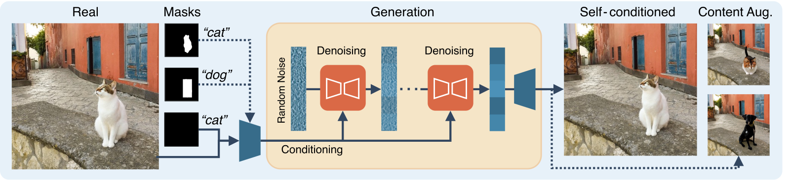

Hình 1.1. Minh họa bài toán khử thiên lệch nội dung và nâng cao tính bền vững trước suy giảm hậu kỳ trên mạng xã hội (Nguồn: Guillaro và cộng sự — B-Free, CVPR 2025 [1]).

Gần đây, hai công trình quốc tế tiêu biểu là B-Free (Guillaro và cộng sự, CVPR 2025 [1]) và GlobalForge (Cui và cộng sự, CVPR 2026 [2]) đã tiếp cận bài toán này từ hai góc độ bổ trợ nhau. B-Free giải quyết gốc rễ vấn đề thiên lệch nội dung bằng cách dùng chính ảnh thật MS-COCO [24] làm khung tham chiếu để vẽ đè (inpainting) ra ảnh giả qua Stable Diffusion 2.1 [23], ép mô hình phải so sánh hai bức ảnh có cùng nội dung trên nền xương sống thị giác tự giám sát DINOv2 ViT-B/14 có token thanh ghi [3, 4]. Trong khi đó, GlobalForge [2] tập trung vào tầng kiến trúc và hàm mất mát trên xương sống ViT-L thông qua bộ lọc thông tin cục bộ (LIB) [10], khối suy luận cấu trúc toàn cục (GSR) và hàm mất mát tương phản suy giảm ($L_{\text{DCS}}$) [11, 32].

Mặc dù B-Free đạt bước tiến lớn trong việc khử thiên lệch nội dung, quá trình khảo sát và thực nghiệm đánh giá lại mô hình gốc B-Free của nhóm nghiên cứu đã chỉ ra ba vướng mắc thực tiễn còn bỏ ngỏ. Trước hết, B-Free gốc huấn luyện bằng cách cập nhật toàn bộ hơn 86,58 triệu tham số (Full Fine-tuning) của mạng DINOv2 ViT-B/14 ở độ phân giải lớn $504 \times 504$. Cách làm này vừa đòi hỏi tài nguyên bộ nhớ GPU rất lớn, vừa tiềm ẩn nguy cơ làm biến dạng không gian đặc trưng hình học tổng quát mà DINOv2 đã học được từ 142 triệu ảnh tự giám sát [3, 5]. Tiếp theo, toàn bộ 300.498 ảnh giả trong tập huấn luyện của B-Free chỉ xuất phát từ một mô hình sinh duy nhất là Stable Diffusion 2.1 [1, 23]. Khi kiểm thử trên dữ liệu mạng xã hội thực tế đa nguồn sinh [7, 8], B-Free gốc bộc lộ điểm yếu rõ rệt trên một số nền tảng như LinkedIn (AUC giảm xuống 0,8803) và thường xuyên báo nhầm ảnh thật thành ảnh AI trên Reddit (tỷ lệ nhận diện đúng ảnh thật TNR chỉ đạt 80,80%). Cuối cùng, vẫn chưa có nghiên cứu nào kiểm chứng một cách có hệ thống xem việc chuyển giao các module cấu trúc chống suy giảm (LIB, GSR, $L_{\text{DCS}}$) từ không gian 1.024 chiều của ViT-L [2] sang không gian 768 chiều mật độ cao ($36 \times 36$ mảnh ảnh) của DINOv2 ViT-B/14 [3] có mang lại lợi ích cộng dồn hay phát sinh sự đánh đổi với khả năng nhận diện đa bộ sinh [6].

Từ những vướng mắc thực tiễn đó, nhóm quyết định lựa chọn và thực hiện đề tài: Nghiên cứu cải tiến mô hình B-Free theo hướng tinh chỉnh hiệu quả tham số và mở rộng đa nguồn sinh cho bài toán phát hiện ảnh AI trên mạng xã hội.

## **2. Mục tiêu và câu hỏi nghiên cứu**

### **2.1. Mục tiêu nghiên cứu**

#### **2.1.1. Mục tiêu tổng quát**

Đề tài hướng tới phát triển một quy trình huấn luyện và kiến trúc cải tiến dựa trên nền tảng B-Free [1] (sử dụng xương sống DINOv2 ViT-B/14 có token thanh ghi [3, 4]), giúp giảm mạnh chi phí tham số huấn luyện, bảo toàn biểu diễn thị giác gốc, đồng thời nâng cao đáng kể độ chính xác và khả năng chống báo động giả khi phát hiện ảnh AI từ nhiều công cụ tạo sinh khác nhau trên các nền tảng mạng xã hội thực tế [6, 7, 8].

#### **2.1.2. Các mục tiêu cụ thể**

Mục tiêu cụ thể thứ nhất là thiết kế cơ chế tinh chỉnh hiệu quả tham số bằng kỹ thuật thích nghi hạng thấp (LoRA) [5, 56] trên 49 lớp của mạng xương sống DINOv2 ViT-B/14 ở độ phân giải $504 \times 504$, đảm bảo hợp nhất trọn vẹn trọng số khi suy luận để không làm tăng thời gian xử lý.

Mục tiêu cụ thể thứ hai là xây dựng chiến lược pha trộn dữ liệu đa nguồn sinh có mỏ neo, giữ nguyên kỷ luật ghép cặp đồng nội dung của B-Free [1, 24] làm trụ cột (75%) và bổ sung có kiểm soát 25% dữ liệu từ 36 bộ sinh đa thế hệ thuộc bộ chuẩn AI-GenBench [6] kết hợp chuỗi mô phỏng suy giảm trực tuyến.

Mục tiêu cụ thể thứ ba là thiết kế, chuyển đổi toán học và tích hợp thử nghiệm các module cấu trúc chống suy giảm gồm LIB, GSR ở không gian 768 chiều và hàm mất mát tương phản suy giảm $L_{\text{DCS}}$ [2, 11] (cả bản đối xứng nguyên bản và bản phân biệt lớp Class-Aware) vào khung DINOv2 ViT-B/14.

Mục tiêu cụ thể thứ tư là thực hiện chuỗi thực nghiệm cắt bỏ tuần tự (từ bậc S1 đến S7 trên nhiều hạt giống ngẫu nhiên độc lập) và kiểm định thống kê nghiêm ngặt [27, 28] trên 13.288 ảnh mạng xã hội thực tế [1, 7, 8] cùng 36 bộ sinh độc lập [6], đồng thời đối sánh trực tiếp với 9 phương pháp tiên tiến trên thế giới để xác định cấu hình tối ưu nhất.

### **2.2. Câu hỏi nghiên cứu**

#### **2.2.1. Câu hỏi nghiên cứu 1 (RQ1 — Về cơ chế tinh chỉnh tham số)**

Việc đóng băng mạng xương sống DINOv2 ViT-B/14 [3] và chỉ tinh chỉnh thông qua các ma trận hạng thấp LoRA ($r = 16, \alpha = 32$) [5] có thể cắt giảm chi phí tham số cập nhật mà vẫn duy trì hoặc vượt qua hiệu năng phân loại của phương pháp tinh chỉnh toàn bộ tham số (Full Fine-tuning) trong mô hình B-Free gốc [1] hay không?

#### **2.2.2. Câu hỏi nghiên cứu 2 (RQ2 — Về mở rộng đa dạng nguồn sinh trong dữ liệu huấn luyện)**

Việc mở rộng tập huấn luyện theo cơ chế giữ 75% dữ liệu ghép cặp đồng nội dung của B-Free [1] làm mỏ neo và pha trộn thêm 25% dữ liệu từ 36 bộ sinh của AI-GenBench [6] (kết hợp mô phỏng suy giảm trực tuyến) có khắc phục được tình trạng giảm hiệu năng trên các nền tảng mạng xã hội khó (như LinkedIn, Reddit) và giảm tỷ lệ báo nhầm ảnh thật của B-Free gốc hay không?

#### **2.2.3. Câu hỏi nghiên cứu 3 (RQ3 — Về tác động và sự đánh đổi của các module cấu trúc chống suy giảm)**

Khi chuyển giao các module lọc thông tin cục bộ (LIB), suy luận cấu trúc toàn cục (GSR) và hàm mất mát tương phản suy giảm ($L_{\text{DCS}}$) [2] sang mạng xương sống tự giám sát DINOv2 ViT-B/14 đã có token thanh ghi [3, 4], các thành phần này tương tác như thế nào với hàm mất mát phân loại, và liệu chúng có mang lại lợi ích ròng trên các bộ kiểm thử ngoài phân phối so với cấu hình tinh gọn hay xuất hiện sự đánh đổi giữa tính bất biến nén và độ nhạy vi cấu trúc?

## **3. Đối tượng, khách thể và phạm vi nghiên cứu**

### **3.1. Đối tượng nghiên cứu**

Đối tượng nghiên cứu của đề tài là các cơ chế cải tiến mô hình phát hiện ảnh do AI tạo ra trên nền tảng DINOv2 ViT-B/14 (vit_base_patch14_reg4_dinov2) [3, 4], bao gồm kỹ thuật thích nghi hạng thấp LoRA trên 49 lớp chiếu [5], chiến lược tổ chức và pha trộn dữ liệu huấn luyện ghép cặp đồng nội dung [1] với dữ liệu đa nguồn sinh [6] kết hợp mô phỏng suy giảm trực tuyến, cùng các module kiến trúc lọc cục bộ (LIB) [10], chú ý cấu trúc tầm xa (GSR) và hàm mất mát tương phản suy giảm ($L_{\text{DCS}}$) [2, 11].

### **3.2. Khách thể nghiên cứu**

Khách thể nghiên cứu là các bức ảnh số — bao gồm ảnh chụp tự nhiên [24, 67] và ảnh nhân tạo được tổng hợp từ 36 kiến trúc GAN [40, 43, 44, 45, 46, 47, 48], Diffusion [23, 42, 49, 50], Flow Matching [51], Autoregressive và Inpainting [52, 53] khác nhau — chịu tác động của các quá trình nén, thay đổi kích thước và hậu xử lý thực tế khi lan truyền qua các nền tảng mạng xã hội (Facebook, Instagram, LinkedIn, X/Twitter, Reddit) và các bộ dữ liệu chuẩn quốc tế [1, 6, 7, 8].

### **3.3. Phạm vi nghiên cứu**

Về phạm vi nội dung và kỹ thuật, đề tài tập trung cải tiến mô hình phân loại nhị phân (Ảnh thật / Ảnh AI) dựa trên ảnh tĩnh RGB ở kích thước khung cắt $504 \times 504$ điểm ảnh với giao thức suy luận 5 góc cắt (5-Crop) [1]. Đề tài không mở rộng sang bài toán định vị vùng chỉnh sửa ở cấp độ điểm ảnh hay phát hiện video deepfake theo chuỗi thời gian [64, 65].

Về phạm vi dữ liệu huấn luyện, nghiên cứu sử dụng tập dữ liệu gốc của B-Free [1] (51.517 gốc ảnh MS-COCO [24] cùng 309.102 ảnh giả từ 6 nhánh SD 2.1 Inpainting [23]) kết hợp với phần mở rộng từ tập huấn luyện đa bộ sinh AI-GenBench [6].

Về phạm vi dữ liệu kiểm thử và đối sánh, mô hình được đánh giá độc lập ngoài phân phối trên 4 bộ dữ liệu chuẩn quy mô lớn gồm ITW-SM (10.000 ảnh từ 4 mạng xã hội) [8], WildRF (2.503 ảnh từ 3 mạng xã hội) [7], B-Free Viral (785 ảnh lan truyền thực tế) [1] và AI-GenBench (36 bộ sinh) [6], đồng thời đối sánh trực tiếp với B-Free gốc [1] cùng 8 phương pháp tiên tiến công bố giai đoạn 2024–2026 gồm DDA [59], CommFor [60], GlobalForge DINOv3 [2], GAPL [58], Co-Spy [21], Effort [61], C2P-CLIP [62] và SAFE [63].

## **4. Phương pháp nghiên cứu tổng quát**

Đề tài vận dụng chặt chẽ quy trình nghiên cứu khoa học thực nghiệm [29] trong lĩnh vực học máy [30] thông qua bốn nhóm phương pháp bổ trợ nhau. Nhóm phương pháp thứ nhất là nghiên cứu lý thuyết và tổng quan tài liệu, thực hiện thu thập, phân loại và phân tích phê phán các công trình nghiên cứu trong và ngoài nước về phát hiện ảnh AI qua ba thế hệ (tần số/CNN cục bộ [12, 13, 14, 17], mô hình nền tảng đóng băng [15, 54, 57], và mô hình căn chỉnh nội dung/cấu trúc [1, 2, 20, 21]), từ đó xác định khoảng trống nghiên cứu và xây dựng cơ sở toán học cho các giả thuyết cải tiến.

Nhóm phương pháp thứ hai là thiết kế và cải biên mô hình, tiến hành phân tích cấu trúc đại số tuyến tính và không gian đặc trưng của mạng DINOv2 ViT-B/14 [3, 22] để thiết kế phân vùng tham số LoRA [5], nội suy nhúng vị trí hai chiều ($518 \to 504$ điểm ảnh), chuyển đổi chiều đặc trưng của LIB và GSR ($1.024 \to 768$), mở rộng bán kính mặt nạ Chebyshev theo mật độ lưới và xây dựng hàm mất mát tương phản nhận biết lớp (Class-Aware DCS) [2, 11].

Nhóm phương pháp thứ ba là thực nghiệm cắt bỏ có kiểm soát (Stepwise Ablation Study), tổ chức chuỗi thí nghiệm thành các bậc kế tiếp nhau (S1 đến S7), trong đó mỗi bậc chỉ thay đổi đúng một yếu tố kỹ thuật trên cùng một tập kiểm định đã khóa cứng bằng hàm băm MD5 để bóc tách chính xác quan hệ nhân quả của từng cải tiến.

Nhóm phương pháp thứ tư là thống kê suy luận và đối sánh đa chiều, thực hiện huấn luyện cấu hình cuối cùng trên 3 hạt giống ngẫu nhiên độc lập (seed 42, 54, 68) để đo độ lệch chuẩn; sử dụng kiểm định Paired Image-level Bootstrap (1.000 lần lấy mẫu lặp lại trên từng ảnh) [27] kết hợp hiệu chỉnh Benjamini–Hochberg ($q_{\text{BH}}$) [28] để khẳng định ý nghĩa thống kê của mọi mức cải thiện hiệu năng.

## **5. Ý nghĩa khoa học, thực tiễn và kết cấu của báo cáo**

Về ý nghĩa khoa học, đề tài làm sáng tỏ cơ chế tương tác giữa việc tinh chỉnh hạng thấp trên xương sống tự giám sát (DINOv2 + Registers) [3, 4, 5], sự đa dạng nguồn sinh trong dữ liệu huấn luyện [1, 6] và các ràng buộc bất biến suy giảm cấu trúc [2]. Đặc biệt, kết quả thực nghiệm cung cấp bằng chứng định lượng chỉ ra giới hạn và sự đánh đổi của hàm mất mát tương phản suy giảm khi áp dụng lên mạng xương sống đã có sẵn năng lực biểu diễn toàn cục mạnh.

Về ý nghĩa thực tiễn, mô hình cải tiến S7 đạt vị trí dẫn đầu trên các bộ chuẩn mạng xã hội thực tế (AUC Pooled trung bình 0,976, giảm tỷ lệ lỗi cân bằng EER xuống còn 6,7%, nâng độ đặc hiệu bảo vệ ảnh thật lên 95,9% – 99,9%), đồng thời giảm hơn 94% – 97% số tham số cần cập nhật khi huấn luyện và không làm phát sinh thêm bất kỳ độ trễ nào khi triển khai suy luận thực tế.

Về kết cấu của báo cáo, nội dung được tổ chức thành 5 chương đánh số La Mã theo đúng trình tự quy trình nghiên cứu khoa học. Chương I (Mở đầu) trình bày bối cảnh, lý do chọn đề tài, mục tiêu, câu hỏi nghiên cứu, đối tượng, khách thể, phạm vi và phương pháp nghiên cứu. Chương II (Tổng quan tình hình nghiên cứu và cơ sở lý thuyết) hệ thống hóa các khái niệm nền tảng, lược khảo các công trình trong và ngoài nước, chỉ ra kết quả đạt được và khoảng trống nghiên cứu. Chương III (Giả thuyết, mô hình và phương pháp nghiên cứu) phát biểu hệ thống giả thuyết tương ứng với các câu hỏi nghiên cứu, thiết kế kiến trúc công cụ cải tiến, quy trình thu thập, phân chia dữ liệu và giao thức kiểm định. Chương IV (Kiểm chứng giả thuyết, phân tích và thảo luận kết quả nghiên cứu) trình bày kết quả thực nghiệm chi tiết, phân tích bảng đặc trưng, kiểm chứng từng giả thuyết qua số liệu và biểu đồ trực quan, đối sánh với 9 phương pháp hiện đại và thảo luận bản chất khoa học. Chương V (Kết luận, khuyến nghị và hạn chế của nghiên cứu) tổng kết các đóng góp chính, chỉ rõ các hạn chế khách quan và đề xuất hướng phát triển tiếp theo.

# **CHƯƠNG II: TỔNG QUAN TÌNH HÌNH NGHIÊN CỨU VÀ CƠ SỞ LÝ THUYẾT**

## **1. Cơ sở lý thuyết và các khái niệm nền tảng**

### **1.1. Các họ mô hình sinh ảnh và dấu vết pháp chứng kỹ thuật số**

Ảnh do AI tạo sinh là hình ảnh được tổng hợp từ các mô hình học sâu [31] mà không trải qua quá trình thu nhận quang học trên cảm biến máy ảnh vật lý. Sự tiến hóa của các mô hình sinh ảnh trải qua bốn nhánh kiến trúc chính: Mạng đối nghịch tạo sinh (GAN) [40], Bộ tự mã hóa biến phân (VAE) [41], Mô hình dựa trên luồng chuẩn hóa (Flow-based Models) và Mô hình khuếch tán (Diffusion Models) [23, 42].

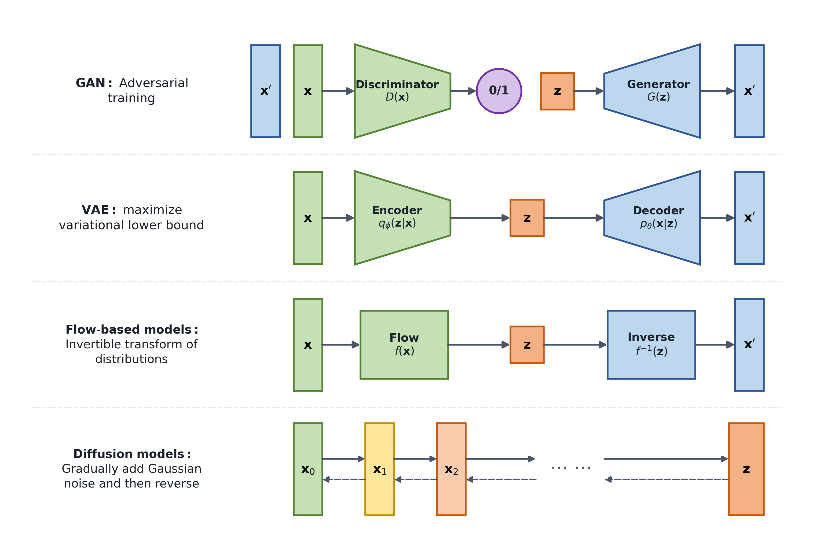

Hình 2.1. So sánh cơ chế hoạt động của bốn họ mô hình sinh ảnh phổ biến gồm GAN, VAE, Flow-based và Diffusion Models (Nguồn: Tham khảo từ ResearchGate — Overview of Deep Generative Models [40, 41, 42]).

Trong đó, các mô hình khuếch tán tiềm ẩn (Latent Diffusion Models — như Stable Diffusion [23], Midjourney, DALL·E 3 [50], FLUX.1 [51]) hiện giữ vai trò thống trị nhờ khả năng sinh ảnh độ phân giải cao và bám sát điều kiện văn bản. Một mô hình khuếch tán hoạt động qua hai giai đoạn: quá trình thuận cộng dần nhiễu Gaussian vào ảnh cho đến khi trở thành nhiễu trắng, và quá trình ngược dùng mạng nơ-ron học cách khử nhiễu từng bước để khôi phục cấu trúc ảnh [42], sau đó đưa qua bộ giải mã (VAE Decoder) [23, 41] để chuyển từ không gian tiềm ẩn về không gian điểm ảnh RGB.

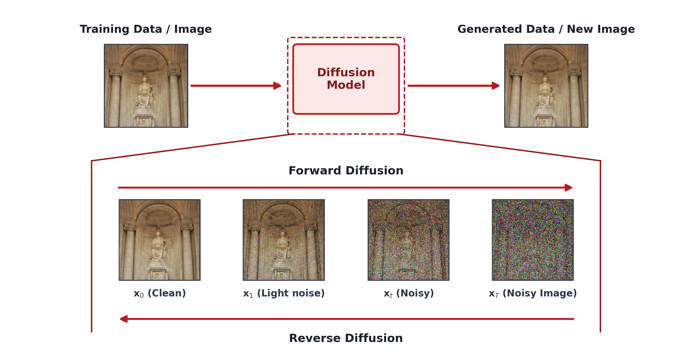

Hình 2.2. Quá trình khuếch tán thuận (thêm nhiễu) và khử nhiễu ngược (sinh ảnh) trong mô hình khuếch tán (Nguồn: Tham khảo từ GeeksforGeeks và Ho và cộng sự — DDPM [42]).

Dưới góc độ giám định hình ảnh số (Digital Image Forensics), chính sự khác biệt trong cơ chế hình thành điểm ảnh là cơ sở vật lý và toán học để phân biệt ảnh thật với ảnh AI [12, 13, 16]. Ở ảnh chụp tự nhiên [24, 67], ánh sáng đi qua hệ thấu kính, bộ lọc mảng màu Bayer (CFA) và cảm biến quang học sẽ để lại nhiễu cảm biến đặc trưng, quy luật nội suy màu nhất quán và cấu trúc hình học tuân thủ chặt chẽ quy luật vật lý trên toàn khung hình. Ngược lại, ở ảnh do AI tạo ra, dù mắt người khó nhận biết, quá trình lấy mẫu lên (upsampling) trong mạng GAN [14, 17, 43] hoặc bước giải mã từ không gian tiềm ẩn qua các lớp tích chập của VAE Decoder trong mô hình khuếch tán [16, 23] luôn để lại các dấu vân tay kỹ thuật (synthesis artifacts). Chúng bao gồm các sai lệch vi mô trong phổ tần số, sự lặp lại kết cấu bất thường ở vùng nền, hoặc sự thiếu ăn khớp về cấu trúc hình học và hướng chiếu sáng giữa các vùng cách xa nhau trên bức ảnh [1, 2].

### **1.2. Thiên lệch nội dung ngữ nghĩa và hiện tượng học đường tắt**

Trong học máy và học sâu [30, 31], hiện tượng học đường tắt (Shortcut Learning) (Geirhos và cộng sự, 2020 [9]) xảy ra khi mạng nơ-ron không học quy luật bản chất của bài toán mà lại bám vào các mối tương quan giả tạo (spurious correlations) dễ nhận biết nhất trong tập huấn luyện để giảm nhanh hàm mất mát.

Đối với bài toán phát hiện ảnh AI, tương quan giả tạo nguy hiểm nhất chính là thiên lệch nội dung ngữ nghĩa (Content Bias) và thiên lệch định dạng kỹ thuật [1, 61]. Nếu tập ảnh thật chỉ gồm ảnh chụp đường phố, vật dụng đời thường từ MS-COCO [24] có kích thước đa dạng và nén JPEG, trong khi tập ảnh giả lại gồm các bức tranh chân dung nghệ thuật, phong cảnh siêu thực được xuất ra ở định dạng PNG không nén với kích thước vuông cố định [21], mô hình sẽ nhanh chóng học cách phân loại dựa trên chủ đề bức ảnh, tỷ lệ khung hình hoặc vết nén JPEG. Để triệt tiêu hiện tượng học đường tắt này, tập dữ liệu huấn luyện phải được thiết kế sao cho nội dung ngữ nghĩa giữa hai lớp Thật và Giả là tương đồng nhau [1]. Khi hai bức ảnh cùng mô tả một khung cảnh, cùng bố cục và cùng trải qua một quy trình biến đổi kích thước/nén như nhau, mọi đặc trưng về chủ đề đều bị vô hiệu hóa, buộc mạng nơ-ron phải đi sâu vào phân tích dấu vết tạo sinh thực chất.

### **1.3. Mô hình nền tảng Vision Transformer, DINOv2 và cơ chế token thanh ghi**

Thay vì sử dụng các phép tích chập cục bộ như mạng CNN truyền thống [12, 31], kiến trúc Vision Transformer (ViT) (Dosovitskiy và cộng sự, ICLR 2021 [22]) chia bức ảnh đầu vào thành một lưới các mảnh vuông không chồng lấp (patches), chiếu tuyến tính từng mảnh thành một vector đặc trưng (patch token) và cộng thêm vector mã hóa vị trí (Position Embedding). Toàn bộ chuỗi token này được đưa qua các khối Tự chú ý đa đầu (Multi-Head Self-Attention — MHSA) và mạng truyền thẳng (MLP), cho phép mô hình liên kết thông tin giữa hai vùng bất kỳ trên bức ảnh ngay từ những tầng đầu tiên.

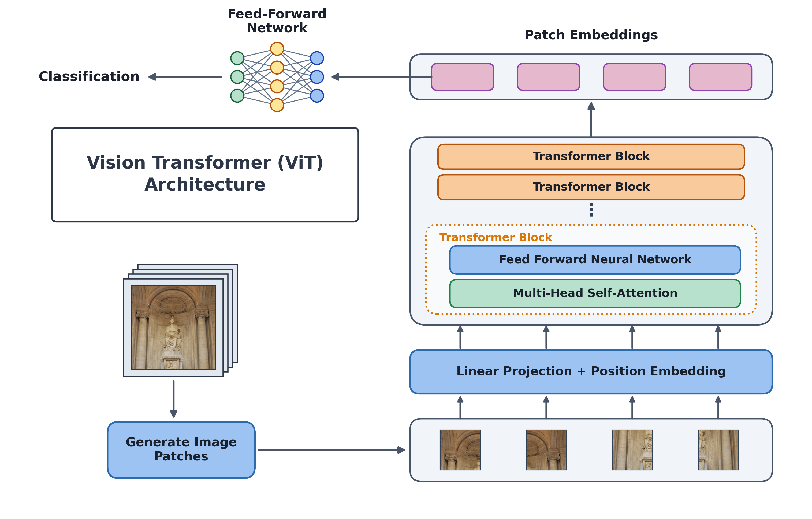

Hình 2.3. Kiến trúc tổng quan của mạng Vision Transformer (ViT) (Nguồn: Dosovitskiy và cộng sự — ICLR 2021 [22]).

Trong các biến thể của ViT, DINOv2 (Oquab và cộng sự, TMLR 2024 [3]) là mô hình nền tảng thị giác được huấn luyện hoàn toàn theo phương pháp tự giám sát (Self-Supervised Learning) trên 142 triệu ảnh chọn lọc (LVD-142M). Khác với CLIP (Radford và cộng sự, ICML 2021 [54]) — vốn học bằng cách ép vector hình ảnh khớp với câu mô tả văn bản nên thiên về nắm bắt khái niệm ngữ nghĩa cấp cao và dễ bỏ qua chi tiết bề mặt — DINOv2 học bằng cơ chế tự chưng cất tri thức ở cả cấp độ toàn ảnh lẫn cấp độ từng mảnh ảnh bị che (patch-level masked modeling). Nhờ vậy, đặc trưng của DINOv2 bảo toàn cực kỳ sắc nét cả cấu trúc hình học không gian lẫn kết cấu vi mô của từng vùng ảnh [1, 3].

Một cải tiến kiến trúc quan trọng đi kèm DINOv2 là cơ chế Token thanh ghi (Register Tokens) (Darcet và cộng sự, ICLR 2024 [4]). Các tác giả phát hiện rằng ở các mạng ViT quy mô lớn, mô hình thường tận dụng một số mảnh ảnh ở vùng nền ít thông tin làm bộ nhớ tạm để gom thông tin toàn cục, tạo ra các token có chuẩn vector lớn đột biến làm nhiễu bản đồ chú ý. Việc chèn thêm 4 token thanh ghi độc lập ([REG], không gắn với vị trí không gian nào trên ảnh) cung cấp vùng nhớ chuyên dụng cho thông tin toàn cục, giúp bản đồ đặc trưng của các mảnh ảnh trở nên sạch, mượt và trung thực hơn [1, 4].

### **1.4. Tính bền vững trước hậu xử lý, lọc thông tin cục bộ và suy luận cấu trúc toàn cục**

Tính bền vững (Robustness) [33, 68] của một mô hình phát hiện ảnh AI là khả năng duy trì quyết định phân loại chính xác khi ảnh đầu vào bị suy giảm chất lượng bởi các phép hậu xử lý phổ biến trên mạng xã hội (nén JPEG, làm mờ Gaussian, thu phóng kích thước, biến đổi màu sắc). Để nâng cao tính bền vững này ở tầng biểu diễn, hai nguyên lý lý thuyết được GlobalForge [2] đề xuất là nút thắt thông tin cục bộ và suy luận cấu trúc toàn cục.

Nguyên lý thứ nhất là Nút thắt Thông tin Cục bộ (Local Information Bottleneck — LIB). Dựa trên lý thuyết Nút thắt thông tin của Tishby và cộng sự (1999) [10], một biểu diễn bền vững cần nén bớt các dao động tần số cao quá nhạy cảm ở cấp độ điểm ảnh cục bộ (vốn dễ bị nén JPEG làm biến dạng), chỉ giữ lại phần tín hiệu đặc trưng cục bộ ổn định [2].

Nguyên lý thứ hai là Suy luận Cấu trúc Toàn cục (Global Structural Reasoning — GSR). Khi các dấu vết vi mô cục bộ bị suy yếu do nén ảnh, các mâu thuẫn về cấu trúc hình học, phối cảnh và sự liên kết giữa các vùng ở xa nhau trên bức ảnh vẫn tồn tại. Việc hạn chế sự phụ thuộc vào các mảnh ảnh liền kề để buộc mạng chú ý tới mối quan hệ tầm xa giúp tăng khả năng phát hiện các bất nhất quán ở quy mô toàn ảnh [2].

## **2. Tổng quan tình hình nghiên cứu ngoài nước và trong nước**

### **2.1. Các giai đoạn phát triển nghiên cứu trên thế giới**

#### **2.1.1. Thế hệ thứ nhất: Khai thác dấu vết cục bộ và miền tần số bằng mạng CNN**

Các công trình đầu tiên như CNNDetection (Wang và cộng sự, CVPR 2020 [12]), PatchFor (Chai và cộng sự, ECCV 2020 [13]), Grag2021 (Gragnaniello và cộng sự, ICME 2021 [14]) hay gần đây hơn là NPR (Tan và cộng sự, CVPR 2024 [17]) và SAFE (Li và cộng sự, 2024 [63]) tập trung tìm kiếm các dấu vết nội suy giữa các điểm ảnh lân cận hoặc bất thường trong phổ tần số / biến đổi sóng con (DWT) do tầng lấy mẫu lên của mạng GAN [40, 43, 44] tạo ra. Mặc dù hiệu quả trên các bộ dữ liệu GAN trong phòng thí nghiệm, hướng đi này bộc lộ điểm yếu nghiêm trọng khi chuyển sang thế hệ Diffusion Models [16, 23] và môi trường mạng xã hội: chỉ cần một phép nén JPEG chất lượng trung bình hoặc một lần thu phóng kích thước, mối tương quan giữa các điểm ảnh liền kề bị phá vỡ hoàn toàn [1, 7].

#### **2.1.2. Thế hệ thứ hai: Tận dụng mô hình nền tảng thị giác và đảo ngược quá trình sinh**

Để khắc phục khả năng tổng quát hóa kém của CNN, UnivFD (Ojha và cộng sự, CVPR 2023 [15]) và nghiên cứu của Cozzolino và cộng sự (CVPRW 2024 [57]) đề xuất đóng băng hoàn toàn mạng CLIP ViT-L/14 [54] và chỉ huấn luyện một bộ phân loại nhẹ trên đỉnh; các biến thể cải tiến trên CLIP như C2P-CLIP [62] hay Effort [61] tìm cách chiếu đặc trưng vào không gian con trực giao hoặc dùng câu lệnh gợi ý chung. Trong khi đó, FakeInversion (Cazenavette và cộng sự, CVPR 2024 [18]) và Synthbuster (Bammey, 2023 [19]) dựa vào sai số tái tạo khi đảo ngược ảnh qua mô hình khuếch tán, còn CoDE (Baraldi và cộng sự, ECCV 2024 [20]) áp dụng học tương phản [32, 33] trên không gian nhúng ViT. Tuy nhiên, việc dựa vào đặc trưng ngữ nghĩa văn bản của CLIP khiến mô hình kém nhạy với dấu vết pháp chứng tinh vi; đồng thời các phương pháp này vẫn chưa giải quyết triệt để sự lệch pha nội dung giữa tập ảnh thật và tập ảnh giả trong dữ liệu huấn luyện [1].

#### **2.1.3. Thế hệ thứ ba: Căn chỉnh dữ liệu khử thiên lệch và tăng cường suy luận cấu trúc**

Đây là thế hệ tiên tiến nhất hiện nay với các đại diện tiêu biểu như B-Free (Guillaro và cộng sự, CVPR 2025 [1]), CO-SPY (Cheng và cộng sự, CVPR 2025 [21]), CommFor (Park và cộng sự, CVPR 2025 [60]), DDA [59], GAPL (CVPR 2026 [58]) và GlobalForge (Cui và cộng sự, CVPR 2026 [2]). Bảng 2.1 tổng hợp và đối chiếu đặc điểm kỹ thuật cũng như hạn chế của các công trình tiêu biểu nhất liên quan trực tiếp đến đề tài.

Bảng 2.1. Tổng hợp và đối chiếu các công trình nghiên cứu tiêu biểu trên thế giới.

| Phương pháp và Công bố | Xương sống chính | Đóng góp cốt lõi | Hạn chế tồn đọng khi áp dụng thực tế |
| :--- | :--- | :--- | :--- |
| CNNDetection [12] (CVPR 2020) | ResNet-50 | Huấn luyện trên ProGAN [44] kết hợp tăng cường làm mờ Gaussian và nén JPEG xác suất 50%. | Phụ thuộc dấu vết riêng của GAN; mất hiệu lực trước các mô hình Diffusion [23] và FLUX [51] mới. |
| PatchFor [13] (ECCV 2020) | Mạng CNN cắt ngắn | Giới hạn trường tiếp nhận ở mức mảnh ảnh nhỏ để ép mạng chỉ nhìn kết cấu cục bộ. | Mất khả năng suy luận cấu trúc toàn ảnh; kết cấu cục bộ dễ bị xóa nhòa khi nén JPEG nặng. |
| UnivFD [15] (CVPR 2023) | CLIP ViT-L/14 [54] (Đóng băng) | Đóng băng bộ mã hóa CLIP, chỉ huấn luyện lớp phân loại tuyến tính trên đặc trưng ngữ nghĩa. | Đặc trưng giữ nguyên thiên lệch ngữ nghĩa văn bản của CLIP, kém nhạy với dấu vết vi cấu trúc. |
| NPR [17] và SAFE [63] (2024) | ResNet / DWT Cục bộ | Khai thác quan hệ nội suy giữa các điểm ảnh liền kề hoặc băng tần sóng con cao tần. | Cực kỳ mong manh trước thao tác thu phóng (resize) và nén lại trên các nền tảng mạng xã hội. |
| FakeInversion [18] (CVPR 2024) | Đảo ngược SD / VAE | Đo sai số tái tạo khi đảo ngược ảnh đầu vào qua bộ tự mã hóa VAE và quá trình khuếch tán. | Chi phí suy luận rất lớn; giảm độ chính xác khi gặp họ mô hình sinh khác hoặc ảnh bị biến đổi màu. |
| CO-SPY [21] (CVPR 2025) | Kết hợp Ngữ nghĩa và Pixel | Phối hợp nhánh đặc trưng ngữ nghĩa cấp cao với nhánh trích xuất dấu vết mức điểm ảnh. | Nhánh điểm ảnh vẫn nhạy cảm với nén mạng xã hội; dễ bị lệch ngưỡng quyết định ngoài phân phối. |
| CommFor [60] và DDA [59] (2025) | ViT-S/16-384 / Dual-Aligned | Mở rộng quy mô dữ liệu cộng đồng hoặc căn chỉnh miền kép bằng tái tạo VAE. | Độ ổn định giữa các nền tảng mạng xã hội chưa đồng đều; CommFor suy giảm trên LinkedIn (0,779). |
| B-Free [1] (CVPR 2025) | DINOv2 ViT-B/14 [3, 4] (4 Registers) | Khử thiên lệch nội dung bằng dữ liệu vẽ đè tự điều kiện hóa (SD 2.1 [23] trên MS-COCO [24]) + suy luận 5 góc cắt 504×504. | Tinh chỉnh toàn bộ 86,58M tham số rất nặng; chỉ học từ 1 bộ sinh duy nhất (SD 2.1) nên hụt hơi trên LinkedIn/Reddit. |
| GlobalForge [2] (CVPR 2026) | CLIP/DINO ViT-L (1.024 chiều) | Đề xuất 3 module chống suy giảm: lọc cục bộ (LIB), chú ý tầm xa Chebyshev (GSR) và mất mát tương phản suy giảm ($L_{\text{DCS}}$). | Thiết kế cho mạng ViT-L cồng kềnh (~300M tham số); chưa kiểm chứng sự tương thích và sự đánh đổi trên khung dữ liệu khử thiên lệch của B-Free. |

### **2.2. Tình hình nghiên cứu tại Việt Nam**

Tại Việt Nam, các nghiên cứu đã công bố trong lĩnh vực phát hiện nội dung giả mạo bằng học sâu phần lớn tập trung vào bài toán phát hiện video deepfake hoặc hoán đổi khuôn mặt (face forgery detection) trên các bộ dữ liệu khuôn mặt truyền thống như FaceForensics++ [64] hay Celeb-DF [65]. Tiêu biểu có thể kể đến nghiên cứu của Lại Minh Tuấn, Phạm Tiến Mạnh và Đồng Thị Thùy Linh (2023) [25] trên Tạp chí Khoa học và Công nghệ — Đại học Thái Nguyên, trong đó nhóm tác giả khảo sát và so sánh sáu kiến trúc mạng tích chập kinh điển (XceptionNet, ResNet101, InceptionResNetV2, MobileNetV2, VGG19, DenseNet121) trên bộ dữ liệu Celeb-DF [65]; hay bài tổng quan của Nguyễn Thu Huyền (2023) [26] về các công cụ phát hiện deepfake dựa trên bất thường khuôn mặt và cấu trúc mã hóa – giải mã.

Nhìn chung, các công trình trong nước hiện nay chủ yếu khai thác lại các mạng CNN truyền thống trên dữ liệu video khuôn mặt. Chưa có công trình nào đi sâu giải quyết đồng thời bài toán phát hiện ảnh tổng hợp toàn phần từ các mô hình khuếch tán thế hệ mới [23, 50, 51] trên nền tảng thị giác tự giám sát quy mô lớn như DINOv2 [3], cũng như chưa đặt trọng tâm vào việc xử lý thiên lệch dữ liệu [1, 9] và kiểm định độ bền vững đa nền tảng trên mạng xã hội với quy mô hàng chục nghìn ảnh [6, 7, 8] như hướng tiếp cận của đề tài này.

## **3. Nhận xét những kết quả đã đạt được và khoảng trống nghiên cứu**

### **3.1. Khoảng trống về cơ chế tinh chỉnh hiệu quả tham số trên xương sống DINOv2 độ phân giải cao**

B-Free gốc [1] sử dụng phương pháp tinh chỉnh toàn bộ 86,58 triệu tham số (Full Fine-tuning). Với ảnh đầu vào lớn $504 \times 504$ (sinh ra tới 1.301 token mỗi ảnh), việc lưu trữ gradient và trạng thái bộ tối ưu AdamW [34] cho toàn bộ mạng gây áp lực lớn lên bộ nhớ GPU, đồng thời làm tăng nguy cơ phá vỡ các đặc trưng hình học tự giám sát của DINOv2 (hiện tượng quên thảm họa — catastrophic forgetting) [3, 5, 55]. Cần có một nghiên cứu kiểm chứng xem kỹ thuật thích nghi hạng thấp LoRA [5, 56] gắn toàn diện trên các lớp chiếu của DINOv2 có thể đạt hiệu quả tương đương hoặc tốt hơn với chỉ một phần rất nhỏ tham số (< 3% – 6%) và gộp thẳng vào mạng gốc khi suy luận hay không.

### **3.2. Khoảng trống về sự đơn điệu nguồn sinh trong dữ liệu căn chỉnh nội dung**

Dù cơ chế vẽ đè Inpainting trên nền MS-COCO [24] của B-Free khử thiên lệch ngữ nghĩa rất tốt, việc toàn bộ ảnh giả trong tập huấn luyện chỉ đến từ một bộ sinh duy nhất (Stable Diffusion 2.1 [23]) khiến mô hình chưa học được phổ dấu vết của các họ kiến trúc khác (như GAN [43, 45, 47], mô hình dòng chảy FLUX [51] hay các biến thể thương mại Midjourney, DALL·E 3 [50]). Chưa có nghiên cứu nào xác định công thức pha trộn tối ưu giữa mỏ neo dữ liệu ghép cặp đồng nội dung [1] và dữ liệu mở rộng đa nguồn sinh [6] để vừa không bị tái nhiễm thiên lệch nội dung, vừa xóa được các điểm mù trên mạng xã hội thực tế (như LinkedIn [8] và Reddit [7]).

### **3.3. Khoảng trống về việc chuyển giao và kiểm chứng sự đánh đổi của các module cấu trúc chống suy giảm**

Các module LIB, GSR và hàm mất mát $L_{\text{DCS}}$ của GlobalForge [2] được thiết kế trên mạng ViT-L (1.024 chiều, độ phân giải thấp $224 \times 224$ với lưới $16 \times 16$). Việc chuyển đổi các module này sang không gian 768 chiều với lưới mảnh ảnh dày đặc $36 \times 36$ (1.296 mảnh) của DINOv2 ViT-B/14 [3] đòi hỏi phải thiết kế lại toán học (như bán kính mặt nạ Chebyshev và cơ chế loại trừ mẫu âm cùng lớp trong hàm InfoNCE [11]). Quan trọng hơn, về mặt thực nghiệm, cần kiểm chứng khách quan xem các module này tương tác đồng thuận hay xung đột với nhau, và trong điều kiện nào chúng cải thiện độ bền vững, trong điều kiện nào việc ép bất biến nén quá mạnh lại gây ra sự đánh đổi với độ nhạy phân loại đa bộ sinh [6].

# **CHƯƠNG III: GIẢ THUYẾT, MÔ HÌNH VÀ PHƯƠNG PHÁP NGHIÊN CỨU**

## **1. Xây dựng giả thuyết và mô hình nghiên cứu**

### **1.1. Phát biểu các giả thuyết nghiên cứu**

#### **1.1.1. Giả thuyết H1 (Tương ứng với RQ1 — Giả thuyết về tinh chỉnh hạng thấp bảo toàn đặc trưng)**

Nếu đóng băng toàn bộ trọng số tiền huấn luyện của mạng xương sống DINOv2 ViT-B/14 (có 4 token thanh ghi) [3, 4] và chỉ huấn luyện các ma trận thích nghi hạng thấp LoRA ($r = 16, \alpha = 32$) [5] trên 49 lớp chiếu của mạng ở độ phân giải $504 \times 504$, mô hình sẽ giảm được trên 94% lượng tham số cần cập nhật mà vẫn hội tụ nhanh, giữ vững không gian đặc trưng hình học gốc để tránh quá khớp [55], đồng thời cho phép gộp thẳng trọng số sau huấn luyện mà không làm phát sinh thêm chi phí tính toán khi suy luận.

#### **1.1.2. Giả thuyết H2 (Tương ứng với RQ2 — Giả thuyết về pha trộn dữ liệu đa nguồn sinh có mỏ neo)**

Nếu giữ tập dữ liệu ghép cặp đồng nội dung của B-Free [1] (MS-COCO [24] + 6 nhánh SD 2.1 Inpainting [23]) làm mỏ neo chính (75%) và pha trộn bổ sung 25% dữ liệu đa nguồn sinh từ 36 bộ sinh của AI-GenBench [6] kết hợp với chuỗi mô phỏng suy giảm trực tuyến ($p = 0,9$), mô hình sẽ mở rộng được biên nhận diện sang các họ mô hình tạo sinh chưa từng thấy mà không đánh mất tính công bằng về nội dung, từ đó vượt qua mô hình B-Free gốc một cách có ý nghĩa thống kê [27, 28] trên các bộ kiểm thử mạng xã hội thực tế (đặc biệt tại các nền tảng khó như LinkedIn [8], Reddit [7]) và giảm mạnh tỷ lệ báo nhầm ảnh thật.

#### **1.1.3. Giả thuyết H3 (Tương ứng với RQ3 — Giả thuyết về sự tương thích và sự đánh đổi của các module cấu trúc chống suy giảm)**

Khi chuyển đổi các module lọc thông tin cục bộ (LIB) [10], suy luận cấu trúc toàn cục (GSR) sang không gian 768 chiều và kết hợp với hàm mất mát tương phản suy giảm ($L_{\text{DCS}}$) [2, 11], quá trình huấn luyện sẽ hội tụ ổn định (hai thành phần mất mát phân loại và tương phản cùng giảm đồng thuận) và giúp tăng cường khả năng nhận diện trên các biến thể giả mạo cục bộ tinh vi cũng như một số tập ảnh mạng xã hội nén nặng. Tuy nhiên, việc ép không gian đặc trưng bất biến quá mạnh trước suy giảm JPEG nặng thông qua hàm tương phản sẽ tạo ra sự đánh đổi (trade-off): làm suy yếu các dấu vết vi cấu trúc tần số trung – cao cần thiết để nhận diện một số họ mô hình GAN cổ điển [45, 47, 48] so với công thức tinh gọn.

### **1.2. Mô hình nghiên cứu đề xuất**

Để kiểm chứng đồng bộ cả ba giả thuyết trên trong một hệ thống thống nhất, nhóm xây dựng mô hình nghiên cứu tổng thể được minh họa tại Hình 3.1 dưới đây. Mô hình nghiên cứu bao gồm ba khối liên kết chặt chẽ: (1) Khối Dữ liệu và Mô phỏng suy giảm, (2) Khối Kiến trúc Xương sống Tinh chỉnh LoRA và Các nhánh Module Cấu trúc thử nghiệm, và (3) Khối Suy luận Hợp nhất 5 Góc cắt và Kiểm định Thống kê.

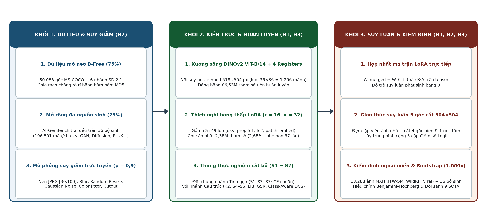

Hình 3.1. Sơ đồ mô hình nghiên cứu tổng thể và khung thực nghiệm kiểm chứng ba giả thuyết của đề tài.

## **2. Thiết kế công cụ: Kiến trúc mô hình cải tiến và cơ chế huấn luyện**

### **2.1. Tinh chỉnh hiệu quả tham số với LoRA trên xương sống DINOv2 ViT-B/14 và nội suy vị trí 504×504**

#### **2.1.1. Xử lý xung đột độ phân giải bằng nội suy hai chiều bảng mã hóa vị trí**

Mạng xương sống được sử dụng là vit_base_patch14_reg4_dinov2.lvd142m [3, 4] từ thư viện timm. Trong kiến trúc này, bức ảnh đầu vào được chia thành các mảnh vuông kích thước $14 \times 14$ điểm ảnh [22]. Trọng số tiền huấn luyện gốc của Meta AI được huấn luyện ở độ phân giải $518 \times 518$ điểm ảnh, tạo ra lưới $37 \times 37 = 1.369$ mảnh, nên tensor mã hóa vị trí pos_embed có kích thước $[1, 1369, 768]$.

Tuy nhiên, trong hệ thống của đề tài, kích thước khung ảnh chuẩn được thiết lập ở mức $504 \times 504$ điểm ảnh [1] (chia hết cho 14, tạo ra lưới chẵn $36 \times 36 = 1.296$ mảnh ảnh, cộng thêm 1 token phân loại [CLS] và 4 token thanh ghi [REG] [4] thành tổng cộng 1.301 token mỗi ảnh). Để nạp trọn vẹn tri thức tiền huấn luyện từ tệp trọng số ngoại tuyến (model.safetensors) mà không gặp lỗi lệch kích thước tensor, hệ thống thực hiện nội suy không gian hai chiều (2D bilinear interpolation) [22] trên bảng mã hóa vị trí. Cụ thể, hệ thống tách riêng và định hình lại pos_embed từ dạng phẳng $[1, 1369, 768]$ về lưới không gian hai chiều $[1, 37, 37, 768]$ (4 token thanh ghi không mang tọa độ không gian nên không nằm trong pos_embed), sau đó áp dụng phép nội suy song tuyến tính để thu nhỏ mượt mà mặt phẳng đặc trưng vị trí từ kích thước $(37, 37)$ về $(36, 36)$, rồi trải phẳng lại thành tensor $[1, 1296, 768]$. Giải pháp này cho phép khôi phục 100% trọng số của mạng xương sống DINOv2 (dropped = 0) mà sai số nội suy vị trí dưới 1%.

#### **2.1.2. Cơ chế thích nghi hạng thấp LoRA trên 49 lớp chiếu và hợp nhất khi suy luận**

Thay vì mở khóa toàn bộ hơn 86,5 triệu tham số của DINOv2 như B-Free gốc [1] (dễ dẫn đến quá khớp và tốn gấp 3–4 lần bộ nhớ VRAM để lưu gradient cùng hai mô-men bậc một, bậc hai của bộ tối ưu AdamW [34]), nhóm áp dụng kỹ thuật LoRA (Low-Rank Adaptation) (Hu và cộng sự, ICLR 2022 [5]) dựa trên giả thuyết rằng sự thay đổi trọng số khi thích nghi một mô hình nền tảng sang bài toán mới nằm trong một không gian con có hạng nội tại thấp (Aghajanyan và cộng sự, 2021 [55]).

Với một lớp tuyến tính có ma trận trọng số tiền huấn luyện $\mathbf{W}_0 \in \mathbb{R}^{d_{\text{out}} \times d_{\text{in}}}$, trọng số gốc $\mathbf{W}_0$ được đóng băng hoàn toàn (requires_grad = False). Phần hiệu chỉnh $\Delta\mathbf{W}$ được phân rã thành tích của hai ma trận hạng thấp $\mathbf{A} \in \mathbb{R}^{r \times d_{\text{in}}}$ và $\mathbf{B} \in \mathbb{R}^{d_{\text{out}} \times r}$ với hạng $r = 16 \ll \min(d_{\text{in}}, d_{\text{out}})$ và hệ số khuếch đại $\alpha = 32$:

$$\mathbf{h} = \mathbf{W}_0 \mathbf{x} + \Delta\mathbf{W}\mathbf{x} = \mathbf{W}_0 \mathbf{x} + \frac{\alpha}{r} \mathbf{B}\mathbf{A}\mathbf{x} = \mathbf{W}_0 \mathbf{x} + 2 \cdot \mathbf{B}\mathbf{A}\mathbf{x}$$

Kế thừa phát hiện từ QLoRA (Dettmers và cộng sự, 2023 [56]), nhóm gắn LoRA vào toàn bộ 4 lớp tuyến tính cốt lõi trong mỗi khối Transformer (qkv, proj, fc1, fc2). Trên 12 khối Transformer, điều này tạo ra $12 \times 4 = 48$ nhánh LoRA, cho phép mô hình điều chỉnh đồng thời cách các mảnh ảnh liên kết không gian với nhau (qua qkv, proj) và cách biến đổi đặc trưng nội tại của từng mảnh (qua fc1, fc2). Ngoài ra, lớp tích chập nhúng mảnh ảnh đầu vào (patch_embed.proj, kích thước nhân $14 \times 14$) cũng được gắn thêm một nhánh thích nghi hạng thấp gồm 21.696 tham số, nâng tổng số lớp được gắn LoRA lên đúng 49 lớp.

Về khởi tạo trọng số, ma trận $\mathbf{A}$ được khởi tạo theo phân phối Kaiming-uniform, trong khi ma trận $\mathbf{B}$ được khởi tạo bằng $\mathbf{0}$ [5]. Nhờ đó, tại bước huấn luyện đầu tiên, $\Delta\mathbf{W} = \mathbf{0}$ và mô hình xuất phát chính xác từ biểu diễn thị giác nguyên bản của DINOv2 [3]. Bảng 3.1 thống kê chi tiết số lượng tham số của các lớp trong mạng xương sống và phần nhánh LoRA tương ứng. Riêng trên mạng xương sống DINOv2, số tham số cần cập nhật giảm từ hơn 86,58 triệu xuống chỉ còn khoảng 2,38 triệu tham số (2,68%) — nhẹ hơn khoảng 37 lần so với tinh chỉnh toàn phần. Kể cả khi bật thêm toàn bộ các module mở rộng (LIB, GSR và đầu phân loại ở nhánh kiến trúc tích hợp đầy đủ), tổng số tham số cần học cũng chỉ là 4.751.811 / 91.277.763 (5,21%).

Khi quá trình huấn luyện kết thúc, do tính chất phân phối của phép nhân ma trận, nhánh LoRA được cộng gộp trực tiếp vào trọng số gốc theo công thức $\mathbf{W}_{\text{merged}} = \mathbf{W}_0 + \frac{\alpha}{r}\mathbf{B}\mathbf{A}$ [5]. Nhóm hiện thực phép gộp này trực tiếp bằng toán tử tensor của PyTorch thay vì phụ thuộc vào hàm tự động của thư viện ngoài (vốn dễ gây lỗi xung đột nhị phân với phần mở rộng torchao trên môi trường CUDA 12.8). Sau khi gộp, mô hình trở về đúng cấu trúc của một mạng ViT thuần nhất, tốc độ suy luận thực tế không chậm đi một mili-giây nào.

Bảng 3.1. Phân tích mức tiết kiệm tham số của cơ chế LoRA ($r = 16, \alpha = 32$) trên mạng xương sống DINOv2 ViT-B/14.

| Thành phần hoặc Lớp trong mô hình | Kích thước chiều ($d_{\text{in}} \rightarrow d_{\text{out}}$) | Số tham số gốc ($\mathbf{W}_0$) | Số tham số nhánh LoRA ($\mathbf{A}, \mathbf{B}$) | Tỷ lệ tham số cần học | Chiến lược huấn luyện |
| :--- | :--- | :--- | :--- | :--- | :--- |
| Lớp chiếu attn.qkv (1 khối) | 768 → 2.304 | 1.769.472 | 49.152 | 2,78% | Đóng băng $\mathbf{W}_0$, học LoRA |
| Lớp chiếu attn.proj (1 khối) | 768 → 768 | 589.824 | 24.576 | 4,17% | Đóng băng $\mathbf{W}_0$, học LoRA |
| Lớp truyền thẳng mlp.fc1 (1 khối) | 768 → 3.072 | 2.359.296 | 61.440 | 2,60% | Đóng băng $\mathbf{W}_0$, học LoRA |
| Lớp truyền thẳng mlp.fc2 (1 khối) | 3.072 → 768 | 2.359.296 | 61.440 | 2,60% | Đóng băng $\mathbf{W}_0$, học LoRA |
| Tổng 48 lớp trên 12 khối Transformer | Chiều 768 | 84.934.656 | 2.359.296 | 2,78% | Đóng băng $\mathbf{W}_0$, học LoRA |
| Lớp nhúng mảnh patch_embed.proj (lớp thứ 49) | Conv2d(3 → 768, 14×14) | 442.368 | 21.696 | 4,90% | Đóng băng $\mathbf{W}_0$, học LoRA |
| Các thành phần khác của DINOv2 (Tokens, pos_embed, LayerNorm) | Chiều 768 | 1.148.928 | 0 | 0,00% | Đóng băng hoàn toàn |
| Đầu phân loại nhị phân (head: 768 → 2) | 768 → 2 | 0 | 1.538 | 100,00% | Huấn luyện đầy đủ |
| Tổng cấu hình tinh gọn (S1–S3, S7: DINOv2 + LoRA 49 lớp + Head) | Chiều 768 | 88.908.482 (Tổng) | 2.382.530 (Học) | 2,68% | Nhẹ hơn ~37 lần so với Full FT |
| Tổng cấu hình khi gắn thêm Module LIB (6.913) và Module GSR (2.362.368) ở nhánh K2 | Chiều 768 | 91.277.763 (Tổng) | 4.751.811 (Học) | 5,21% | LIB và GSR huấn luyện đầy đủ |

### **2.2. Thiết kế chuyển giao các module cấu trúc LIB và GSR sang không gian 768 chiều**

#### **2.2.1. Module Nút thắt Thông tin Cục bộ (LIBAdapter — 768 chiều)**

Để kiểm chứng Giả thuyết H3, nhóm thiết kế kiến trúc tích hợp BFreeGlobalForgeViT, đặt hai module LIBAdapter và GSRAdapter [2] ngay phía sau khối Transformer thứ 12 của DINOv2 ViT-B/14 [3] và trước tầng phân loại cuối cùng. Việc đặt ở vị trí hậu kỳ (post-hoc) thay vì chèn vào giữa các khối Transformer giúp bảo toàn trọn vẹn luồng lan truyền đặc trưng tự giám sát qua 12 tầng của DINOv2. Vì hai module này cần thao tác trên cấu trúc tọa độ lưới 2D của bức ảnh, hệ thống tách bỏ 5 token tiền tố không mang tọa độ không gian (1 [CLS] + 4 [REG]), chỉ lấy $N = 1.296$ token mảnh ảnh $\mathbf{X} \in \mathbb{R}^{B \times 1296 \times 768}$ (tương ứng lưới không gian $36 \times 36$) để đưa vào LIB và GSR.

Tại module LIBAdapter, chuỗi token $\mathbf{X}$ được xếp lại thành bản đồ đặc trưng hai chiều $\mathbf{F} \in \mathbb{R}^{B \times 768 \times 36 \times 36}$ và đưa qua một phép tích chập làm mờ Gaussian $3 \times 3$ theo từng kênh độc lập (groups = 768). Nhờ cấu trúc tích chập theo chiều sâu (depthwise convolution), module tự động co giãn từ 1.024 chiều của GlobalForge gốc [2] về 768 chiều của ViT-B/14. Đầu ra của LIB là tổ hợp lồi giữa đặc trưng gốc và đặc trưng đã làm mượt qua một tham số cổng khả huấn $\beta$ (khởi tạo $\beta_0 = -0,85 \Rightarrow \alpha = \sigma(\beta_0) \approx 0,30$):

$$\hat{\mathbf{F}} = (1 - \alpha)\,\mathbf{F} + \alpha\,\text{Blur}_{\text{Gauss}3\times 3}(\mathbf{F}), \quad \alpha = \frac{1}{1 + e^{-\beta}}$$

Cơ chế này đóng vai trò như một bộ lọc thông thấp mềm theo nguyên lý Nút thắt thông tin [10], làm dịu bớt các gai nhiễu cao tần quá nhạy cảm (vốn dễ bị nén JPEG xóa mất) trước khi chuyển sang bước suy luận toàn cục.

#### **2.2.2. Module Suy luận Cấu trúc Toàn cục (GSRAdapter — 768 chiều)**

Sau khi qua LIB, 1.296 token được đưa vào một khối Tự chú ý một đầu (Single-head Self-Attention) có kết nối tắt (residual connection). Điểm khác biệt cốt lõi của GSR [2] nằm ở mặt nạ che vùng lân cận theo khoảng cách Chebyshev (Chebyshev neighborhood masking). Với hai mảnh ảnh bất kỳ $u$ và $v$ có tọa độ $(r_u, c_u)$ và $(r_v, c_v)$ trên lưới $36 \times 36$, khoảng cách Chebyshev được tính bằng $d_{\text{Cheb}}(u, v) = \max\big(|r_u - r_v|,\, |c_u - c_v|\big)$. Mọi cặp mảnh ảnh nằm gần nhau trong bán kính cửa sổ $w_{\text{gsr}}$ ($d_{\text{Cheb}}(u, v) \le w_{\text{gsr}}$) đều bị gán giá trị $-\infty$ trên ma trận điểm chú ý trước khi lấy hàm Softmax:

$$\mathbf{H}_{\text{GSR}} = \mathbf{H}_{\text{LIB}} + \gamma_{\text{gate}} \cdot \text{Softmax}\!\left(\frac{\mathbf{Q}\mathbf{K}^\top}{\sqrt{768}} + \mathbf{M}_{\text{Cheb}}\right)\mathbf{V}\mathbf{W}_O$$

Bằng cách chặn không cho mỗi mảnh ảnh nhìn vào chính nó và vùng hàng xóm sát vách, GSR bắt buộc mỗi vị trí phải thu thập bằng chứng từ các vùng ở xa trên bức ảnh để phát hiện sự thiếu nhất quán về cấu trúc, ánh sáng và phối cảnh toàn cục. Trong quá trình nghiên cứu, nhóm thử nghiệm cả hai thiết lập của GSR: thiết lập nguyên bản kế thừa trực tiếp từ GlobalForge [2] ($w_{\text{gsr}} = 3$, $\gamma_{\text{gate}} = 1$, tổng hợp bằng trung bình cộng 1.296 mảnh ảnh ở nhánh thử nghiệm K2), và thiết lập hiệu chỉnh tỷ lệ hình học ở bậc thực nghiệm S5 (mở rộng $w_{\text{gsr}} = 7$ để che vùng $15 \times 15$ tương ứng 17,4% diện tích lưới $36 \times 36$, kết hợp cổng khởi tạo $\gamma_{\text{gate}} = 0$ và đầu phân loại nối [CLS] với trung bình mảnh ảnh cls_plus_patch).

### **2.3. Thiết kế hàm mất mát tổng hợp và cải tiến hàm tương phản suy giảm nhận biết lớp**

#### **2.3.1. Hàm mất mát phân loại Cross-Entropy có làm mềm nhãn**

Để hướng dẫn mô hình vừa phân loại chính xác ảnh thật/ảnh giả, vừa duy trì biểu diễn đặc trưng ổn định khi ảnh bị nén hoặc làm mờ, hàm mục tiêu tổng quát có dạng $\mathcal{L}_{\text{total}} = \mathcal{L}_{\text{CE}} + \lambda_{\text{DCS}} \cdot \mathcal{L}_{\text{DCS}}$. Với xác suất dự đoán $p_c$ cho lớp $c \in \{0: \text{Thật},\; 1: \text{Giả}\}$ và hệ số làm mềm nhãn $\varepsilon \in [0;\, 0,1]$ (Szegedy và cộng sự, CVPR 2016 [38]), nhãn mục tiêu mềm được xác định bởi $y_c^{\text{smooth}} = (1 - \varepsilon)y_c + \frac{\varepsilon}{2}$, và hàm mất mát phân loại là:

$$\mathcal{L}_{\text{CE}} = -\sum_{c=0}^{1} y_c^{\text{smooth}} \log(p_c)$$

Kỹ thuật làm mềm nhãn giúp ngăn mô hình đẩy logit về các giá trị cực đoan quá sớm, cải thiện độ hiệu chuẩn xác suất (calibration) [39] của đầu ra.

#### **2.3.2. Hàm mất mát tương phản cấu trúc nhận thức suy giảm từ bản Đối xứng đến bản Nhận biết lớp**

##### **2.3.2.1. Dạng InfoNCE đối xứng nguyên bản (Vanilla DCS)**

Ứng với mỗi bức ảnh sạch $\mathbf{x}_i^{\text{clean}}$ trong lô huấn luyện kích thước $B$, hệ thống sinh trực tuyến một phiên bản bị làm suy giảm chất lượng bề mặt $\mathbf{x}_i^{\text{deg}}$ (qua nén JPEG, làm mờ Gaussian và biến đổi màu sắc). Vector biểu diễn đã chuẩn hóa $\ell_2$ của hai nhánh được ký hiệu là $\mathbf{z}_i$ và $\tilde{\mathbf{z}}_i$. Dựa trên hàm InfoNCE của van den Oord và cộng sự (2018) [11] và SimCLR (Chen và cộng sự, 2020 [32]), cặp $(\mathbf{z}_i, \tilde{\mathbf{z}}_i)$ của cùng một bức ảnh đóng vai trò là cặp dương (positive pair), trong khi toàn bộ các mẫu khác $j \neq i$ trong cùng batch đóng vai trò là mẫu âm (negative pairs) với nhiệt độ $\tau = 0,07$:

$$\ell(\mathbf{z}_i, \tilde{\mathbf{z}}_i) = -\log \frac{\exp(\mathbf{z}_i^\top \tilde{\mathbf{z}}_i / \tau)}{\sum_{k=1}^{B} \exp(\mathbf{z}_i^\top \tilde{\mathbf{z}}_k / \tau)}, \quad \mathcal{L}_{\text{DCS-vanilla}} = \frac{1}{2B}\sum_{i=1}^{B}\Big[\ell(\mathbf{z}_i, \tilde{\mathbf{z}}_i) + \ell(\tilde{\mathbf{z}}_i, \mathbf{z}_i)\Big]$$

Ở nhánh K2, để tránh việc hàm tương phản nguyên bản đẩy các mẫu cùng lớp ra xa nhau quá mạnh làm cản trở hàm phân loại chính, nhóm đặt trọng số điều chuẩn nhỏ $\lambda_{\text{DCS}} = 0,01$.

##### **2.3.2.2. Dạng InfoNCE nhận biết lớp (Class-Aware DCS)**

Nhóm nhận thấy điểm bất hợp lý về mặt lý thuyết của Vanilla InfoNCE trong bài toán phân loại nhị phân là một nửa số mẫu $j \neq i$ trong batch có cùng nhãn lớp với mẫu $i$ ($y_j = y_i$). Nếu ép hai bức ảnh thật (hoặc hai bức ảnh giả) phải đẩy nhau ra xa trên mặt cầu đơn vị, cấu trúc cụm của từng lớp sẽ bị phân tán. Do đó, ở bậc S6, nhóm thiết kế lại mẫu số của hàm mất mát sao cho chỉ những mẫu thuộc lớp đối diện ($y_j \neq y_i$) mới bị đẩy ra xa:

$$\mathcal{L}_{\text{DCS-class-aware}} = -\frac{1}{B}\sum_{i=1}^{B} \log \frac{\exp(\mathbf{z}_i^\top \tilde{\mathbf{z}}_i / \tau)}{\exp(\mathbf{z}_i^\top \tilde{\mathbf{z}}_i / \tau) + \sum_{j:\, y_j \neq y_i} \Big[\exp(\mathbf{z}_i^\top \mathbf{z}_j / \tau) + \exp(\mathbf{z}_i^\top \tilde{\mathbf{z}}_j / \tau)\Big]}$$

Thiết kế này tận dụng hoàn hảo đặc tính dữ liệu ghép cặp của B-Free [1]: khi ảnh thật và ảnh giả vẽ đè từ cùng một gốc ảnh xuất hiện trong batch, chúng khác nhãn lớp ($y_j \neq y_i$) nên trở thành cặp mẫu âm khó (hard negatives), ép mô hình vừa bất biến trước nén JPEG vừa tách biệt ranh giới Thật – Giả.

### **2.4. Tối ưu hóa hạ tầng huấn luyện: Thuật toán tự động dò kích thước lô và độ chính xác BFloat16**

Khi huấn luyện mô hình ở độ phân giải cao $504 \times 504$ (đặc biệt ở các cấu hình có hàm mất mát tương phản $\mathcal{L}_{\text{DCS}}$ đòi hỏi chạy hai lượt lan truyền thuận cho ảnh sạch và ảnh suy giảm trong mỗi bước cập nhật), việc chọn kích thước lô (batch size) thủ công rất dễ dẫn đến hai thái cực: hoặc quá lớn gây tràn bộ nhớ GPU (Out-Of-Memory — OOM) làm sập tiến trình, hoặc quá nhỏ gây lãng phí tài nguyên phần cứng (GPU NVIDIA RTX Pro 6000 96GB VRAM trên Kaggle).

Để giải quyết bài toán này một cách tự động và chính xác, nhóm thiết kế thuật toán Auto Batch Size Finder kết hợp hai pha (Nhân đôi — Doubling và Tìm kiếm nhị phân — Binary Search) chạy thử trực tiếp trên hàm compute_loss() thật (bao gồm đủ cả hai nhánh lan truyền thuận và một lượt lan truyền ngược) dưới ngưỡng an toàn tối đa 90% dung lượng VRAM (max_vram_frac = 0.9).

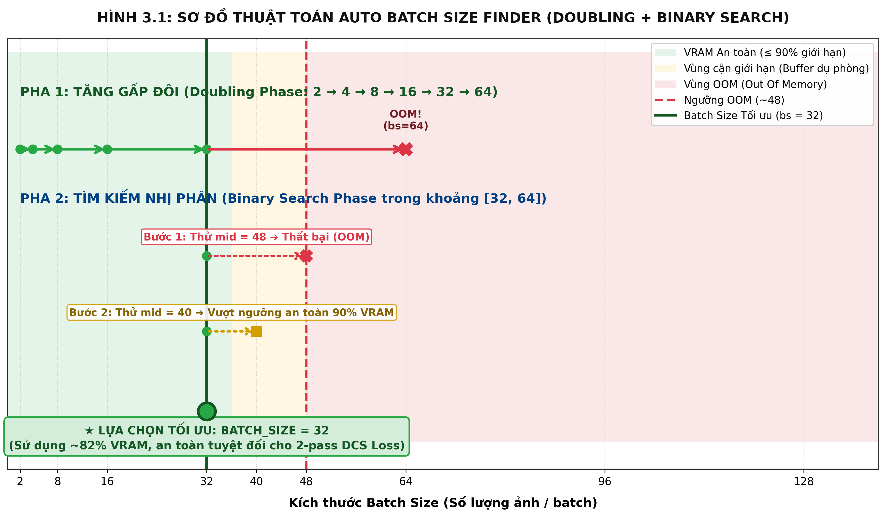

Hình 3.2. Sơ đồ thuật toán tự động xác định kích thước lô tối ưu bằng Doubling kết hợp Binary Search trong giới hạn 90% VRAM.

Bên cạnh đó, toàn bộ vòng lặp huấn luyện được vận hành dưới chế độ độ chính xác hỗn hợp tự động BFloat16 (torch.amp.autocast với dtype=torch.bfloat16) (Kalamkar và cộng sự, 2019 [37]) kết hợp bộ tối ưu AdamW (Loshchilov và Hutter, ICLR 2019 [34]) với tốc độ học cực đại $\eta_{\max} = 10^{-4}$, suy giảm trọng số tách rời $w = 10^{-4}$ đến $10^{-2}$, lịch giảm tốc độ học Cosine Annealing theo từng bước cập nhật (per-step) (Loshchilov và Hutter, ICLR 2017 [35]) và cắt chuẩn gradient ở ngưỡng 1,0 (Pascanu và cộng sự, ICML 2013 [36]). Việc chọn bf16 [37] thay vì fp16 mang lại ưu thế kỹ thuật lớn cho kiến trúc Transformer: bf16 giữ nguyên 8 bit phần mũ (exponent) giống hệt fp32 nên có cùng dải biểu diễn động, triệt tiêu hoàn toàn hiện tượng tràn số (overflow) hoặc hụt số (underflow) khi tính toán ma trận chú ý và hàm mũ nhiệt độ thấp ($\tau = 0,07$) mà không cần dùng bộ co giãn GradScaler.

## **3. Thu thập, phân chia và xử lý dữ liệu nghiên cứu**

### **3.1. Tổ chức dữ liệu gốc căn chỉnh nội dung và phân chia chống rò rỉ bằng hàm băm MD5**

#### **3.1.1. Cấu trúc sáu biến thể sinh ảnh giả từ Stable Diffusion 2.1**

Nguồn dữ liệu nền tảng của nghiên cứu kế thừa từ bộ dữ liệu căn chỉnh nội dung của B-Free [1], bao gồm 51.517 ảnh thật gốc trích từ bộ dữ liệu MS-COCO (Lin và cộng sự, ECCV 2014 [24]) và 309.102 ảnh giả tương ứng được sinh từ Stable Diffusion 2.1 (Rombach và cộng sự, CVPR 2022 [23]). Ứng với mỗi bức ảnh thật có mã định danh gốc (stem), 6 biến thể ảnh giả được tạo ra nhằm bao phủ cả trường hợp tái tạo toàn ảnh lẫn vẽ đè cục bộ.

Biến thể thứ nhất là SD2.1_selfconditioned, thực hiện tái tạo toàn bộ bức ảnh qua bộ mã hóa – giải mã VAE và quá trình khử nhiễu tự điều kiện hóa của SD 2.1. Biến thể thứ hai là SD2.1_selfconditioned_origBG, giữ nguyên toàn bộ điểm ảnh phông nền thật của ảnh gốc MS-COCO và chỉ thay thế vùng đối tượng chính bằng kết quả tự điều kiện hóa. Biến thể thứ ba là SD2.1_inpainted_samecat, xóa vùng vật thể theo mặt nạ MS-COCO và vẽ đè một vật thể mới thuộc cùng danh mục ngữ nghĩa (toàn ảnh đi qua bộ giải mã VAE). Biến thể thứ tư là SD2.1_inpainted_samecat_origBG, vẽ đè vật thể cùng danh mục nhưng ghép trả lại phần phông nền nguyên bản từ ảnh thật. Biến thể thứ năm là SD2.1_inpainted_diffcat, xóa vùng vật thể và vẽ đè một vật thể thuộc khác danh mục ngữ nghĩa. Biến thể thứ sáu là SD2.1_inpainted_diffcat_origBG, vẽ đè vật thể khác danh mục nhưng giữ nguyên phông nền thật của ảnh gốc.

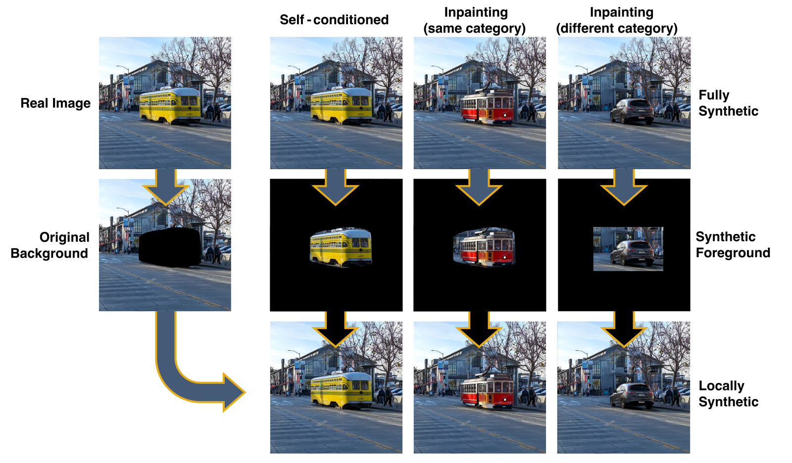

Hình 3.3. Cơ chế sinh dữ liệu ghép cặp căn chỉnh nội dung từ ảnh thật MS-COCO qua 6 biến thể vẽ đè của Stable Diffusion 2.1 (Nguồn: Guillaro và cộng sự — B-Free, CVPR 2025 [1]).

#### **3.1.2. Nguyên tắc phân chia chống rò rỉ gốc ảnh bằng hàm băm MD5**

Vì một bức ảnh thật và 6 biến thể giả của nó chia sẻ chung khung cảnh và phông nền, nếu chia ngẫu nhiên theo từng tệp ảnh thì sẽ xảy ra hiện tượng ảnh thật nằm ở tập Huấn luyện còn bản vẽ đè của chính ảnh đó lại lọt sang tập Kiểm định, gây rò rỉ dữ liệu nghiêm trọng. Để ngăn chặn tuyệt đối hiện tượng này và đảm bảo tính tất định trên mọi môi trường chạy, nhóm phân chia theo mã gốc ảnh (stem) thông qua hàm băm MD5:

$$\text{bucket}(\text{stem}) = \Big(\text{MD5}(\text{stem}) \bmod 100\Big) < 3$$

Đối với tập Kiểm định nội bộ cố định (Internal Validation — dưới 3% số gốc, tức 1.434 gốc ảnh), toàn bộ ảnh thật và cả 6 nhánh giả của 1.434 gốc này được cách ly hoàn toàn khỏi quá trình huấn luyện. Khi đánh giá kiểm định nội bộ, mỗi gốc lấy đúng 1 ảnh thật và 1 ảnh giả đại diện (SD2.1_selfconditioned), tạo thành tập kiểm định cân bằng gồm 2.868 ảnh (1.434 thật / 1.434 giả) cố định xuyên suốt mọi thí nghiệm.

Đối với kho dữ liệu Huấn luyện (Train Pool — 97% số gốc còn lại, tức 50.083 gốc ảnh), kho này bao gồm 50.083 ảnh thật và $50.083 \times 6 = 300.498$ ảnh giả. Ở nhánh thử nghiệm K2 (lấy mẫu động theo từng định danh — Per-ID Dynamic Pairing), mỗi chu kỳ duyệt qua 50.083 gốc ảnh; tại mỗi gốc, hệ thống lấy ảnh thật với xác suất $p = 0,5$ hoặc chọn ngẫu nhiên 1 trong 6 biến thể ảnh giả với xác suất 0,5, đảm bảo tỷ lệ kỳ vọng Thật : Giả là 1:1. Ở chuỗi thực nghiệm chuẩn hóa S1–S7 (chế độ ghép cặp đầy đủ — Paired Mode), mỗi chu kỳ lấy đủ cả cặp thật – giả cho từng gốc (50.083 ảnh thật + 50.083 ảnh giả chọn ngẫu nhiên từ 6 biến thể = 100.166 mẫu), kết hợp cùng 2.735 mẫu từ tập bổ sung nội bộ (683 thật + 2.052 giả sau khi đã tách 30% held-out), tạo thành đúng 102.901 mẫu/chu kỳ cho hai bậc nền tảng S1 và S2.

### **3.2. Chiến lược pha trộn đa dạng nguồn sinh có mỏ neo với AI-GenBench (25%)**

Để kiểm chứng Giả thuyết H2 và giải quyết triệt để nút thắt chỉ học từ một bộ sinh SD 2.1, từ bậc S3 trở đi (S3, S5, S6 và S7), nhóm thiết kế cơ chế pha trộn dữ liệu đa nguồn sinh có mỏ neo (other_frac = 0.25). Phần mỏ neo chống thiên lệch nội dung chiếm 75% trọng tâm, giữ nguyên toàn bộ 102.901 mẫu ghép cặp của B-Free [1] trong mỗi chu kỳ huấn luyện để duy trì kỷ luật buộc mô hình không được phân loại dựa trên chủ đề ngữ nghĩa [9].

Phần mở rộng đa bộ sinh từ tập huấn luyện AI-GenBench chiếm 25% bổ sung, trích xuất cân bằng 46.800 ảnh thật và 46.800 ảnh giả (tổng cộng 93.600 mẫu, sau khi đã tách riêng 10% tương ứng 5.200 thật + 5.200 giả làm tập kiểm định held-out) trải đều trên các bộ sinh của bộ chuẩn AI-GenBench (Pellegrini và cộng sự, 2024 [6]) thuộc nhiều trường phái kiến trúc khác nhau (GAN [43, 45, 46, 47], Diffusion đa thế hệ [23, 42, 50], Flow Matching [51], mô hình tự hồi quy và sửa ảnh [52, 53]). Nhờ chiến lược pha trộn này, tổng quy mô tập huấn luyện mỗi chu kỳ tăng từ 102.901 mẫu lên 196.501 mẫu/chu kỳ, giúp mô hình học được phổ dấu vết tạo sinh phong phú ngay trong quá trình tối ưu hóa.

### **3.3. Xử lý kích thước khung hình và chuỗi mô phỏng suy giảm mạng xã hội trực tuyến**

Để không làm biến dạng cấu trúc tần số không gian của dấu vết sinh ảnh khi đưa về kích thước đầu vào $504 \times 504$, hệ thống tuyệt đối không co kéo (resize) cưỡng bức toàn bộ bức ảnh về khung vuông, mà sử dụng chiến lược cắt ngẫu nhiên (Random Crop $504 \times 504$) kết hợp lật ngang ngẫu nhiên ($p = 0,5$) [1]. Đối với các bức ảnh có kích thước cạnh nhỏ hơn 504 điểm ảnh, ảnh được đệm lặp viền hoặc ghép mảnh theo đúng quy chuẩn của B-Free (Hình 3.4).

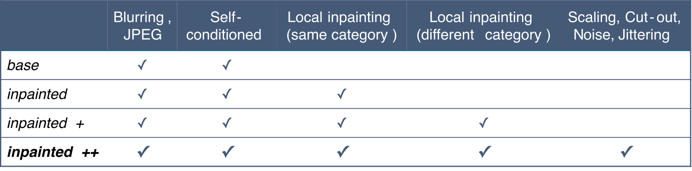

Hình 3.4. Chiến lược cắt khung hình 504×504 và đệm viền bảo toàn cấu trúc điểm ảnh trong quá trình huấn luyện (Nguồn: Guillaro và cộng sự — B-Free, CVPR 2025 [1]).

Ngay sau bước cắt khung không gian, để giúp mô hình làm quen với các biến dạng khắc nghiệt trên Internet [33, 68], bức ảnh được đưa qua chuỗi mô phỏng suy giảm trực tuyến (online_aug preset bfree với xác suất kích hoạt tổng thể $p_{\text{any}} = 0,9$) [1]. Chuỗi này bao gồm sáu phép biến đổi ngẫu nhiên: nén JPEG ngẫu nhiên (jpeg_p = 0.5, hệ số chất lượng $Q \in [30, 100]$); làm mờ Gaussian (blur_p = 0.4, độ lệch chuẩn $\sigma \in [0,1;\; 3,0]$); thu phóng kích thước (resize_p = 0.4, tỷ lệ co giãn $\in [0,25;\; 1,5]$); nhiễu cộng Gaussian (noise_p = 0.3, độ lệch chuẩn $\in [0,002;\; 0,03]$); biến đổi màu sắc (jitter_p = 0.4, thay đổi độ sáng, tương phản, bão hòa trong dải $[0,7;\; 1,3]$); và che khuất vùng ngẫu nhiên (cutout_p = 0.3, xóa từ 2% đến 20% diện tích khung hình). Riêng khi tính nhánh ảnh suy giảm $\mathbf{x}_{\text{deg}}$ cho hàm mất mát tương phản $\mathcal{L}_{\text{DCS}}$ [2], ảnh sạch $\mathbf{x}_{\text{clean}}$ sau khi cắt khung được sao chép sang nhánh thứ hai và bắt buộc trải qua nén JPEG chất lượng thấp $Q \in [20, 80]$ kết hợp làm mờ Gaussian $\sigma \in [0,5;\; 1,5]$ và biến đổi màu sắc với xác suất 80%.

## **4. Thiết kế quy trình thực nghiệm cắt bỏ, công cụ kiểm thử thực tế và phương pháp kiểm định thống kê**

### **4.1. Thiết kế thang thực nghiệm cắt bỏ tuần tự (S1 đến S7) và tiêu chuẩn cổng kiểm định**

Một sai lầm phổ biến trong nhiều nghiên cứu cải tiến mô hình là gộp tất cả các ý tưởng mới vào chạy một lần duy nhất, dẫn đến việc không thể biết thành phần nào thực sự mang lại hiệu quả và thành phần nào gây tác dụng ngược. Để khắc phục triệt để hạn chế này, bên cạnh nhánh thử nghiệm tích hợp toàn phần ban đầu (K2: chạy 8 chu kỳ với đầy đủ LoRA + LIB + GSR + Vanilla DCS $\lambda = 0,01$ trên dữ liệu gốc B-Free), nhóm thiết kế một Thang thực nghiệm cắt bỏ 6 bậc (S1, S2, S3, S5, S6 và S7), trong đó mỗi bậc sau chỉ thay đổi đúng một biến số so với bậc trước (Bảng 3.2).

Bảng 3.2. Thiết kế chi tiết các bậc trong thang thực nghiệm cắt bỏ từ S1 đến S7.

| Mã bậc | Tên cấu hình thí nghiệm | Quy mô mẫu mỗi chu kỳ | Mô phỏng suy giảm trực tuyến (bfree) | Mở rộng 25% AI-GenBench (36 bộ sinh) | Module cấu trúc LIB và GSR | Hàm mất mát tương phản $\mathcal{L}_{\text{DCS}}$ | Số chu kỳ và Hạt giống (Seeds) | Mục đích kiểm chứng khoa học |
| :--- | :--- | :--- | :--- | :--- | :--- | :--- | :--- | :--- |
| S1 | S1_clean_ce | 102.901 | Không (p = 0,0) | Không | Không | Không | 2 epochs (seed 42) | Đường cơ sở sạch: DINOv2 + LoRA trên dữ liệu ghép cặp B-Free. |
| S2 | S2_online_aug | 102.901 | Có (p = 0,9) | Không | Không | Không | 2 epochs (seed 42) | Đo tác động của chuỗi mô phỏng suy giảm trực tuyến (tái tạo B-Free bằng LoRA). |
| S3 | S3_add_aigenbench | 196.501 | Có (p = 0,9) | Có (25%) | Không | Không | 2 epochs (seed 42) | Kiểm chứng H2: Đánh giá hiệu quả của việc mở rộng đa nguồn sinh có mỏ neo. |
| S5 | S5_lib_gsr_zero_init | 196.501 | Có (p = 0,9) | Có (25%) | Có ($w_{\text{gsr}} = 7$) | Không | 2 epochs (seed 42) | Kiểm chứng H3: Đánh giá đóng góp của LIB + GSR (cổng zero-init, cls_plus_patch). |
| S6 | S6_dcs_class_aware | 196.501 | Có (p = 0,9) | Có (25%) | Không | Class-Aware ($\lambda = 0,1$) | 2 epochs (seed 42) | Kiểm chứng H3: Đánh giá hàm tương phản suy giảm có phân biệt lớp. |
| S7 | S7_final_3seeds | 196.501 | Có (p = 0,9) | Có (25%) | Chọn từ Gate | Chọn từ Gate | 6 epochs (42, 54, 68) | Kiểm chứng H1 và H2: Huấn luyện hội tụ sâu cấu hình tối ưu trên 3 hạt giống độc lập. |

Sau khi chạy sàng lọc 2 chu kỳ cho các bậc S3, S5 và S6, các mô hình trung gian này được đưa qua một Cổng kiểm định ngoài miền (Out-of-Domain Gate Test) trên 3 bộ dữ liệu ngoài phân phối (AI-GenBench [6], WildRF [7], B-Free Viral [1]). Một thành phần kiến trúc phức tạp (như LIB+GSR ở S5 hoặc Class-Aware DCS ở S6) chỉ được giữ lại để đưa lên bậc S7 nếu nó giúp tăng trung bình $\Delta\text{AUC} \ge +0,005$ so với S3 và không làm bất kỳ bộ dữ liệu kiểm thử nào bị sụt giảm quá 0,01 AUC.

### **4.2. Hệ thống bộ dữ liệu kiểm thử ngoài phân phối và giao thức suy luận 5 góc cắt**

#### **4.2.1. Ba bộ dữ liệu mạng xã hội và lan truyền thực tế (13.288 ảnh)**

Bộ chuẩn thứ nhất là ITW-SM (In-The-Wild Social Media — 10.000 ảnh; 5.000 thật / 5.000 giả) [8], được thu thập trực tiếp từ 4 nền tảng mạng xã hội lớn có thuật toán nén và xử lý ảnh khác nhau, bao gồm Facebook (2.351 ảnh), Instagram (3.385 ảnh), LinkedIn (2.200 ảnh) và X / Twitter (2.064 ảnh). Bộ chuẩn thứ hai là WildRF (2.503 ảnh; 1.251 thật / 1.252 giả) [7], gồm các ảnh đã qua nén JPEG nhiều tầng, cắt cúp và chèn chữ/biểu tượng trên Facebook (320 ảnh), Reddit (1.500 ảnh) và Twitter (683 ảnh). Bộ chuẩn thứ ba là B-Free Viral (785 ảnh; 269 thật / 516 giả) [1], gồm các ảnh lan truyền rộng rãi trên Internet qua nhiều ngày và nhiều lần tải lên lại, có tỷ lệ lớp mất cân bằng tự nhiên.

#### **4.2.2. Bộ chuẩn đa nguồn sinh AI-GenBench (36 bộ sinh)**

Bộ dữ liệu AI-GenBench (Pellegrini và cộng sự, 2024 [6]) bao gồm 16 kiến trúc họ GAN / Sửa ảnh (ProGAN [44], StyleGAN 1/2/3 [43], BigGAN [45], CycleGAN [46], GauGAN [48], StarGAN [47], GANformer, VQGAN, ProjectedGAN, SN-PatchGAN, FaceSynthetics, IMLE, CRN, Denoising Diffusion GAN) và 20 kiến trúc họ Khuếch tán / Tự hồi quy hiện đại (DDPM [42], DALL·E 3 [50], DeepFloyd IF, FLUX 1 Dev [51], FLUX 1 Schnell [51], Latent Diffusion [23], SD 1.4, SD 1.5, SD 2.1, SDXL 1.0, Midjourney, Glide, ADM, VQ-Diffusion, Palette [53], MAT, LaMa [52], CIPS).

#### **4.2.3. Giao thức suy luận 5 góc cắt thống nhất**

Tại bước suy luận, đối với mỗi bức ảnh kiểm thử $\mathbf{I}$, nếu chiều rộng hoặc chiều cao nhỏ hơn 504 điểm ảnh, hệ thống thực hiện đệm lặp viền (replicate padding) cho đủ 504 điểm ảnh để bảo toàn nguyên vẹn tần số điểm ảnh gốc [1]. Tiếp theo, 5 góc cắt kích thước $504 \times 504$ (4 góc biên: trên-trái, trên-phải, dưới-trái, dưới-phải và 1 góc trung tâm) được trích xuất và đưa qua mạng DINOv2 (đã gộp trọng số LoRA) trong cùng một lô để tính trung bình logit:

$$\bar{\mathbf{z}}(\mathbf{I}) = \frac{1}{5}\sum_{c=1}^{5} \mathbf{z}_c, \quad s(\mathbf{I}) = \bar{z}_{\text{AI}}(\mathbf{I}) - \bar{z}_{\text{Real}}(\mathbf{I}), \quad P(\text{AI} \mid \mathbf{I}) = \frac{1}{1 + \exp\big(-s(\mathbf{I})\big)}$$

Đối với 8 mô hình đối chứng tiên tiến khác gồm DDA [59], CommFor ViT-S/16-384 [60], GlobalForge DINOv3 [2], GAPL [58], Co-Spy [21], Effort [61], C2P-CLIP [62] và SAFE [63], để đảm bảo sự công bằng tuyệt đối, mỗi mô hình đều được chạy trên cùng 13.288 bức ảnh nhưng sử dụng đúng bộ tiền xử lý và kích thước khung hình tối ưu do chính tác giả mô hình đó quy định.

### **4.3. Hệ thống chỉ số đánh giá và phương pháp kiểm định Paired Bootstrap**

Hệ thống sử dụng năm nhóm chỉ số đo lường bổ trợ nhau để đánh giá toàn diện năng lực của mô hình. Chỉ số thứ nhất là Diện tích dưới đường cong ROC (AUC-ROC), đo xác suất một bức ảnh AI ngẫu nhiên được mô hình chấm điểm nghi ngờ $P(\text{AI})$ cao hơn một bức ảnh thật ngẫu nhiên: $\text{AUC} = P\big(s(\mathbf{I}_{\text{AI}}) > s(\mathbf{I}_{\text{Real}})\big)$. Đây là thước đo cốt lõi nhất vì nó đánh giá năng lực phân tách nguyên bản của mô hình qua mọi ngưỡng quyết định có thể từ 0 đến 1, không bị ảnh hưởng bởi sự lệch thang điểm hay mất cân bằng số lượng mẫu. Báo cáo trình bày cả AUC Pooled (gộp chung toàn bộ ảnh của bộ dữ liệu) và AUC Macro (trung bình cộng không trọng số giữa các nền tảng con). Chỉ số thứ hai là Tỷ lệ lỗi cân bằng (Equal Error Rate — EER), đo tỷ lệ sai sót tại ngưỡng quyết định tối ưu mà ở đó tỷ lệ báo nhầm ảnh thật thành ảnh AI (FPR) bằng với tỷ lệ bỏ sót ảnh AI (FNR). Chỉ số thứ ba là Độ chính xác trung bình (Average Precision — AP), đo diện tích dưới đường cong Precision–Recall. Nhóm chỉ số thứ tư là các độ đo tại ngưỡng vận hành cố định $\tau = 0,5$, bao gồm Độ nhạy trên ảnh giả (TPR Fake), Độ đặc hiệu trên ảnh thật ($\text{TNR Real} = 1 - \text{FPR}$) và Độ chính xác cân bằng ($\text{bAcc} = \frac{\text{TPR} + \text{TNR}}{2}$). Nhóm chỉ số thứ năm bao gồm Tỷ lệ phát hiện tại mức báo động giả 10% (Pd@10%FPR), Sai số hiệu chuẩn kỳ vọng (ECE) [39] và Hàm hợp lý âm cân bằng ($\text{NLL}_{\text{bal}}$).

Để chứng minh mức chênh lệch $\Delta\text{AUC} = \text{AUC}_{\text{Model A}} - \text{AUC}_{\text{Model B}}$ không phải là kết quả ngẫu nhiên, nhóm thực hiện lấy mẫu Bootstrap có hoàn lại $B = 1.000$ lần ở cấp độ từng bức ảnh (Efron và Tibshirani, 1993 [27]). Trong mỗi lần lấy mẫu $b$, cả hai mô hình cùng được tính AUC trên đúng một tập chỉ số ảnh để thu được phân phối hiệu số $\{\Delta\text{AUC}^{(b)}\}_{b=1}^{1000}$, từ đó xác định khoảng tin cậy 95% ($\text{CI}_{95\%}$) và trị số $p_{\text{boot}}$ hai phía. Khi so sánh đồng thời trên 8 nền tảng mạng xã hội, trị số $p_{\text{boot}}$ được hiệu chỉnh kiểm soát tỷ lệ phát hiện sai bằng phương pháp Benjamini–Hochberg ($q_{\text{BH}}$) (Benjamini và Hochberg, 1995 [28]) ở ngưỡng $\alpha = 0,05$.

# **CHƯƠNG IV: KIỂM CHỨNG GIẢ THUYẾT, PHÂN TÍCH VÀ THẢO LUẬN KẾT QUẢ NGHIÊN CỨU**

## **1. Phân tích tổng quan các đặc trưng kỹ thuật cải tiến và kết quả hội tụ nội bộ**

### **1.1. Phân tích đối chiếu các đặc trưng cải tiến cốt lõi của mô hình đề xuất**

Trước khi đi vào các bảng số liệu thực nghiệm chi tiết, Bảng 4.1 tổng hợp và phân tích cơ chế hoạt động, vai trò kỹ thuật cũng như tác động thực nghiệm của từng đặc trưng cải tiến (features) được nhóm thiết kế so với mô hình B-Free gốc [1] và GlobalForge gốc [2].

Bảng 4.1. Phân tích đối chiếu từng đặc trưng kỹ thuật cải tiến trong đề tài so với mô hình nền tảng.

| Nhóm đặc trưng (Feature) | Thiết kế trong B-Free gốc [1] | Thiết kế cải tiến trong đề tài | Cơ chế tác động và Hiệu quả thực nghiệm đạt được |
| :--- | :--- | :--- | :--- |
| Cơ chế tinh chỉnh mạng xương sống DINOv2 ViT-B/14 | Tinh chỉnh toàn bộ (Full Fine-tuning) 86,58 triệu tham số của DINOv2. | Đóng băng mạng gốc, gắn LoRA ($r=16, \alpha=32$) trên 49 lớp chiếu (chỉ học 2,38 triệu tham số, tương đương 2,68%). | Giảm ~37 lần số tham số cập nhật trên xương sống, tiết kiệm bộ nhớ AdamW, giữ nguyên biểu diễn hình học tự giám sát của DINOv2 và gộp thẳng vào mạng gốc khi suy luận (độ trễ bằng 0). |
| Xử lý mã hóa vị trí ở độ phân giải 504×504 | Khởi tạo từ trọng số đã huấn luyện của tác giả. | Nội suy song tuyến hai chiều bảng pos_embed từ lưới 37×37 (518 px) về lưới 36×36 (504 px) ngoại tuyến. | Khôi phục 100% trọng số tiền huấn luyện (dropped = 0), tạo lưới 1.296 mảnh ảnh nguyên vẹn không bị cắt lẻ ở biên, sai số nội suy vị trí dưới 1%. |
| Đặc trưng nguồn sinh dữ liệu huấn luyện | Đơn nguồn sinh: Toàn bộ 300.498 ảnh giả chỉ sinh từ một mô hình Stable Diffusion 2.1 (102.901 mẫu/chu kỳ). | Pha trộn có mỏ neo: Giữ 75% dữ liệu ghép cặp B-Free làm mỏ neo + bổ sung 25% dữ liệu từ 36 bộ sinh AI-GenBench (196.501 mẫu/chu kỳ). | Vừa giữ được kỷ luật chống học vẹt nội dung của B-Free, vừa mở rộng từ điển dấu vết sang GAN, FLUX, Midjourney, DALL·E 3; giúp tăng +0,0376 AUC trên LinkedIn và +0,0264 AUC trên Reddit. |
| Phân chia dữ liệu chống rò rỉ gốc ảnh | Chia tập huấn luyện và kiểm định theo cấu hình nội bộ của tác giả. | Chia tách tất định bằng hàm băm MD5 trên mã gốc ảnh (stem): 97% gốc vào Train (50.083 gốc), dưới 3% gốc vào Val (1.434 gốc). | Cách ly tuyệt đối ảnh thật và cả 6 biến thể vẽ đè của cùng một gốc ảnh về một phía, triệt tiêu 100% nguy cơ rò rỉ ngữ cảnh giữa tập huấn luyện và tập kiểm định. |
| Đặc trưng lọc cục bộ LIB và chú ý tầm xa GSR | Không sử dụng (chỉ dùng đầu phân loại trên token [CLS]). | Chuyển đổi LIB và GSR từ 1.024 chiều (ViT-L) sang 768 chiều (ViT-B/14) trên 1.296 mảnh ảnh; thử nghiệm mở rộng mặt nạ Chebyshev $w_{\text{gsr}} = 3 \to 7$. | Tương thích hoàn toàn về mặt toán học; giúp biến thể giả cục bộ khó nhất (selfconditioned_origBG) hội tụ đạt 99,65% bAcc, nhưng tỏ ra dư thừa khi DINOv2 đã có 4 token thanh ghi. |
| Đặc trưng hàm mất mát tương phản suy giảm $\mathcal{L}_{\text{DCS}}$ | Không sử dụng (chỉ dùng hàm mất mát phân loại nhị phân). | Cải biên từ Vanilla InfoNCE sang Class-Aware DCS (chỉ đẩy các mẫu âm thuộc lớp đối diện $y_j \neq y_i$ trong batch). | Giảm đồng thuận 87,3% cùng hàm phân loại, giúp tăng AUC trên ảnh nén Reddit (+0,0082) và Viral (+0,0046), nhưng làm mờ dấu vết tần số cao của GAN cổ điển trên AI-GenBench (-0,0233 AUC). |
| Tự động tối ưu bộ nhớ và kiểu số học huấn luyện | Thiết lập kích thước lô cố định thủ công. | Thuật toán Auto Batch Size Finder (Doubling + Binary Search ở ngưỡng 90% VRAM) kết hợp độ chính xác BFloat16. | Tận dụng tối đa dung lượng GPU 96GB mà không bao giờ bị tràn bộ nhớ (OOM) khi chạy 2 nhánh lan truyền thuận; giữ nguyên dải động 8-bit exponent không cần GradScaler. |

### **1.2. Kết quả hội tụ của cấu hình tích hợp trên tập kiểm định và sự đồng thuận của hàm mất mát**

Ở nhánh thực nghiệm đầu tiên (cấu hình tích hợp đầy đủ K2: mạng xương sống DINOv2 ViT-B/14 [3, 4] gắn LoRA $r=16, \alpha=32$ [5] trên 49 lớp, kết hợp hai module cấu trúc LIB, GSR 768 chiều và hàm mất mát tương phản suy giảm $\mathcal{L}_{\text{DCS}}$ [2] với trọng số điều chuẩn $\lambda_{\text{DCS}} = 0,01$, làm mềm nhãn $\varepsilon = 0,1$ [38]), mô hình được huấn luyện trong 8 chu kỳ (epochs) trên tập dữ liệu ghép cặp B-Free [1] (50.083 định danh huấn luyện, kiểm định trên 2.868 ảnh của tập Internal Val). Tổng thời gian huấn luyện chỉ mất khoảng 2,5 giờ (~19 phút/chu kỳ) với chỉ 5,21% tổng số tham số nhận gradient (4.751.811 / 91.277.763). Bảng 4.2 và Hình 4.1 ghi lại chi tiết diễn biến của từng thành phần hàm mất mát cũng như các chỉ số kiểm định qua 8 chu kỳ.

Bảng 4.2. Diễn biến hội tụ của cấu hình tích hợp qua 8 chu kỳ huấn luyện.

| Chu kỳ (Epoch) | Mất mát tổng ($\mathcal{L}_{\text{total}}$) | Mất mát phân loại ($\mathcal{L}_{\text{CE}}$) | Mất mát tương phản ($\mathcal{L}_{\text{DCS}}$) | Mất mát kiểm định (Val Loss) | Chỉ số Val AUC | Độ chính xác cân bằng Val bAcc (%) | Ghi chú trạng thái |
| :--- | :--- | :--- | :--- | :--- | :--- | :--- | :--- |
| 1 | 0,2983 | 0,2969 | 0,1363 | 0,2332 | 0,9993 | 98,78% | Hội tụ nhanh ngay chu kỳ đầu |
| 2 | 0,2183 | 0,2177 | 0,0649 | 0,2121 | 1,0000 | 99,79% | Val AUC chạm ngưỡng tối đa 1,0000 |
| 3 | 0,2118 | 0,2114 | 0,0451 | 0,2115 | 1,0000 | 99,86% | Tiếp tục giảm mạnh $\mathcal{L}_{\text{DCS}}$ |
| 4 | 0,2073 | 0,2070 | 0,0297 | 0,2119 | 1,0000 | 99,79% | Ổn định vùng hội tụ |
| 5 | 0,2044 | 0,2041 | 0,0258 | 0,2094 | 1,0000 | 99,97% | Đạt đỉnh Val bAcc (Best Checkpoint) |
| 6 | 0,2025 | 0,2023 | 0,0216 | 0,2083 | 1,0000 | 99,90% | Tốc độ học giảm sâu theo lịch Cosine |
| 7 | 0,2014 | 0,2013 | 0,0180 | 0,2086 | 1,0000 | 99,93% | Duy trì bão hòa trên tập kiểm định |
| 8 | 0,2007 | 0,2005 | 0,0173 | 0,2076 | 1,0000 | 99,93% | Kết thúc chu trình huấn luyện |

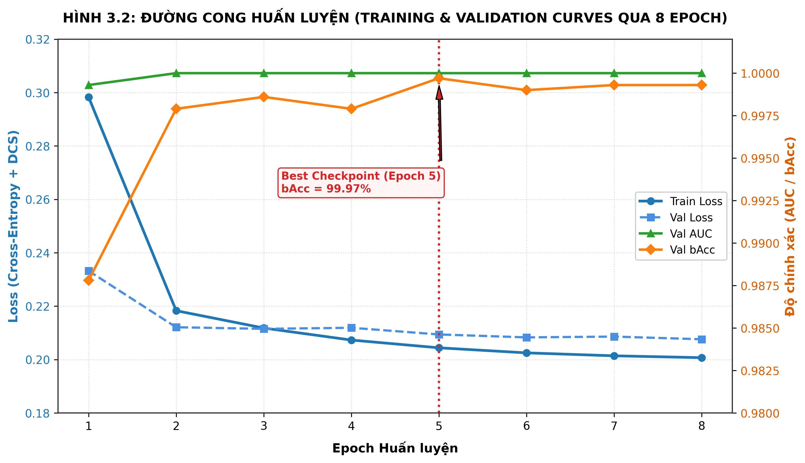

Hình 4.1. Đường cong hội tụ của hàm mất mát huấn luyện, AUC và độ chính xác cân bằng (bAcc) qua 8 chu kỳ huấn luyện.

Từ Bảng 4.2 và Hình 4.1, hai luận điểm khoa học quan trọng được rút ra để kiểm chứng bước đầu cho Giả thuyết H1 và Giả thuyết H3. Luận điểm thứ nhất khẳng định hiệu quả của cơ chế tinh chỉnh LoRA (H1): chỉ với 19 phút huấn luyện của chu kỳ đầu tiên và chỉ cập nhật 5,21% số tham số, mô hình đã đạt Val AUC = 0,9993 và chạm mức tuyệt đối 1,0000 ngay từ chu kỳ thứ 2; tại chu kỳ thứ 5, độ chính xác cân bằng đạt đỉnh 99,97% (chỉ phân loại sai đúng 1 ảnh trong tổng số 2.868 ảnh kiểm định). Điều này chứng minh rằng mạng xương sống DINOv2 [3] đã chứa sẵn nền tảng biểu diễn hình học và kết cấu cực kỳ phong phú; ta hoàn toàn không cần cập nhật toàn bộ 86,58 triệu tham số gốc mà chỉ cần một lớp thích nghi hạng thấp mỏng [5] để định hướng lại không gian đặc trưng sang bài toán phát hiện dấu vết sinh ảnh.

Luận điểm thứ hai khẳng định sự đồng thuận không xung đột giữa hai hàm mất mát ($\mathcal{L}_{\text{CE}}$ và $\mathcal{L}_{\text{DCS}}$ — H3): xuyên suốt 8 chu kỳ, mất mát phân loại $\mathcal{L}_{\text{CE}}$ giảm đều đặn 32,5% (từ 0,2969 về 0,2005, tiến sát mức sàn lý thuyết của nhãn mềm $\varepsilon = 0,1$), đồng thời mất mát tương phản suy giảm $\mathcal{L}_{\text{DCS}}$ giảm mạnh tới 87,3% (từ 0,1363 xuống 0,0173). Hai đường cong giảm song hành mượt mà, không hề xuất hiện hiện tượng giằng co (một hàm giảm làm hàm kia tăng), chứng tỏ ở mức trọng số điều chuẩn hợp lý, mục tiêu gom cụm ảnh sạch – ảnh suy giảm hoàn toàn tương thích với mục tiêu phân tách ranh giới Thật – Giả.

### **1.3. Phân tích khả năng nhận diện trên từng biến thể giả mạo cục bộ và toàn cục**

Để kiểm tra xem mô hình có thực sự học được các dấu vết tạo sinh tinh vi hay chỉ dựa vào sự khác biệt ngữ cảnh dễ nhận biết, nhóm bóc tách kết quả kiểm định của cả 6 biến thể sinh ảnh giả từ Stable Diffusion 2.1 [23] qua các chu kỳ (Bảng 4.3 và Hình 4.2).

Bảng 4.3. Diễn biến Val AUC và Val bAcc theo từng biến thể sinh ảnh giả SD 2.1.

| Biến thể ảnh giả trong tập kiểm định | Bản chất can thiệp của AI trên ảnh gốc MS-COCO | AUC (Ep.1) | bAcc (Ep.1) | AUC (Ep.5) | bAcc (Ep.5) | AUC (Ep.8) | bAcc (Ep.8) |
| :--- | :--- | :--- | :--- | :--- | :--- | :--- | :--- |
| SD2.1_inpainted_diffcat | Vẽ đè vật thể khác danh mục (toàn ảnh qua VAE) | 0,9999 | 99,55% | 1,0000 | 100,00% | 1,0000 | 99,93% |
| SD2.1_inpainted_diffcat_origBG | Vẽ đè vật thể khác danh mục, giữ nguyên nền thật | 0,9998 | 99,41% | 1,0000 | 99,90% | 1,0000 | 99,93% |
| SD2.1_inpainted_samecat | Vẽ đè vật thể cùng danh mục (toàn ảnh qua VAE) | 0,9998 | 99,55% | 1,0000 | 100,00% | 1,0000 | 99,93% |
| SD2.1_inpainted_samecat_origBG | Vẽ đè vật thể cùng danh mục, giữ nguyên nền thật | 0,9976 | 99,09% | 1,0000 | 99,97% | 1,0000 | 99,90% |
| SD2.1_selfconditioned | Tái tạo toàn bộ ảnh theo cơ chế tự điều kiện hóa | 0,9993 | 98,78% | 1,0000 | 99,97% | 1,0000 | 99,93% |
| SD2.1_selfconditioned_origBG | Tái tạo đúng vật thể gốc, giữ nguyên 100% nền thật | 0,9873 | 94,18% | 0,9995 | 99,27% | 0,9999 | 99,65% |

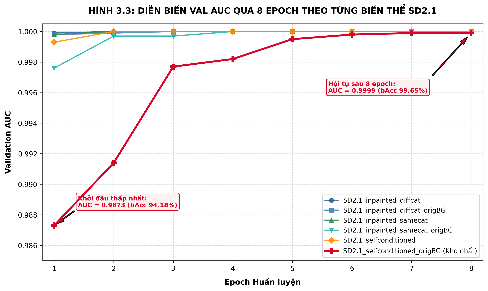

Hình 4.2. Diễn biến chỉ số Val AUC theo từng chu kỳ huấn luyện trên 6 biến thể sinh ảnh giả của Stable Diffusion 2.1.

Số liệu từ Bảng 4.3 và Hình 4.2 chỉ ra một quy luật vật lý rất thú vị. Ở chu kỳ 1, trong khi 5 biến thể đầu đều đạt ngay độ chính xác cân bằng trên 98,7% – 99,5%, thì riêng biến thể SD2.1_selfconditioned_origBG (đường màu đỏ trên Hình 4.2) xuất phát thấp hơn hẳn với bAcc = 94,18% (AUC = 0,9873). Lý do là ở biến thể selfconditioned_origBG, toàn bộ phông nền xung quanh là điểm ảnh thật 100% từ máy ảnh gốc, còn vùng vật thể chính được AI tái tạo lại theo đúng hình dáng và danh mục của vật thể gốc (không hề có sự lệch lạc về ngữ cảnh như việc ghép một vật thể khác loại vào nền). Do đó, ở chu kỳ đầu, một số bức ảnh có diện tích vật thể nhỏ bị phông nền thật áp đảo. Tuy nhiên, từ chu kỳ 2 đến chu kỳ 8, nhờ cơ chế đối chiếu cấu trúc tầm xa giữa các vùng của mạng ViT/GSR kết hợp với quá trình tinh chỉnh LoRA, mô hình đã học được cách phát hiện sự bất nhất quán vi mô ngay tại ranh giới giữa vùng vật thể tái tạo và phông nền thật, đưa độ chính xác trên biến thể khó nhất này bứt phá lên 99,65% (AUC = 0,9999).

### **1.4. Thử nghiệm sức chịu đựng trước chuỗi suy giảm vật lý khắc nghiệt**

Mặc dù cấu hình K2 đạt hiệu năng gần như tuyệt đối trên tập kiểm định sạch cùng nguồn SD 2.1, một câu hỏi phương pháp luận bắt buộc phải đặt ra là: khi bức ảnh bị tấn công bởi các phép suy giảm vật lý ngoài luồng huấn luyện (như thu phóng giảm mẫu sâu hoặc chồng lấn liên tiếp 3–5 tầng biến dạng) [33, 68] và khi gặp các bộ sinh hoàn toàn khác ngoài SD 2.1, mô hình chỉ học trên dữ liệu SD 2.1 sẽ phản ứng ra sao? Để trả lời câu hỏi này, nhóm tiến hành bài kiểm tra áp lực (stress test) trên tập kiểm thử suy giảm vật lý đa cấp độ (realdeg_bench_style.csv, Bảng 4.4).

Bảng 4.4. Kết quả kiểm tra áp lực của mô hình đơn nguồn sinh trước các phép suy giảm đơn lẻ và suy giảm chồng lấn nhiều cấp.

| Điều kiện chất lượng ảnh kiểm thử | Bản chất biến dạng vật lý | Chỉ số AUC | Độ chính xác cân bằng bAcc (%) | Mức độ suy giảm hiệu năng |
| :--- | :--- | :--- | :--- | :--- |
| Ảnh sạch (Clean Baseline) | Không biến dạng hậu kỳ | 1,0000 | 99,93% | Mốc chuẩn lý tưởng |
| Nhiễu cộng Gaussian (Gaussian Noise) | Cộng nhiễu ngẫu nhiên phá cấu trúc vi mô | 0,8856 | 73,57% | Suy giảm trung bình |
| Nén JPEG (JPEG Compression) | Nén lượng tử hóa khối DCT tần số cao | 0,8774 | 72,66% | Suy giảm trung bình |
| Làm mờ Gaussian (Gaussian Blur) | Lọc thông thấp xóa biên sắc nét | 0,8698 | 76,53% | Suy giảm trung bình |
| Thu phóng giảm – tăng mẫu (Down-Up Resize) | Nội suy lại toàn bộ lưới điểm ảnh | 0,8667 | 65,10% | Nhạy cảm mạnh ở ngưỡng 0,5 |
| Suy giảm kết hợp Cấp độ 1 (Compound Step 1) | Phối hợp biến dạng nhẹ (tương tự đăng tải 1 lần) | 0,9455 | 84,34% | Duy trì khả năng phân tách tốt |
| Suy giảm kết hợp Cấp độ 3 (Compound Step 3) | Chồng lấn 3 phép suy giảm liên hoàn | 0,7796 | 66,35% | Suy giảm đáng kể |
| Suy giảm kết hợp Cấp độ 5 (Compound Step 5) | Chồng lấn 5 phép suy giảm cực đoan | 0,6589 | 58,30% | Dấu vết tần số cao bị xóa gần hết |

Kết quả ở Bảng 4.4 cho thấy một thực tế khoa học rất rõ ràng: nếu chỉ huấn luyện trên dữ liệu của một bộ sinh duy nhất (SD 2.1) với bộ suy giảm 3 phép cơ bản (JPEG + Blur + ColorJitter dùng cho $\mathcal{L}_{\text{DCS}}$), mô hình tuy giữ được AUC = 0,9455 ở mức suy giảm kết hợp cấp độ 1 nhưng vẫn bị sụt giảm mạnh khi gặp phép thu phóng lại lưới điểm ảnh (Down-Up Resize, bAcc rơi xuống 65,10%) hoặc khi nhiều phép biến dạng chồng lấn. Điều này chứng minh rằng chỉ thêm module kiến trúc (LIB, GSR, $\mathcal{L}_{\text{DCS}}$) trên dữ liệu đơn nguồn sinh là chưa đủ, mà bắt buộc phải tiến hành thang thực nghiệm cắt bỏ (S1 đến S7) để kết hợp đầy đủ chuỗi tăng cường 6 phép biến dạng trực tuyến bfree (bao gồm cả Random Resize, Gaussian Noise, Cutout) và mở rộng đa dạng nguồn sinh với AI-GenBench [6].

## **2. Kiểm chứng theo thang thực nghiệm cắt bỏ (S1 đến S6) và phân tích sự đánh đổi của các module cấu trúc**

### **2.1. Kết quả huấn luyện từ bậc S1 đến S6**

Theo đúng thiết kế tại Bảng 3.2, nhóm thực hiện huấn luyện tuần tự các bậc từ S1 đến S6 (mỗi bậc chạy 2 chu kỳ với cùng hạt giống seed = 42 và cùng tập kiểm định nội bộ 2.868 ảnh có áp dụng suy giảm kiểm định val_aug = True để phản ánh sát điều kiện thực tế). Bảng 4.5 và các Hình 4.3, 4.4, 4.5 tổng hợp quá trình hội tụ của các bậc đại diện.

Bảng 4.5. So sánh quá trình hội tụ qua 2 chu kỳ huấn luyện giữa các bậc trong thang thực nghiệm cắt bỏ với seed = 42.

| Bậc thí nghiệm và Cấu hình thay đổi | Quy mô mẫu mỗi chu kỳ | Chu kỳ | Train Loss (Tổng) | Train $\mathcal{L}_{\text{CE}}$ | Train $\mathcal{L}_{\text{DCS}}$ | Val Loss | Chỉ số Val AUC | Độ chính xác Val bAcc (%) | Thời gian chạy (2 Epochs) |
| :--- | :--- | :--- | :--- | :--- | :--- | :--- | :--- | :--- | :--- |
| S1 (S1_clean_ce: Chỉ dữ liệu ghép cặp B-Free + LoRA, ảnh sạch) | 102.901 | 2 | — | — | 0,0000 | — | 0,9941 | 95,99% | ~1,30 giờ |
| S2 (S2_online_aug: S1 + Chuỗi suy giảm trực tuyến bfree p = 0,9) | 102.901 | 1 | 0,2524 | 0,2524 | 0,0000 | 0,1837 | 0,9845 | 91,95% | ~1,40 giờ |
| S2 (S2_online_aug: Kết thúc chu kỳ 2) | 102.901 | 2 | 0,1431 | 0,1431 | 0,0000 | 0,1307 | 0,9910 | 94,60% | ~1,40 giờ |
| S3 (S3_add_aigenbench: S2 + Mở rộng 25% AI-GenBench trên 36 bộ sinh) | 196.501 | 1 | 0,2325 | 0,2325 | 0,0000 | 0,1752 | 0,9850 | 92,43% | ~1,85 giờ |
| S3 (S3_add_aigenbench: Kết thúc chu kỳ 2) | 196.501 | 2 | 0,1361 | 0,1361 | 0,0000 | 0,1249 | 0,9918 | 95,15% | ~1,85 giờ |
| S6 (S6_dcs_class_aware: S3 + Hàm tương phản phân biệt lớp Class-Aware DCS) | 196.501 | 1 | 0,2264 | 0,2203 | 0,0611 | 0,1666 | 0,9877 | 93,86% | ~2,77 giờ |
| S6 (S6_dcs_class_aware: Kết thúc chu kỳ 2) | 196.501 | 2 | 0,1305 | 0,1266 | 0,0390 | 0,1290 | 0,9929 | 95,54% | ~2,77 giờ (Tăng 1,5 lần) |

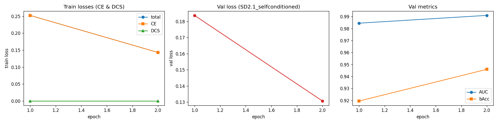

Hình 4.3. Đường cong huấn luyện của bậc nền tảng S2 khi bật chuỗi mô phỏng suy giảm trực tuyến.

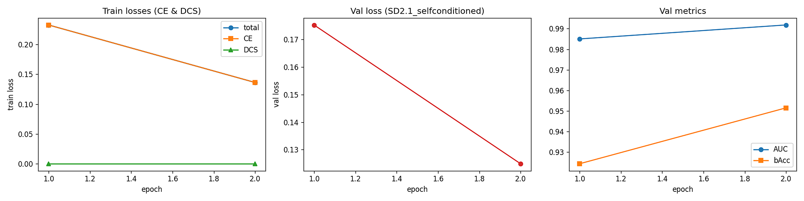

Hình 4.4. Đường cong huấn luyện của bậc S3 khi bổ sung 25% dữ liệu đa bộ sinh từ AI-GenBench.

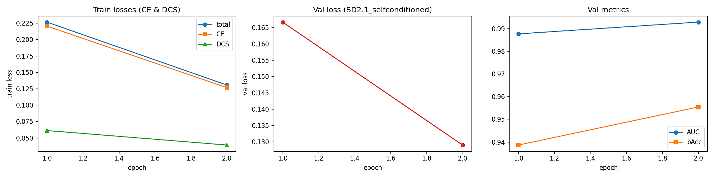

Hình 4.5. Đường cong huấn luyện của bậc S6 khi kết hợp thêm hàm mất mát tương phản phân biệt lớp Class-Aware DCS.

Quan sát Bảng 4.5 và ba đồ thị trên, khi chuyển từ S2 sang S3 (bổ sung thêm 93.600 mẫu từ AI-GenBench [6], nâng tổng số mẫu lên 196.501 mẫu/chu kỳ), mặc dù dữ liệu huấn luyện trở nên đa dạng và phức tạp hơn rất nhiều, mất mát kiểm định nội bộ (Val Loss) lại giảm từ 0,1307 xuống 0,1249, đồng thời Val AUC tăng từ 0,9910 lên 0,9918 và Val bAcc tăng từ 94,60% lên 95,15%. Điều này chứng tỏ việc pha trộn 25% dữ liệu đa nguồn sinh không hề gây nhiễu cho nhiệm vụ gốc mà còn giúp mạng học được đặc trưng phân loại tổng quát hơn. Khi chuyển tiếp từ S3 sang S6 (bổ sung thêm nhánh tương phản nhận biết lớp Class-Aware DCS với $\lambda_{\text{DCS}} = 0,1$), thành phần $\mathcal{L}_{\text{DCS}}$ giảm mượt mà từ 0,0611 xuống 0,0390 (Hình 4.5), đẩy Val AUC nội bộ nhích thêm từ 0,9918 lên 0,9929 và Val bAcc lên 95,54%, đổi lại thời gian huấn luyện tăng gấp 1,5 lần (từ 1,85 giờ lên 2,77 giờ cho 2 chu kỳ).

### **2.2. Kiểm định ngoài miền tại cổng quyết định (S3 so với S5 và S6) và lý giải bản chất sự đánh đổi**

#### **2.2.1. Xác nhận sự đánh đổi giữa bất biến nén cực đoan và độ nhạy vi cấu trúc đa bộ sinh**

Nếu một nghiên cứu chỉ dừng lại ở tập kiểm định nội bộ (Bảng 4.5), người làm thực nghiệm sẽ dễ dàng ngộ nhận rằng S6 là mô hình tốt nhất. Tuy nhiên, theo đúng quy trình phương pháp luận đã thiết lập ở Chương III, nhóm đưa các cấu hình ứng viên (S3, S5, S6) qua Cổng kiểm định ngoài phân phối (Out-of-Domain Gate Test) trên 3 bộ dữ liệu hoàn toàn độc lập: AI-GenBench (36 bộ sinh) [6], WildRF (2.503 ảnh mạng xã hội) [7] và B-Free Viral (785 ảnh lan truyền) [1]. Bảng 4.6 trình bày kết quả đối sánh trực tiếp giữa S3 (cấu hình tinh gọn: DINOv2 + LoRA + bfree aug + 25% AI-GenBench) và S6 (S3 + Class-Aware DCS) tại cùng mốc 2 chu kỳ huấn luyện.

Bảng 4.6. Kết quả kiểm định ngoài phân phối tại Cổng quyết định giữa Bậc S3 và Bậc S6 ở mốc 2 Epochs, seed = 42.

| Bộ dữ liệu hoặc Tập con kiểm thử độc lập | Chỉ số đo lường | Bậc S3 (Tinh gọn + 25% AIGB) | Bậc S6 (S3 + Class-Aware DCS) | Mức chênh lệch (S6 − S3) | Kết luận tại Cổng kiểm định (Gate Verdict) |
| :--- | :--- | :--- | :--- | :--- | :--- |
| 1. AI-GenBench [6] (Gộp toàn bộ 36 bộ sinh) | AUC Pooled | 0,8987 | 0,8754 | −0,0233 | Vi phạm ngưỡng tụt tối đa (> 0,01 AUC) |
| 1. AI-GenBench (Độ chính xác và Sai số) | bAcc @ 0,5 / EER | 61,99% / 0,1922 | 60,72% / 0,2130 | −1,27% / +0,0208 | S3 giữ độ chính xác cao hơn và tỷ lệ lỗi thấp hơn |
| 2. WildRF — Facebook [7] (320 ảnh) | AUC / bAcc @ 0,5 | 0,9922 / 96,56% | 0,9879 / 96,25% | −0,0043 / −0,31% | S3 nhỉnh hơn trên Facebook |
| 3. WildRF — Reddit [7] (1.500 ảnh) | AUC / bAcc @ 0,5 | 0,9803 / 93,67% | 0,9885 / 94,80% | +0,0082 / +1,13% | S6 cải thiện khả năng chịu nén trên Reddit |
| 4. WildRF — Twitter [7] (683 ảnh) | AUC / bAcc @ 0,5 | 0,9978 / 97,22% | 0,9982 / 97,22% | +0,0004 / 0,00% | Cả hai cùng đạt trần (> 0,997) |
| WildRF (Trung bình Macro 3 nền tảng) | AUC Macro | 0,9901 | 0,9915 | +0,0014 | Mức tăng rất nhỏ (< 0,005 quy định) |
| 5. B-Free Viral [1] (785 ảnh lan truyền) | AUC / bAcc @ 0,5 | 0,9733 / 86,69% | 0,9779 / 84,18% | +0,0046 / −2,51% | S6 nhỉnh nhẹ AUC nhưng S3 giữ cân bằng ngưỡng tốt hơn |

Bảng 4.6 phơi bày một hiện tượng vật lý rất rõ nét: việc bổ sung hàm tương phản Class-Aware DCS ở bậc S6 quả thực giúp mô hình chống chịu tốt hơn trên các tập ảnh bị nén mạng xã hội nặng như WildRF Reddit (AUC tăng +0,0082, lên 0,9885) và B-Free Viral (AUC tăng +0,0046, lên 0,9779). Thế nhưng, chính ràng buộc ép vector biểu diễn của ảnh sạch phải trùng khít với vector của ảnh bị nén JPEG nặng ($Q \in [30, 70]$) đã khiến mạng học cách triệt tiêu và bỏ qua toàn bộ dải thông tin tần số trung – cao. Hậu quả là khi kiểm thử trên 36 bộ sinh của AI-GenBench [6], S6 bị sụt giảm −0,0233 AUC so với S3 (từ 0,8987 xuống 0,8754), đặc biệt mất độ nhạy trên các họ mô hình GAN cổ điển vốn có dấu vết nằm ở tần số trung – cao (cụ thể: trên StarGAN [47], AUC tụt từ 0,9494 ở S3 xuống 0,8606 ở S6; trên BigGAN [45] tụt từ 0,9420 xuống 0,8798; trên GauGAN [48] tụt từ 0,9285 xuống 0,8653).

#### **2.2.2. Lý giải vai trò của xương sống DINOv2 có 4 token thanh ghi ở bậc S3**

Ở bậc S5 (S5_lib_gsr_zero_init), ngoài việc làm tăng đáng kể chi phí bộ nhớ khi phải nhân ma trận chú ý kích thước $1.296 \times 1.296$ trên cả 5 góc cắt và phát sinh lệch khóa trạng thái cổng gsr.gate khi hợp nhất suy luận, việc gắn thêm bộ lọc làm mờ cố định LIB và mặt nạ chặn lân cận GSR lên trên đặc trưng DINOv2 tỏ ra dư thừa. Lý do là trong bài báo GlobalForge gốc [2], LIB và GSR được sinh ra để khắc phục điểm yếu của CLIP ViT-L/14 [54] (vốn học theo nhãn văn bản nên bản đồ chú ý bị nhiễu cục bộ). Ngược lại, DINOv2 ViT-B/14 có 4 token thanh ghi [3, 4] đã được tiền huấn luyện tự giám sát ở cấp độ mảnh ảnh và dùng chính 4 token thanh ghi để gom ngữ cảnh toàn cục một cách tự nhiên.

#### **2.2.3. Quyết định lựa chọn cấu hình tối ưu lên bậc S7**

Do S5 và S6 không vượt qua tiêu chuẩn cổng kiểm định (S6 làm giảm quá 0,01 AUC trên AI-GenBench và tốn gấp 1,5 lần thời gian chạy), nhóm tuân thủ nghiêm ngặt kỷ luật thực nghiệm: chọn công thức tinh gọn và toàn diện nhất của Bậc S3 (DINOv2 ViT-B/14 + LoRA 49 lớp + Tăng cường suy giảm trực tuyến bfree + Pha trộn 25% dữ liệu đa nguồn sinh AI-GenBench) để đưa lên huấn luyện hội tụ sâu 6 chu kỳ trên 3 hạt giống ngẫu nhiên độc lập ở Bậc S7.

## **3. Kiểm chứng Giả thuyết H1 và H2 ở quy mô đầy đủ: Mô hình S7 đa hạt giống và đối sánh với B-Free gốc**

### **3.1. Độ ổn định hội tụ qua 3 hạt giống ngẫu nhiên độc lập (Seeds 42, 54, 68)**

Ở bậc hoàn thiện S7, nhóm huấn luyện cấu hình được chọn trong 6 chu kỳ (18.420 bước cập nhật trọng số với kích thước lô hiệu dụng 64) trên toàn bộ 196.501 mẫu/chu kỳ. Để loại trừ hoàn toàn yếu tố ngẫu nhiên trong việc khởi tạo ma trận LoRA $\mathbf{A}$, thứ tự trộn dữ liệu và phép cắt/làm suy giảm ảnh trực tuyến, ba mô hình S7 được huấn luyện độc lập hoàn toàn với ba hạt giống: seed = 42, seed = 54 và seed = 68. Bảng 4.7 và ba đồ thị tại Hình 4.6, 4.7, 4.8 trình bày kết quả hội tụ của cả ba hạt giống qua 6 chu kỳ.

Bảng 4.7. Diễn biến hội tụ qua 6 chu kỳ huấn luyện của 3 hạt giống ngẫu nhiên độc lập ở Bậc S7.

| Chu kỳ (Epoch) | S7_seed42 (Train Loss / Val Loss / Val AUC / Val bAcc) | S7_seed54 (Train Loss / Val Loss / Val AUC / Val bAcc) | S7_seed68 (Train Loss / Val Loss / Val AUC / Val bAcc) | Trung bình và Độ lệch chuẩn 3 Seeds (Val AUC / Val bAcc) |
| :--- | :--- | :--- | :--- | :--- |
| 1 | 0,2367 / 0,1583 / 0,9867 / 94,04% | 0,2346 / 0,1787 / 0,9836 / 92,02% | 0,2351 / 0,1622 / 0,9857 / 93,55% | 0,9853 ± 0,0016 / 93,20% ± 1,05% |
| 2 | 0,1416 / 0,1249 / 0,9917 / 94,63% | 0,1402 / 0,1440 / 0,9887 / 94,14% | 0,1425 / 0,1476 / 0,9907 / 93,13% | 0,9904 ± 0,0015 / 93,97% ± 0,76% |
| 3 | 0,1144 / 0,1019 / 0,9943 / 96,13% | 0,1162 / 0,0970 / 0,9948 / 96,48% | 0,1136 / 0,1157 / 0,9942 / 94,67% | 0,9944 ± 0,0003 / 95,76% ± 0,96% |
| 4 | 0,0975 / 0,0944 / 0,9960 / 95,99% | 0,0969 / 0,0947 / 0,9949 / 95,75% | 0,0970 / 0,0908 / 0,9961 / 95,92% | 0,9957 ± 0,0007 / 95,89% ± 0,12% |
| 5 | 0,0871 / 0,0798 / 0,9967 / 96,72% | 0,0868 / 0,0797 / 0,9964 / 97,04% | 0,0858 / 0,0821 / 0,9965 / 96,65% | 0,9965 ± 0,0002 / 96,80% ± 0,21% |
| 6 | 0,0808 / 0,0746 / 0,9970 / 96,86% | 0,0811 / 0,0761 / 0,9967 / 97,04% | 0,0801 / 0,0765 / 0,9970 / 96,86% | 0,9969 ± 0,0002 / 96,92% ± 0,10% |

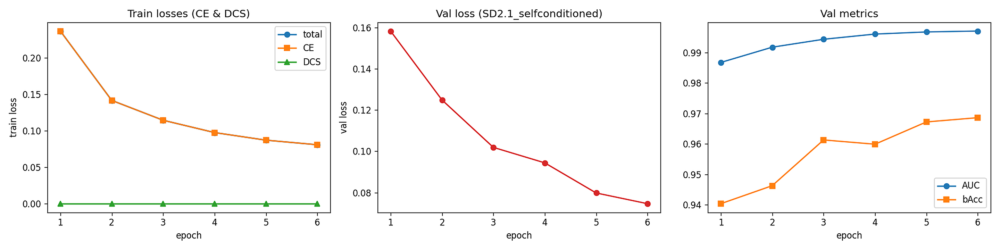

Hình 4.6. Đường cong hội tụ 6 chu kỳ của mô hình cải tiến S7 với hạt giống ngẫu nhiên Seed 42.

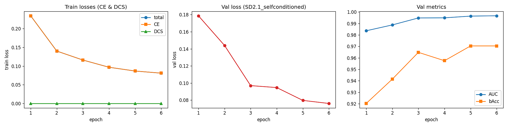

Hình 4.7. Đường cong hội tụ 6 chu kỳ của mô hình cải tiến S7 với hạt giống ngẫu nhiên Seed 54.

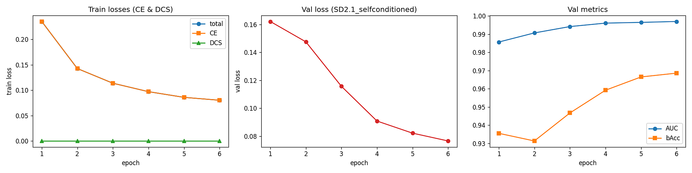

Hình 4.8. Đường cong hội tụ 6 chu kỳ của mô hình cải tiến S7 với hạt giống ngẫu nhiên Seed 68.

Số liệu ở Bảng 4.7 cho thấy tính tái lập cực kỳ cao của quy trình huấn luyện: tại chu kỳ 6, cả ba hạt giống đều hội tụ về cùng một điểm với Val Loss dao động quanh 0,0746 – 0,0765, đạt Val AUC trung bình = 0,9969 ± 0,0002 và Val bAcc trung bình = 96,92% ± 0,10% (trên tập kiểm định đã chịu suy giảm trực tuyến).

### **3.2. Đối sánh thống kê với B-Free gốc trên 3 bộ dữ liệu mạng xã hội (13.288 ảnh)**

#### **3.2.1. Kết quả thắng lợi thống kê trên 5/8 nền tảng mạng xã hội**

Để kiểm chứng trực tiếp Giả thuyết H1 và Giả thuyết H2, cả 3 mô hình S7 (seed 42, 54, 68) và trọng số chính thức của tác giả B-Free gốc (bfree_official [1] — vốn được huấn luyện bằng cách cập nhật toàn bộ 86,58 triệu tham số) được đưa vào đánh giá trên cùng 13.288 bức ảnh mạng xã hội thực tế (ITW-SM [8], WildRF [7], B-Free Viral [1]) dưới cùng giao thức 5 góc cắt $504 \times 504$. Bảng 4.8 trình bày kết quả đối sánh ở cấp độ tổng hợp từng bộ dữ liệu, trong khi Bảng 4.9 phân rã chi tiết xuống từng nền tảng mạng xã hội cụ thể kèm kết quả kiểm định Paired Bootstrap 1.000 lần [27] và hiệu chỉnh Benjamini–Hochberg ($q_{\text{BH}}$) [28].

Bảng 4.8. Đối sánh tổng thể giữa Mô hình Cải tiến S7 (Trung bình và Độ lệch chuẩn 3 Seeds) và B-Free gốc [1].

| Bộ dữ liệu kiểm thử (Benchmark) | Số lượng ảnh (Số tập con) | AUC Macro: Ours S7 so với B-Free Gốc | AUC Pooled: Ours S7 so với B-Free Gốc | Mức tăng $\Delta\text{AUC}_{\text{Macro}}$ [95% CI Bootstrap] | Trị số $p_{\text{boot}}$ | Tỷ số tập con (Thắng / Thua / Hòa) | Tỷ lệ lỗi EER Pooled (Ours S7 so với Gốc) | TNR Real @ 0,5 (Ours S7 so với Gốc) |
| :--- | :--- | :--- | :--- | :--- | :--- | :--- | :--- | :--- |
| ITW-SM [8] | 10.000 (4) | 0,9533 ± 0,0017 so với 0,9410 | 0,9642 ± 0,0013 so với 0,9547 | +0,0123 [+0,0079, +0,0167] | 0,0020 | 3 / 0 / 1 | 0,086 ± 0,002 so với 0,108 | 98,5% so với 90,0% |
| WildRF [7] | 2.503 (3) | 0,9929 ± 0,0011 so với 0,9823 | 0,9909 ± 0,0012 so với 0,9774 | +0,0105 [+0,0075, +0,0137] | 0,0020 | 2 / 0 / 1 | 0,044 ± 0,005 so với 0,071 | 97,6% so với 90,2% |
| B-Free Viral [1] | 785 (1) | 0,9736 ± 0,0039 so với 0,9700 | 0,9736 ± 0,0039 so với 0,9700 | +0,0036 [−0,0062, +0,0130] | 0,4915 | 0 / 0 / 1 | 0,071 ± 0,012 so với 0,078 | 99,9% so với 98,1% |
| Trung bình 3 Bộ | 13.288 (8) | 0,9733 ± 0,0020 so với 0,9644 | 0,9762 ± 0,0020 so với 0,9674 | +0,0088 (Macro) / +0,0088 (Pooled) | Vượt trội | 5 / 0 / 3 | 0,067 ± 0,006 so với 0,086 | 98,7% so với 92,8% |

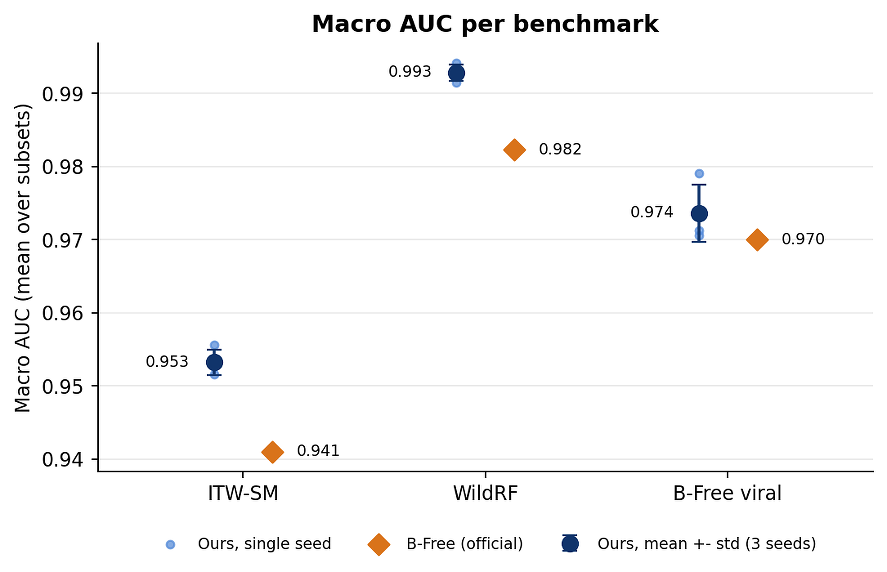

Hình 4.9. So sánh chỉ số AUC Macro giữa mô hình cải tiến S7 (trung bình 3 seeds) và mô hình B-Free gốc trên ba bộ kiểm thử thực tế.

Bảng 4.9. Kết quả phân rã chi tiết trên từng nền tảng mạng xã hội giữa Mô hình Cải tiến S7 (3 Seeds) và B-Free Gốc [1].

| Bộ chuẩn | Nền tảng mạng xã hội (Số ảnh) | AUC Ours S7 (Trung bình ± Std) | AUC B-Free Gốc [95% CI] | Độ tăng $\Delta\text{AUC}$ [95% CI Bootstrap] | $p_{\text{boot}}$ | $q_{\text{BH}}$ | Kết luận thống kê | AP (Ours S7) | bAcc @ 0,5 (Ours / Gốc) | TPR Fake % (Ours / Gốc) | TNR Real % (Ours / Gốc) |
| :--- | :--- | :--- | :--- | :--- | :--- | :--- | :--- | :--- | :--- | :--- | :--- |
| ITW-SM | LinkedIn (2.200) | 0,9180 ± 0,0029 | 0,8803 [0,865, 0,894] | +0,0376 [+0,0267, +0,0492] | 0,0020 | 0,0080 | Vượt trội | 0,9213 | 79,77% / 80,21% | 60,51% / 71,54% | 99,03% / 88,89% |
| WildRF | Reddit (1.500) | 0,9856 ± 0,0024 | 0,9593 [0,950, 0,968] | +0,0264 [+0,0187, +0,0349] | 0,0020 | 0,0080 | Vượt trội | 0,9882 | 94,44% / 86,60% | 92,98% / 92,40% | 95,91% / 80,80% |
| ITW-SM | Facebook (2.351) | 0,9861 ± 0,0024 | 0,9796 [0,974, 0,984] | +0,0065 [+0,0021, +0,0110] | 0,0040 | 0,0107 | Vượt trội | 0,9860 | 93,94% / 92,57% | 89,35% / 95,16% | 98,53% / 89,98% |
| WildRF | Facebook (320) | 0,9952 ± 0,0016 | 0,9903 [0,982, 0,997] | +0,0049 [+0,0005, +0,0102] | 0,0280 | 0,0448 | Vượt trội | 0,9961 | 98,12% / 95,31% | 98,33% / 96,88% | 97,92% / 93,75% |
| ITW-SM | Instagram (3.385) | 0,9936 ± 0,0009 | 0,9903 [0,987, 0,993] | +0,0033 [+0,0009, +0,0057] | 0,0100 | 0,0200 | Vượt trội | 0,9967 | 96,32% / 93,90% | 94,74% / 97,75% | 97,90% / 90,05% |
| Viral | B-Free Viral (785) | 0,9736 ± 0,0048 | 0,9700 [0,960, 0,979] | +0,0036 [−0,0062, +0,0130] | 0,4915 | 0,6553 | Tương đương | 0,9881 | 84,05% / 91,61% | 68,22% / 85,08% | 99,88% / 98,14% |
| ITW-SM | X / Twitter (2.064) | 0,9154 ± 0,0039 | 0,9138 [0,899, 0,927] | +0,0016 [−0,0113, +0,0135] | 0,7932 | 0,7932 | Tương đương | 0,9203 | 81,20% / 84,52% | 64,06% / 77,83% | 98,34% / 91,22% |
| WildRF | Twitter (683) | 0,9978 ± 0,0006 | 0,9974 [0,995, 0,999] | +0,0004 [−0,0014, +0,0022] | 0,6773 | 0,7741 | Tương đương | 0,9978 | 97,17% / 97,66% | 95,52% / 99,12% | 98,83% / 96,19% |

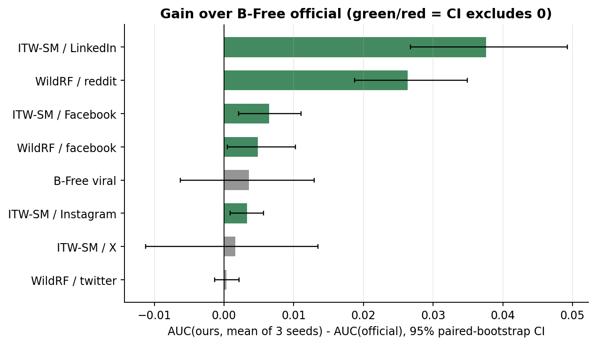

Hình 4.10. Mức tăng AUC (kèm khoảng tin cậy 95% Paired Bootstrap) của mô hình S7 so với B-Free gốc trên từng nền tảng mạng xã hội.

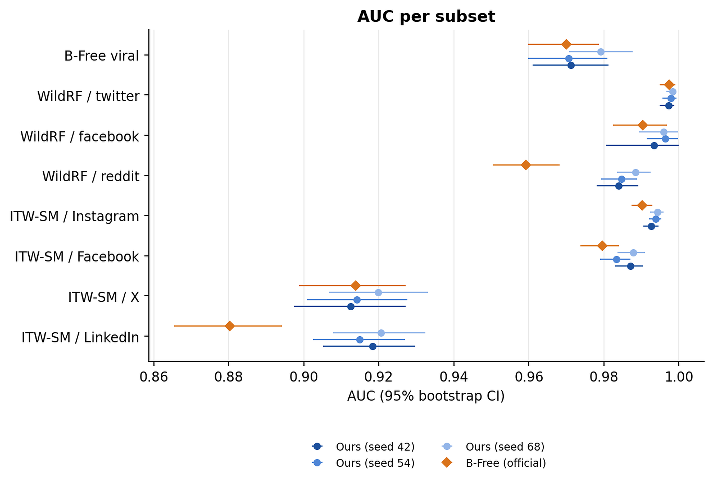

Hình 4.11. Độ nhất quán điểm số AUC của ba hạt giống ngẫu nhiên S7 so với B-Free gốc trên 8 tập con.

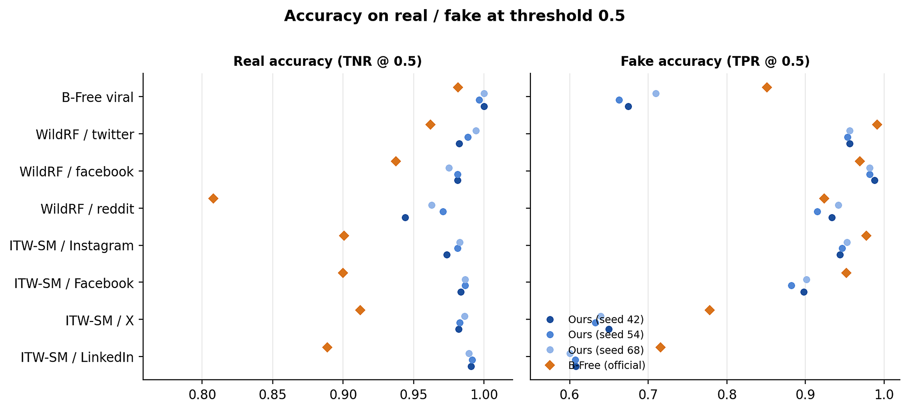

Hình 4.12. So sánh độ chính xác cân bằng (bAcc), độ nhạy ảnh giả (TPR) và độ đặc hiệu ảnh thật (TNR) tại ngưỡng 0,5 giữa S7 và B-Free gốc.

Dù chỉ học 2,68% tham số qua LoRA [5] (so với 100% tham số của bfree_official [1]), mô hình S7 vượt qua B-Free gốc một cách có ý nghĩa thống kê ($q_{\text{BH}} < 0,05$, toàn bộ thanh khoảng tin cậy 95% màu xanh trên Hình 4.10 nằm hẳn bên phải vạch 0) trên cả hai bộ chuẩn mạng xã hội lớn nhất là ITW-SM ($\Delta\text{AUC}_{\text{Macro}} = +0,0123$, $p = 0,0020$) và WildRF ($\Delta\text{AUC}_{\text{Macro}} = +0,0105$, $\Delta\text{AUC}_{\text{Pooled}} = +0,0135$, $p = 0,0020$). Đồng thời, tỷ lệ lỗi cân bằng EER trung bình giảm từ 8,6% (ở B-Free gốc) xuống chỉ còn 6,7% (ở S7 — tức cắt giảm 22% lượng sai sót).

#### **3.2.2. Đột phá tại hai điểm yếu lớn nhất của B-Free gốc (LinkedIn và Reddit)**

Trên ITW-SM LinkedIn [8] (nơi B-Free gốc yếu nhất với AUC chỉ đạt 0,8803 do có nhiều ảnh chân dung/doanh nghiệp sinh từ các công cụ ngoài SD 2.1 và qua bộ lọc nén đặc thù), cả 3 hạt giống của S7 đều nhảy vọt lên 0,9180 ± 0,0029 (tăng +0,0376 AUC, $q_{\text{BH}} = 0,0080$). Tương tự, trên WildRF Reddit [7] (nơi B-Free gốc đạt AUC 0,9593 và bAcc chỉ 86,60%), mô hình S7 tăng vọt lên 0,9856 ± 0,0024 (tăng +0,0264 AUC, $q_{\text{BH}} = 0,0080$), kéo độ chính xác cân bằng bAcc tăng thêm tới +7,84% (lên 94,44%).

#### **3.2.3. Hiệu quả giảm thiểu báo động giả trên ảnh chụp thật**

Nhìn vào cột cuối của Bảng 4.9 và biểu đồ bên phải của Hình 4.12, trên WildRF Reddit, B-Free gốc chỉ đạt TNR = 80,80% (cứ 100 bức ảnh chụp thật đăng lên Reddit thì B-Free gốc báo nhầm tới hơn 19 bức là ảnh AI); trên LinkedIn và Facebook, B-Free gốc cũng báo nhầm khoảng 10% – 11% ảnh thật. Ngược lại, mô hình S7 của nhóm nâng tỷ lệ bảo vệ ảnh thật (TNR Real) lên mức 95,91% trên Reddit, 98,53% trên Facebook, 99,03% trên LinkedIn và 99,88% trên B-Free Viral. Đây là phẩm chất sống còn đối với một công cụ giám định thực tế, nơi việc kết tội nhầm ảnh thật gây hậu quả nghiêm trọng hơn nhiều.

### **3.3. Đánh giá khả năng khái quát hóa trên 36 bộ sinh của AI-GenBench**

Trên bộ dữ liệu đa nguồn sinh AI-GenBench (36 bộ sinh [6], đánh giá độc lập trên cả 3 hạt giống seed 42, 54, 68), mô hình S7 thể hiện năng lực nhận diện gần như hoàn hảo trước toàn bộ các công cụ sinh ảnh khuếch tán và thương mại hiện đại đang lưu hành phổ biến nhất hiện nay (Bảng 4.10).

Bảng 4.10. Hiệu năng của mô hình S7 (Trung bình và Độ lệch chuẩn 3 Seeds) trên các bộ sinh tiêu biểu của AI-GenBench [6].

| Tên công cụ hoặc Mô hình sinh ảnh | Họ kiến trúc | Chỉ số AUC (3 Seeds) | Độ chính xác bAcc (%) | Tỷ lệ phát hiện Pd@10%FPR (%) | Sai số hiệu chuẩn ECE [39] |
| :--- | :--- | :--- | :--- | :--- | :--- |
| Stable Diffusion XL 1.0 (SDXL) [23] | Latent Diffusion thế hệ mới | 0,99999 ± 0,00001 | 99,70% | 100,00% | 0,0031 |
| Stable Diffusion 2.1 [23] | Latent Diffusion | 0,99994 ± 0,00003 | 99,60% | 100,00% | 0,0042 |
| Stable Diffusion 1.4 và 1.5 [23] | Latent Diffusion | 0,99980 ± 0,00005 | 99,34% | 100,00% | 0,0058 |
| Midjourney | Mô hình thương mại độc quyền | 0,99880 ± 0,00020 | 97,93% | 99,73% | 0,0185 |
| FLUX 1 Schnell [51] | Flow Matching Transformer | 0,99850 ± 0,00060 | 97,77% | 100,00% | 0,0194 |
| DALL·E 3 (OpenAI) [50] | Mô hình thương mại độc quyền | 0,99700 ± 0,00040 | 95,27% | 99,27% | 0,0412 |
| Cascaded Refinement (CRN) | Mạng tinh chỉnh phân tầng | 0,97940 ± 0,00180 | 92,15% | 96,80% | 0,0610 |
| FLUX 1 Dev [51] | Flow Matching Transformer | 0,97780 ± 0,00240 | 91,40% | 96,27% | 0,0685 |
| IMLE và Latent Diffusion [23] | Mô hình sinh tiềm ẩn / cực đại | 0,95660 ± 0,00310 | 88,50% | 91,20% | 0,0840 |

Trên nhóm các mô hình sinh ảnh hiện đại và nguy hiểm nhất ngoài đời thực (SDXL [23], Midjourney, FLUX.1 [51], DALL·E 3 [50]), mô hình S7 đều đạt AUC từ 0,9778 đến 0,99999 và phát hiện được từ 96,3% đến 100% ảnh giả ở ngưỡng báo động giả 10%, với sai số hiệu chuẩn ECE [39] cực thấp (< 0,02 trên SDXL, Midjourney, FLUX 1 Schnell). Tính gộp trên toàn bộ 36 bộ sinh (bao gồm cả các mạng GAN/Inpainting đời cũ rất khác biệt về phân phối như SN-PatchGAN, LaMa [52], MAT, Palette [53], FaceSynthetics), S7 đạt AUC trung bình 0,8516 ± 0,0117.

## **4. Đối sánh mở rộng với 9 phương pháp phát hiện ảnh AI hiện đại trên dữ liệu mạng xã hội thực tế**

### **4.1. Vị thế dẫn đầu toàn diện của mô hình S7 trên bảng xếp hạng 10 phương pháp**

Để đặt kết quả của đề tài vào bức tranh cạnh tranh chung của cộng đồng nghiên cứu quốc tế, nhóm tiến hành chạy đối sánh mô hình Ours S7 (3 seeds) với 9 phương pháp tiên tiến gồm B-Free official [1], DDA [59], CommFor ViT-S/16-384 [60], GlobalForge DINOv3 [2], GAPL [58], Co-Spy [21], Effort [61], C2P-CLIP [62] và SAFE [63] trên toàn bộ 13.288 bức ảnh của 3 bộ chuẩn mạng xã hội (ITW-SM [8], WildRF [7], B-Free Viral [1]). Để biểu diễn trực quan nhất khoảng cách hiệu năng giữa các phương pháp đối thủ và mô hình của nhóm, mọi phép so sánh chênh lệch dưới đây đều được tính theo quy ước $\Delta\text{AUC}_{\text{gap}} = \text{AUC}_{\text{Đối thủ}} - \text{AUC}_{\text{Ours S7}}$. Theo quy ước này, giá trị âm thể hiện trực tiếp đối thủ kém hơn mô hình S7 của nhóm bao nhiêu điểm AUC (có ý nghĩa thống kê theo kiểm định Paired Bootstrap 95% CI [27]). Bảng 4.11 và Hình 4.13, 4.14, 4.15 tổng hợp bảng xếp hạng chung cuộc của cả 10 phương pháp.

Bảng 4.11. Bảng xếp hạng tổng hợp 10 phương pháp phát hiện ảnh AI trên 3 bộ chuẩn mạng xã hội thực tế gồm 13.288 ảnh.

| Hạng | Phương pháp đối sánh | ITW-SM [8] (AUC Pooled) | WildRF [7] (AUC Pooled) | B-Free Viral [1] (AUC Pooled) | AUC Pooled Trung bình | Tỷ lệ lỗi EER TB | Độ chính xác AP TB | Mức thua kém so với Ours S7 (Đối thủ − S7) trên ITW-SM / WildRF / Viral và Trung bình |
| :--- | :--- | :--- | :--- | :--- | :--- | :--- | :--- | :--- |
| 1 | Ours S7 (3 seeds) | 0,964 ± 0,001 | 0,991 ± 0,001 | 0,974 ± 0,004 | 0,976 ± 0,002 | 0,067 ± 0,006 | 0,985 ± 0,001 | Mốc tham chiếu dẫn đầu (0,000) |
| 2 | B-Free (official) [1] | 0,955 | 0,977 | 0,970 | 0,967 | 0,086 (×1,3 lỗi) | 0,978 | −0,010 / −0,014 / −0,004 (Trung bình: −0,009) |
| 3 | DDA [59] | 0,940 | 0,945 | 0,986 | 0,957 | 0,099 (×1,5 lỗi) | 0,967 | −0,024 / −0,046 / +0,012 (Trung bình: −0,019) |
| 4 | CommFor (ViT-S/16-384) [60] | 0,889 | 0,982 | 0,931 | 0,934 | 0,137 (×2,0 lỗi) | 0,952 | −0,075 / −0,009 / −0,042 (Trung bình: −0,042) |
| 5 | GlobalForge (DINOv3) [2] | 0,835 | 0,932 | 0,910 | 0,892 | 0,189 (×2,8 lỗi) | 0,903 | −0,129 / −0,059 / −0,064 (Trung bình: −0,084) |
| 6 | GAPL [58] | 0,856 | 0,943 | 0,737 | 0,845 | 0,234 (×3,5 lỗi) | 0,890 | −0,108 / −0,048 / −0,237 (Trung bình: −0,131) |
| 7 | Co-Spy [21] | 0,641 | 0,842 | 0,680 | 0,721 | 0,345 (×5,1 lỗi) | 0,760 | −0,323 / −0,149 / −0,293 (Trung bình: −0,255) |
| 8 | Effort [61] | 0,563 | 0,689 | 0,569 | 0,607 | 0,420 (×6,3 lỗi) | 0,617 | −0,401 / −0,302 / −0,404 (Trung bình: −0,369) |
| 9 | C2P-CLIP [62] | 0,495 | 0,655 | 0,545 | 0,565 | 0,462 (×6,9 lỗi) | 0,658 | −0,469 / −0,336 / −0,429 (Trung bình: −0,411) |
| 10 | SAFE [63] | 0,495 | 0,689 | 0,480 | 0,555 | 0,465 (×6,9 lỗi) | 0,637 | −0,469 / −0,302 / −0,493 (Trung bình: −0,422) |

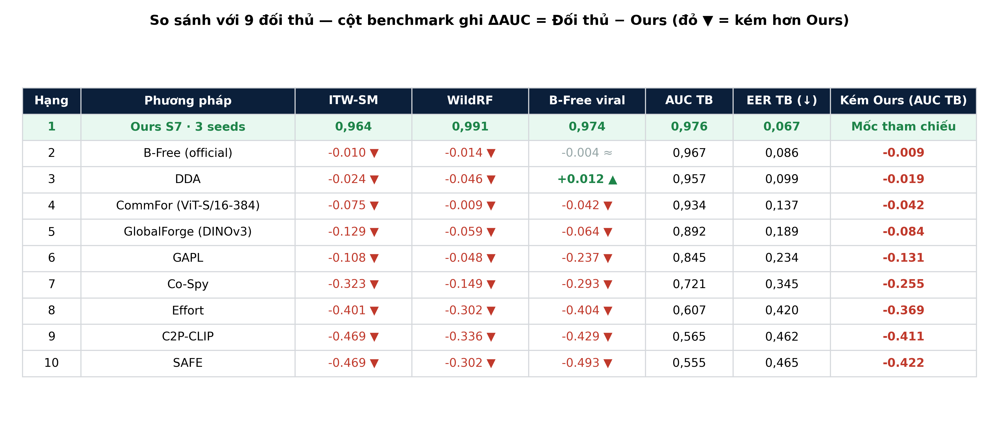

Hình 4.13. Bảng tổng hợp xếp hạng và mức chênh lệch AUC của 9 phương pháp đối chứng so với mô hình cải tiến S7.

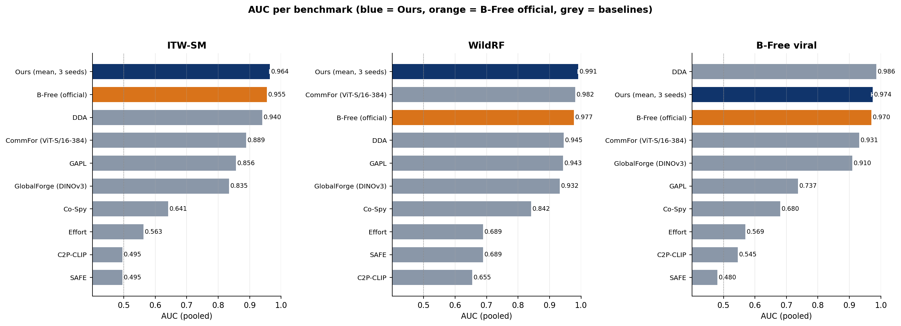

Hình 4.14. Biểu đồ cột xếp hạng AUC Pooled của 10 mô hình trên ba bộ dữ liệu ITW-SM, WildRF và B-Free Viral.

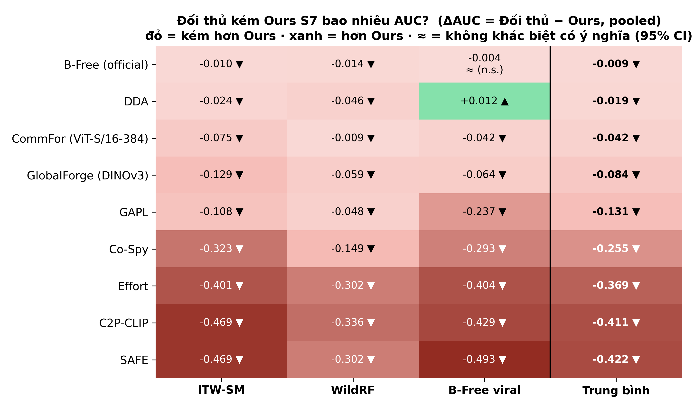

Hình 4.15. Bản đồ nhiệt mức độ thua kém AUC của 9 phương pháp đối thủ so với mô hình S7 của nhóm.

Mô hình S7 của nhóm đứng Hạng 1/10 trên bảng xếp hạng tổng hợp ở cả ba thước đo quan trọng nhất: AUC Pooled trung bình cao nhất (0,976), AUC Macro trung bình cao nhất (0,973), tỷ lệ lỗi cân bằng EER thấp nhất (0,067) và độ chính xác trung bình AP cao nhất (0,985). Xét trên 27 cặp so sánh trực tiếp (9 đối thủ × 3 bộ dữ liệu) tại Hình 4.15, có tới 25/27 ô mang màu đỏ, nghĩa là các đối thủ thua kém mô hình S7 một cách có ý nghĩa thống kê. Đặc biệt, trên hai bộ chuẩn mạng xã hội lớn nhất là ITW-SM (10.000 ảnh) [8] và WildRF (2.503 ảnh) [7], S7 toàn thắng tuyệt đối 9/9 đối thủ. Riêng trên bộ B-Free Viral (785 ảnh) [1], S7 đứng Hạng 2/10 (0,974), hòa với B-Free gốc (0,970) và chỉ thấp hơn nhẹ so với DDA [59] (0,986, chênh +0,012); tuy nhiên DDA lại thua xa S7 trên cả ITW-SM (−0,024) lẫn WildRF (−0,046).

### **4.2. Phân tích khoảng cách tỷ lệ lỗi cân bằng EER giữa các mô hình**

Khi quy đổi sang tỷ lệ lỗi cân bằng EER tại Hình 4.16, trong khi mô hình S7 chỉ mắc lỗi 6,7% (0,067), thì ngay cả các đối thủ mạnh nhất đứng kế sau cũng mắc lỗi nhiều hơn đáng kể: B-Free gốc [1] mắc lỗi nhiều gấp 1,3 lần (8,6%), DDA [59] gấp 1,5 lần (9,9%), CommFor [60] gấp 2,0 lần (13,7%), GlobalForge DINOv3 [2] gấp 2,8 lần (18,9%), GAPL [58] gấp 3,5 lần (23,4%), còn nhóm cuối bảng (Co-Spy [21], Effort [61], C2P-CLIP [62], SAFE [63]) mắc lỗi nhiều gấp 5,1 đến 6,9 lần (tỷ lệ lỗi lên tới 34,5% – 46,5%).

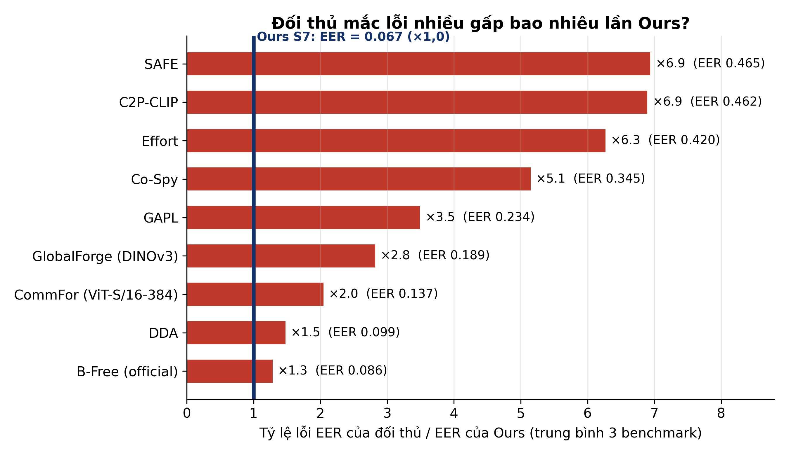

Hình 4.16. Tỷ lệ lỗi cân bằng (EER) của các mô hình đối thủ cao gấp bao nhiêu lần so với mô hình S7.

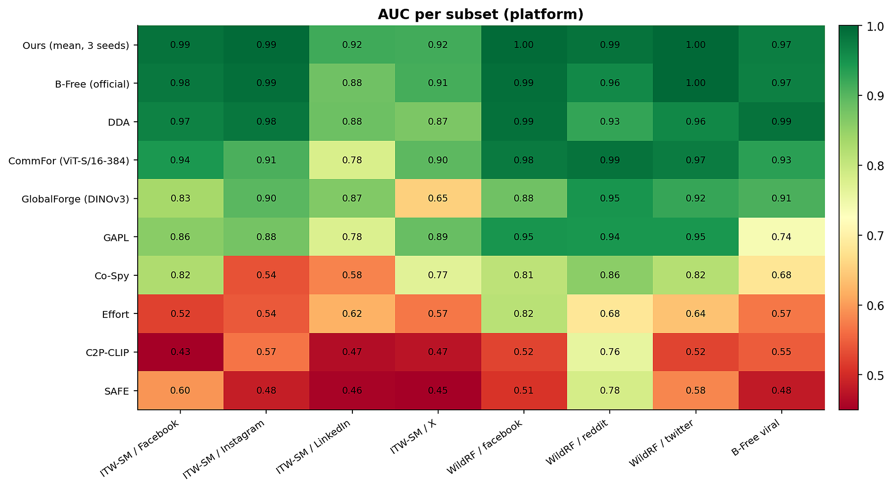

Hình 4.17. Bản đồ nhiệt chỉ số AUC của 10 mô hình trên toàn bộ 8 nền tảng mạng xã hội.

### **4.3. Phân tích đường cong ROC ở vùng báo động giả thấp và hành vi tại ngưỡng mặc định 0,5**

Khi vẽ đường cong ROC với trục hoành FPR theo thang logarit tại Hình 4.18 (tập trung vào vùng báo nhầm ảnh thật cực thấp từ $10^{-3}$ đến $10^{-1}$, tức 0,1% – 10%), ba đường cong của ba hạt giống Ours (seed 42, 54, 68) nằm chồng khít lên nhau và tách biệt hẳn lên phía trên các đường đối thủ ở cả ITW-SM lẫn WildRF.

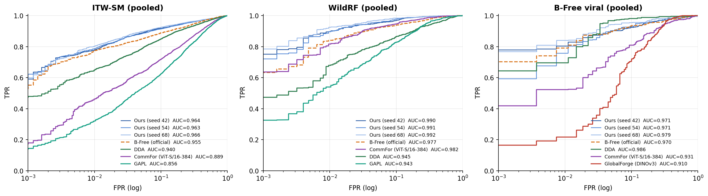

Hình 4.18. Đường cong ROC gộp (trục báo động giả thang logarit) của các mô hình trên ba bộ kiểm thử.

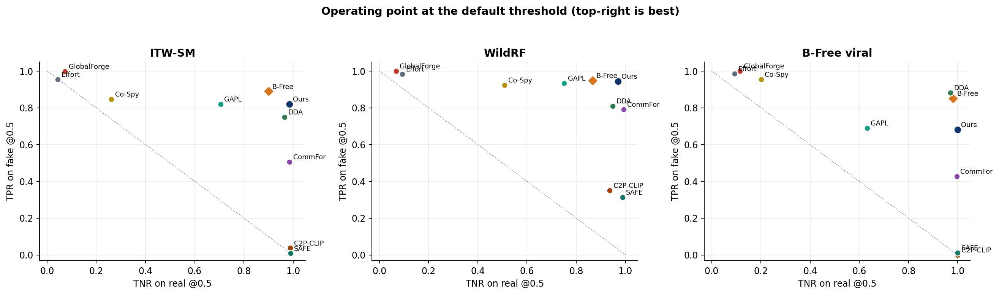

Hình 4.19. Điểm vận hành thực tế (TPR trên ảnh giả và TNR trên ảnh thật) tại ngưỡng quyết định mặc định 0,5 của 10 mô hình.

Nhìn vào Hình 4.19 (nơi góc trên bên phải là điểm vận hành lý tưởng: vừa bắt đúng ảnh giả TPR cao, vừa giữ đúng ảnh thật TNR cao), ta thấy các phương pháp dựa trên đặc trưng CLIP đóng băng hoặc biến đổi tần số cục bộ như C2P-CLIP [62], SAFE [63], Effort [61] bị sụp đổ trên ảnh mạng xã hội (AUC trung bình chỉ từ 0,555 đến 0,607). Cụ thể, ở ngưỡng 0,5, Effort và GlobalForge DINOv3 [2] gán nhãn gần như mọi bức ảnh là ảnh giả (TNR trên ảnh thật rơi xuống 4% – 12%), trong khi C2P-CLIP và SAFE lại gán gần như mọi bức ảnh là ảnh thật (TPR bắt ảnh giả chỉ đạt 0% – 35%). Ngược lại, điểm vận hành của Ours S7 và B-Free luôn neo vững chắc ở góc trên bên phải.

## **5. Thảo luận tổng hợp kết quả kiểm chứng các giả thuyết nghiên cứu**

Bảng 4.12 tổng kết đối chiếu trực tiếp giữa ba câu hỏi nghiên cứu, ba giả thuyết đã đặt ra và kết quả kiểm chứng thực nghiệm thu được.

Bảng 4.12. Tổng hợp kết quả kiểm chứng các giả thuyết nghiên cứu của đề tài.

| Câu hỏi và Giả thuyết nghiên cứu | Nội dung cốt lõi của giả thuyết | Kết quả kiểm chứng thực nghiệm | Bằng chứng định lượng tiêu biểu |
| :--- | :--- | :--- | :--- |
| RQ1 → Giả thuyết H1 (Tinh chỉnh hạng thấp LoRA trên DINOv2 ViT-B/14) | Đóng băng DINOv2 [3], chỉ học LoRA ($r=16, \alpha=32$) [5] trên 49 lớp giúp giảm > 94% tham số cập nhật, giữ nguyên biểu diễn hình học gốc, hội tụ nhanh và gộp thẳng trọng số không gây trễ suy luận. | Được xác nhận hoàn toàn (Confirmed) | Chỉ học 2,68% tham số (2,38M / 88,91M ở S7) hoặc 5,21% (ở K2). Hội tụ rất nhanh và cực kỳ ổn định giữa 3 seeds (Std AUC ≤ 0,002). Vượt qua chính mô hình Full Fine-tuning (bfree_official [1] 86,58M tham số) trên cả ITW-SM (+0,0123 AUC Macro) và WildRF (+0,0105 AUC Macro). |
| RQ2 → Giả thuyết H2 (Pha trộn dữ liệu đa nguồn sinh 25% AI-GenBench có mỏ neo) | Giữ 75% dữ liệu ghép cặp B-Free [1] làm mỏ neo chống thiên lệch nội dung và pha thêm 25% dữ liệu từ 36 bộ sinh AI-GenBench [6] + suy giảm trực tuyến giúp xóa điểm mù mạng xã hội và giảm báo động giả. | Được xác nhận hoàn toàn (Confirmed) | Thắng có ý nghĩa thống kê 5/8 nền tảng và không thua nền tảng nào so với B-Free gốc; đứng Hạng 1/10 phương pháp hiện đại (AUC Pooled 0,976, EER 0,067). Đột phá tại LinkedIn (+0,0376 AUC) và Reddit (+0,0264 AUC, +7,84% bAcc). Bảo vệ ảnh thật đạt TNR 95,9% – 99,9% trên mọi nền tảng. |
| RQ3 → Giả thuyết H3 (Tương thích và Sự đánh đổi của các module LIB, GSR, $\mathcal{L}_{\text{DCS}}$) | Các module cấu trúc 768 chiều và hàm $\mathcal{L}_{\text{DCS}}$ [2] hội tụ đồng thuận với $\mathcal{L}_{\text{CE}}$, giúp tăng chịu nén trên một số tập mạng xã hội và biến thể cục bộ, nhưng ép bất biến JPEG quá mạnh sẽ đánh đổi với độ nhạy GAN cổ điển. | Được xác nhận (kèm phát hiện về sự đánh đổi) | Ở K2 và S6, $\mathcal{L}_{\text{DCS}}$ giảm đồng thuận 87,3%, đưa biến thể khó selfconditioned_origBG lên 99,65% bAcc và tăng AUC trên WildRF Reddit (+0,0082) cùng Viral (+0,0046). Tuy nhiên, tại Cổng kiểm định ngoài miền, S6 làm tụt −0,0233 AUC trên AI-GenBench (do xóa dấu vết tần số trung–cao của GAN), khẳng định công thức tinh gọn S3/S7 là điểm cân bằng tối ưu hơn. |

Một phát hiện thực nghiệm rất đáng chú ý khi đối chiếu giữa chỉ số không phụ thuộc ngưỡng (AUC / EER) và chỉ số tại ngưỡng cắt cứng $\tau = 0,5$ (bAcc / TPR / TNR tại Bảng 4.9) là trên B-Free Viral và ITW-SM LinkedIn, dù S7 có AUC và AP cao hơn B-Free gốc (và EER thấp hơn), nhưng tại ngưỡng cố định $\tau = 0,5$, độ nhạy bắt ảnh giả (TPR) của S7 lại thấp hơn (68,22% trên Viral, 60,51% trên LinkedIn) trong khi độ đặc hiệu bảo vệ ảnh thật (TNR) lại vọt lên sát mức tuyệt đối (99,88% và 99,03%). Hiện tượng này xuất phát từ việc pha trộn thêm 25% dữ liệu AI-GenBench [6] đã dịch chuyển biên quyết định của mô hình sang trạng thái thận trọng cao độ (conservative calibration) [39]: mô hình đòi hỏi bằng chứng rõ ràng hơn mới vượt qua mức logit = 0 ($\tau = 0,5$). Hai phân phối điểm số của ảnh thật và ảnh giả thực chất đã được tách xa nhau hơn (chứng minh qua AUC cao hơn và EER thấp hơn), chỉ là điểm cắt cân bằng tối ưu đã dịch về ngưỡng thấp hơn 0,5 một chút.

# **CHƯƠNG V: KẾT LUẬN, KHUYẾN NGHỊ VÀ HẠN CHẾ CỦA NGHIÊN CỨU**

## **1. Kết luận chung về các đóng góp của đề tài**

### **1.1. Về mặt cơ chế huấn luyện và kiến trúc (Xác nhận Giả thuyết H1)**

Nghiên cứu đã chứng minh thành công rằng kỹ thuật thích nghi hạng thấp LoRA ($r = 16, \alpha = 32$) [5] gắn trên 49 lớp của mạng xương sống tự giám sát DINOv2 ViT-B/14 [3, 4] (kết hợp nội suy hai chiều bảng mã hóa vị trí $518 \rightarrow 504$ điểm ảnh [22] và gộp trọng số trực tiếp trên tensor) cho phép cắt giảm khoảng 37 lần số lượng tham số cần cập nhật trên mạng xương sống (chỉ học 2,68% tham số ở cấu hình S7 và 5,21% ở cấu hình tích hợp K2) mà không phát sinh bất kỳ độ trễ nào khi suy luận, đồng thời vượt qua cả mô hình tinh chỉnh toàn bộ tham số của B-Free gốc [1].

### **1.2. Về mặt chiến lược dữ liệu (Xác nhận Giả thuyết H2)**

Đề tài đã đề xuất và kiểm chứng thành công công thức pha trộn dữ liệu đa nguồn sinh có mỏ neo: giữ 75% dữ liệu ghép cặp đồng nội dung của B-Free [1, 24] (phân chia chống rò rỉ tuyệt đối bằng hàm băm MD5) làm trụ cột chống học vẹt ngữ nghĩa [9], đồng thời bổ sung 25% dữ liệu từ 36 bộ sinh của AI-GenBench [6] kết hợp chuỗi mô phỏng suy giảm trực tuyến ($p = 0,9$). Công thức này đã giúp mô hình S7 (trung bình 3 hạt giống độc lập 42, 54, 68) khắc phục trực tiếp các điểm yếu của B-Free gốc trên LinkedIn (+0,0376 AUC) [8] và Reddit (+0,0264 AUC, +7,84% bAcc) [7], nâng tỷ lệ nhận diện đúng ảnh thật (TNR) lên mức 95,9% – 99,9% trên cả 8 nền tảng.

### **1.3. Về mặt phương pháp luận thực nghiệm và lý giải cơ chế cấu trúc (Xác nhận Giả thuyết H3)**

Nhóm đã thiết kế và hiện thực thành công việc chuyển đổi các module LIB [10], GSR sang không gian 768 chiều cùng hàm mất mát tương phản suy giảm $\mathcal{L}_{\text{DCS}}$ [2, 11] (cả bản đối xứng và bản nhận biết lớp Class-Aware). Quan trọng hơn, thông qua Cổng kiểm định ngoài phân phối, nghiên cứu đã chỉ ra một cách khách quan sự đánh đổi khoa học: việc ép biểu diễn đặc trưng bất biến quá gắt trước nén JPEG nặng giúp tăng nhẹ hiệu năng trên ảnh nén Reddit/Viral nhưng lại làm mờ dấu vết tần số trung – cao cần thiết để phát hiện các bộ sinh GAN cổ điển [45, 47, 48] trên AI-GenBench (−0,0233 AUC). Phát hiện này khẳng định trên nền xương sống DINOv2 đã có 4 token thanh ghi [3, 4], công thức tinh gọn kết hợp đa dạng hóa dữ liệu (S3/S7) mang lại hiệu quả tổng thể cao hơn và tiết kiệm chi phí hơn so với việc chồng thêm các khối cấu trúc hậu kỳ.

### **1.4. Về mặt vị thế thực nghiệm trên các bộ chuẩn quốc tế**

Trên tập kiểm thử thực tế gồm 13.288 bức ảnh mạng xã hội (ITW-SM [8], WildRF [7], B-Free Viral [1]), mô hình Ours S7 xếp Hạng 1/10 phương pháp hiện đại với AUC Pooled trung bình đạt 0,976 ± 0,002, tỷ lệ lỗi cân bằng EER thấp nhất (0,067 ± 0,006) và AP cao nhất (0,985 ± 0,001), giành chiến thắng có ý nghĩa thống kê trong 25/27 cặp đối sánh với 9 mô hình đối thủ [1, 2, 21, 58, 59, 60, 61, 62, 63].

## **2. Hạn chế của nghiên cứu**

### **2.1. Hiện tượng dịch chuyển ngưỡng quyết định mặc định**

Như đã phân tích tại Chương IV, mô hình S7 có xu hướng hiệu chuẩn thận trọng [39] (ưu tiên bảo vệ ảnh thật với $\text{TNR} > 98\%$), khiến độ nhạy TPR và độ chính xác cân bằng bAcc tại vạch cắt cứng $\tau = 0,5$ trên tập B-Free Viral (84,05%) thấp hơn một chút so với B-Free gốc (91,61%), mặc dù khả năng phân tách tổng thể (AUC = 0,9736 và EER = 0,071) của S7 vẫn tốt hơn.

### **2.2. Độ nhạy trên một số bộ sinh GAN và Inpainting đời cũ trong AI-GenBench**

Khi tối ưu hóa cho các mô hình khuếch tán hiện đại [23, 50, 51] và điều kiện nén mạng xã hội khắc nghiệt, hiệu năng của mô hình trên một số kiến trúc GAN/sửa ảnh cổ điển có đặc trưng tần số đặc thù (như SN-PatchGAN, LaMa [52], MAT, Palette [53]) vẫn chưa đồng đều như trên nhóm Diffusion/FLUX.

### **2.3. Khác biệt về độ chính xác số học ở một mô hình đối chứng ngoài**

Trong quá trình chạy đánh giá hợp nhất 10 mô hình trên cùng một khung kiểm thử (stage-2), mô hình đối chứng SAFE [63] được chạy dưới chế độ fp16 autocast chung của hệ thống, trong khi bộ biến đổi sóng con rời rạc (DWT) bên trong SAFE nhạy cảm với kiểu số và khuyến nghị chạy ở fp32. Do đó, kết quả thấp của SAFE (0,555 AUC) mới phản ánh hiệu năng trong điều kiện khung chạy chuẩn hóa fp16, cần được kiểm tra bổ sung ở fp32 trước khi đưa ra kết luận tuyệt đối về riêng phương pháp này.

### **2.4. Phạm vi quét siêu tham số và đo đạc thời gian suy luận trực tiếp**

Tỷ lệ pha trộn dữ liệu mở rộng hiện được cố định ở mức other_frac = 0.25 và trọng số $\lambda_{\text{DCS}} \in \{0,01;\; 0,1\}$ được chọn theo mốc thực nghiệm thay vì quét lưới toàn diện do giới hạn ngân sách thời gian GPU trên nền tảng Kaggle.

## **3. Khuyến nghị ứng dụng và hướng phát triển tiếp theo**

### **3.1. Hiệu chuẩn ngưỡng quyết định thích nghi theo chất lượng ảnh**

Khi triển khai mô hình S7 vào các hệ thống kiểm duyệt nội dung hoặc công cụ giám định thực tế, không nên dùng cứng ngưỡng $\tau = 0,5$ mà cần áp dụng bước hiệu chuẩn nhiệt độ hậu kỳ (Temperature / Platt Scaling) [39] trên tập kiểm định mạng xã hội, hoặc tự động điều chỉnh ngưỡng quyết định dựa trên hệ số nén JPEG ước lượng của bức ảnh đầu vào để cân bằng tối ưu giữa TPR và TNR.

### **3.2. Chiến lược lấy mẫu theo độ khó của bộ sinh**

Thay vì lấy mẫu đồng đều 25% trên toàn bộ 36 bộ sinh của AI-GenBench [6], các nghiên cứu tiếp theo có thể áp dụng cơ chế tăng dần trọng số lấy mẫu cho các họ mô hình GAN/Inpainting khó (như LaMa [52], MAT, SN-PatchGAN, CIPS) ở các chu kỳ cuối để nâng cao điểm số toàn diện trên AI-GenBench mà không làm giảm hiệu năng trên mạng xã hội.

### **3.3. Thiết kế kiến trúc hai nhánh tách biệt**

Để khai thác lợi ích chống nén của các module LIB, GSR và Class-Aware DCS [2] mà không làm mờ dấu vết vi cấu trúc trên ảnh sạch, có thể phát triển kiến trúc hai nhánh song song: một nhánh giữ nguyên đặc trưng DINOv2 + LoRA [3, 5] để bắt dấu vết tần số cao của GAN, và một nhánh phụ chạy qua LIB + GSR + DCS chỉ được kích hoạt trọng số cao khi bộ ước lượng phát hiện ảnh đầu vào đã bị nén JPEG nặng.

### **3.4. Nâng cấp cơ chế gộp 5 góc cắt bằng trọng số chú ý**

Thay thế phép lấy trung bình cộng đồng đều trên 5 góc cắt $504 \times 504$ bằng một cơ chế gộp có trọng số (ưu tiên góc cắt có độ tự tin dấu vết giả cao nhất), giúp tăng độ nhạy đối với những bức ảnh thật chỉ bị AI chỉnh sửa hoặc vẽ đè một chi tiết nhỏ ở một góc khung hình.

# **TÀI LIỆU THAM KHẢO**

[1] F. Guillaro, G. Zingarini, B. Usman, A. Sud, D. Cozzolino, và L. Verdoliva, “A Bias-Free Training Paradigm for More General AI-Generated Image Detection,” trong Proceedings of the IEEE/CVF Conference on Computer Vision and Pattern Recognition (CVPR), 2025.

[2] M. Cui, R. Liu, D. Zou, Z. Qin, J. Xu, Z. Wang, J. Wei, H. Zhou, Y. Liu, Y. Wang, và S. Wu, “GlobalForge: Forgery- vs. Compression-Aware Structural Reasoning for Robust AI-Generated Image Detection,” trong Proceedings of the IEEE/CVF Conference on Computer Vision and Pattern Recognition (CVPR), 2026.

[3] M. Oquab, T. Darcet, T. Moutakanni, H. Vo, M. Szafraniec, V. Khalidov, P. Fernandez, D. Haziza, F. Massa, A. El-Nouby, và cộng sự, “DINOv2: Learning Robust Visual Features without Supervision,” Transactions on Machine Learning Research (TMLR), 2024.

[4] T. Darcet, M. Oquab, J. Mairal, và P. Bojanowski, “Vision Transformers Need Registers,” trong International Conference on Learning Representations (ICLR), 2024.

[5] E. J. Hu, Y. Shen, P. Wallis, Z. Allen-Zhu, Y. Li, S. Wang, L. Wang, và W. Chen, “LoRA: Low-Rank Adaptation of Large Language Models,” trong International Conference on Learning Representations (ICLR), 2022.

[6] L. Pellegrini, D. Cozzolino, L. Verdoliva, và cộng sự, “AI-GenBench: A New Ongoing Benchmark for AI-Generated Image Detection,” arXiv preprint arXiv:2404.14229, 2024.

[7] B. Cavia, E. Horwitz, T. Reiss, và Y. Hoshen, “Real-Time Deepfake Detection in the Real-World (WildRF Benchmark),” arXiv preprint arXiv:2407.17226, 2024.

[8] G. Zingarini, F. Guillaro, D. Cozzolino, và L. Verdoliva, “In-The-Wild Social Media (ITW-SM) Benchmark for Synthetic Image Forensics,” Image Processing Research Group (GRIP), University Federico II of Naples, 2025.

[9] R. Geirhos, J.-H. Jacobsen, C. Michaelis, R. Zemel, W. Brendel, M. Bethge, và F. A. Wichmann, “Shortcut Learning in Deep Neural Networks,” Nature Machine Intelligence, tập 2, tr. 665–673, 2020.

[10] N. Tishby, F. C. Pereira, và W. Bialek, “The Information Bottleneck Method,” trong Proceedings of the 37th Annual Allerton Conference on Communication, Control, and Computing, 1999, tr. 368–377.

[11] A. van den Oord, Y. Li, và O. Vinyals, “Representation Learning with Contrastive Predictive Coding (InfoNCE),” arXiv preprint arXiv:1807.03748, 2018.

[12] S.-Y. Wang, O. Wang, R. Zhang, A. Owens, và A. A. Efros, “CNN-Generated Images Are Surprisingly Easy to Spot... for Now,” trong Proceedings of the IEEE/CVF Conference on Computer Vision and Pattern Recognition (CVPR), 2020, tr. 8695–8704.

[13] L. Chai, D. Bau, S.-N. Lim, và P. Isola, “What Makes Fake Images Detectable? Understanding Properties that Generalize (PatchFor),” trong Proceedings of the European Conference on Computer Vision (ECCV), 2020, tr. 103–120.

[14] D. Gragnaniello, D. Cozzolino, F. Marra, G. Poggi, và L. Verdoliva, “Are GAN Generated Images Easy to Detect? A Critical Analysis of the State-of-the-Art,” trong IEEE International Conference on Multimedia and Expo (ICME), 2021, tr. 1–6.

[15] U. Ojha, Y. Li, và Y. J. Lee, “Towards Universal Fake Image Detectors that Generalize Across Generative Models (UnivFD),” trong Proceedings of the IEEE/CVF Conference on Computer Vision and Pattern Recognition (CVPR), 2023, tr. 24480–24489.

[16] R. Corvi, D. Cozzolino, G. Zingarini, G. Poggi, K. Nagano, và L. Verdoliva, “On the Detection of Synthetic Images Generated by Diffusion Models,” trong IEEE International Conference on Acoustics, Speech and Signal Processing (ICASSP), 2023.

[17] C. Tan, Y. Zhao, S. Wei, G. Gu, P. Liu, và Y. Wei, “Rethinking the Up-Sampling Operations in CNN-Based Generative Network for Generalizable Deepfake Detection (NPR),” trong Proceedings of the IEEE/CVF Conference on Computer Vision and Pattern Recognition (CVPR), 2024.

[18] G. Cazenavette, A. Sud, T. Leung, và B. Usman, “FakeInversion: Learning to Detect Images from Unseen Text-to-Image Models by Inverting Stable Diffusion,” trong Proceedings of the IEEE/CVF Conference on Computer Vision and Pattern Recognition (CVPR), 2024.

[19] Q. Bammey, “Synthbuster: Towards Detection of Diffusion Model Generated Images,” IEEE Open Journal of Signal Processing, tập 5, tr. 1–9, 2023.

[20] L. Baraldi và cộng sự, “Contrasting Deepfakes Diffusion via Contrastive Learning and Global-Local Similarities (CoDE),” trong Proceedings of the European Conference on Computer Vision (ECCV), 2024.

[21] S. Cheng, L. Lyu, Z. Wang, X. Zhang, và V. Sehwag, “CO-SPY: Combining Semantic and Pixel Features to Detect Synthetic Images by AI,” trong Proceedings of the IEEE/CVF Conference on Computer Vision and Pattern Recognition (CVPR), 2025.

[22] A. Dosovitskiy, L. Beyer, A. Kolesnikov, D. Weissenborn, X. Zhai, T. Unterthiner, M. Dehghani, M. Minderer, G. Heigold, S. Gelly, J. Uszkoreit, và N. Houlsby, “An Image Is Worth 16x16 Words: Transformers for Image Recognition at Scale (ViT),” trong International Conference on Learning Representations (ICLR), 2021.

[23] R. Rombach, A. Blattmann, D. Lorenz, P. Esser, và B. Ommer, “High-Resolution Image Synthesis with Latent Diffusion Models (Stable Diffusion),” trong Proceedings of the IEEE/CVF Conference on Computer Vision and Pattern Recognition (CVPR), 2022, tr. 10684–10695.

[24] T.-Y. Lin, M. Maire, S. Belongie, J. Hays, P. Perona, D. Ramanan, P. Dollár, và C. L. Zitnick, “Microsoft COCO: Common Objects in Context,” trong Proceedings of the European Conference on Computer Vision (ECCV), 2014, tr. 740–755.

[25] Lại Minh Tuấn, Phạm Tiến Mạnh, và Đồng Thị Thùy Linh, “Phát hiện deepfake dựa trên học sâu,” Tạp chí Khoa học và Công nghệ — Đại học Thái Nguyên (TNU-JST), tập 228, số 15, 2023.

[26] Nguyễn Thu Huyền, “Tìm hiểu về một số phương pháp phát hiện ra Deepfake trong Deep Learning,” Tạp chí Thiết bị Giáo dục, tập 2, số 299, tr. 57, 2023.

[27] B. Efron và R. J. Tibshirani, An Introduction to the Bootstrap, Chapman & Hall/CRC Monographs on Statistics & Applied Probability, 1993.

[28] Y. Benjamini và Y. Hochberg, “Controlling the False Discovery Rate: A Practical and Powerful Approach to Multiple Testing,” Journal of the Royal Statistical Society: Series B (Methodological), tập 57, số 1, tr. 289–300, 1995.

[29] Vũ Cao Đàm, Giáo trình Phương pháp luận nghiên cứu khoa học, Hà Nội: Nhà xuất bản Khoa học và Kỹ thuật, 2005.

[30] T. M. Mitchell, Machine Learning, New York: McGraw-Hill, 1997.

[31] Y. LeCun, Y. Bengio, và G. Hinton, “Deep Learning,” Nature, tập 521, tr. 436–444, 2015.

[32] T. Chen, S. Kornblith, M. Norouzi, và G. Hinton, “A Simple Framework for Contrastive Learning of Visual Representations (SimCLR),” trong Proceedings of the 37th International Conference on Machine Learning (ICML), 2020, tr. 1597–1607.

[33] K. He, H. Fan, Y. Wu, S. Xie, và R. Girshick, “Momentum Contrast for Unsupervised Visual Representation Learning (MoCo),” trong Proceedings of the IEEE/CVF Conference on Computer Vision and Pattern Recognition (CVPR), 2020, tr. 9729–9738.

[34] I. Loshchilov và F. Hutter, “Decoupled Weight Decay Regularization (AdamW),” trong International Conference on Learning Representations (ICLR), 2019.

[35] I. Loshchilov và F. Hutter, “SGDR: Stochastic Gradient Descent with Warm Restarts (Cosine Annealing),” trong International Conference on Learning Representations (ICLR), 2017.

[36] R. Pascanu, T. Mikolov, và Y. Bengio, “On the Difficulty of Training Recurrent Neural Networks (Gradient Clipping),” trong Proceedings of the 30th International Conference on Machine Learning (ICML), 2013, tr. 1310–1318.

[37] D. Kalamkar và cộng sự, “A Study of BFLOAT16 for Deep Learning Training,” arXiv preprint arXiv:1905.12322, 2019.

[38] C. Szegedy, V. Vanhoucke, S. Ioffe, J. Shlens, và Z. Wojna, “Rethinking the Inception Architecture for Computer Vision (Label Smoothing),” trong Proceedings of the IEEE Conference on Computer Vision and Pattern Recognition (CVPR), 2016, tr. 2818–2826.

[39] C. Guo, G. Pleiss, Y. Sun, và K. Q. Weinberger, “On Calibration of Modern Neural Networks (ECE & Temperature Scaling),” trong Proceedings of the 34th International Conference on Machine Learning (ICML), 2017, tr. 1321–1330.

[40] I. Goodfellow, J. Pouget-Abadie, M. Mirza, B. Xu, D. Warde-Farley, S. Ozair, A. Courville, và Y. Bengio, “Generative Adversarial Nets (GAN),” trong Advances in Neural Information Processing Systems (NeurIPS), tập 27, 2014.

[41] D. P. Kingma và M. Welling, “Auto-Encoding Variational Bayes (VAE),” trong International Conference on Learning Representations (ICLR), 2014.

[42] J. Ho, A. Jain, và P. Abbeel, “Denoising Diffusion Probabilistic Models (DDPM),” trong Advances in Neural Information Processing Systems (NeurIPS), tập 33, 2020, tr. 6840–6851.

[43] T. Karras, S. Laine, và T. Aila, “A Style-Based Generator Architecture for Generative Adversarial Networks (StyleGAN),” trong Proceedings of the IEEE/CVF Conference on Computer Vision and Pattern Recognition (CVPR), 2019, tr. 4401–4410.

[44] T. Karras, T. Aila, S. Laine, và J. Lehtinen, “Progressive Growing of GANs for Improved Quality, Stability, and Variation (ProGAN),” trong International Conference on Learning Representations (ICLR), 2018.

[45] A. Brock, J. Donahue, và K. Simonyan, “Large Scale GAN Training for High Fidelity Natural Image Synthesis (BigGAN),” trong International Conference on Learning Representations (ICLR), 2019.

[46] J.-Y. Zhu, T. Park, P. Isola, và A. A. Efros, “Unpaired Image-to-Image Translation Using Cycle-Consistent Adversarial Networks (CycleGAN),” trong Proceedings of the IEEE International Conference on Computer Vision (ICCV), 2017, tr. 2223–2232.

[47] Y. Choi, M. Choi, M. Kim, J.-W. Ha, S. Kim, và J. Choo, “StarGAN: Unified Generative Adversarial Networks for Multi-Domain Image-to-Image Translation,” trong Proceedings of the IEEE Conference on Computer Vision and Pattern Recognition (CVPR), 2018, tr. 8789–8797.

[48] T. Park, M.-Y. Liu, T.-C. Wang, và J.-Y. Zhu, “Semantic Image Synthesis with Spatially-Adaptive Normalization (GauGAN / SPADE),” trong Proceedings of the IEEE/CVF Conference on Computer Vision and Pattern Recognition (CVPR), 2019, tr. 2337–2346.

[49] A. Ramesh, M. Pavlov, G. Goh, S. Gray, C. Voss, A. Radford, M. Chen, và I. Sutskever, “Zero-Shot Text-to-Image Generation (DALL·E),” trong Proceedings of the 38th International Conference on Machine Learning (ICML), 2021, tr. 8821–8831.

[50] J. Betker, G. Goh, L. Jing, T. Brooks, J. Wang, L. Li, L. Ouyang, J. Zhuang, J. Lee, Y. Guo, và cộng sự, “Improving Image Generation with Better Captions (DALL·E 3),” OpenAI Technical Report, 2023.

[51] Black Forest Labs, “FLUX.1: Transformer-Powered Flow Models at Scale,” Technical Release, 2024.

[52] R. Suvorov và cộng sự, “Resolution-Robust Large Mask Inpainting with Fourier Convolutions (LaMa),” trong Proceedings of the IEEE/CVF Winter Conference on Applications of Computer Vision (WACV), 2022, tr. 2149–2159.

[53] C. Saharia, W. Chan, H. Chang, C. Lee, J. Ho, T. Salimans, D. Fleet, và M. Norouzi, “Palette: Image-to-Image Diffusion Models,” trong ACM SIGGRAPH Conference Proceedings, 2022.

[54] A. Radford, J. W. Kim, C. Hallacy, A. Ramesh, G. Goh, S. Agarwal, G. Sastry, A. Askell, P. Mishkin, J. Clark, và cộng sự, “Learning Transferable Visual Models From Natural Language Supervision (CLIP),” trong Proceedings of the 38th International Conference on Machine Learning (ICML), 2021, tr. 8748–8763.

[55] A. Aghajanyan, L. Zettlemoyer, và S. Gupta, “Intrinsic Dimensionality Explains the Effectiveness of Language Model Fine-Tuning,” trong Proceedings of the 59th Annual Meeting of the Association for Computational Linguistics (ACL), 2021, tr. 7319–7328.

[56] T. Dettmers, A. Pagnoni, A. Holtzman, và L. Zettlemoyer, “QLoRA: Efficient Finetuning of Quantized LLMs,” trong Advances in Neural Information Processing Systems (NeurIPS), tập 36, 2023.

[57] D. Cozzolino, G. Poggi, R. Corvi, M. Nießner, và L. Verdoliva, “Raising the Bar of AI-Generated Image Detection with CLIP,” trong Proceedings of the IEEE/CVF Conference on Computer Vision and Pattern Recognition Workshops (CVPRW), 2024.

[58] “Scaling Up AI-Generated Image Detection with Generator-Aware Prototypes (GAPL),” trong Proceedings of the IEEE/CVF Conference on Computer Vision and Pattern Recognition (CVPR), 2026.

[59] “Dual-Domain / Degradation-Aligned AI-Generated Image Detection (DDA),” Technical Benchmark Reference, 2025.

[60] J. Park và cộng sự, “Community Forensics: Using Thousands of Generators to Train Fake Image Detectors (CommFor),” trong Proceedings of the IEEE/CVF Conference on Computer Vision and Pattern Recognition (CVPR), 2025.

[61] S. Yan, O. Li, J. Cai, Y. Hao, X. Jiang, Y. Hu, và W. Xie, “A Sanity Check for AI-Generated Image Detection / Orthogonal Subspace Decomposition (Effort),” trong International Conference on Learning Representations (ICLR), 2025.

[62] C. Tan và cộng sự, “C2P-CLIP: Injecting Category-Common Prompt into CLIP to Enhance Generalization in Deepfake Detection,” trong Proceedings of the AAAI Conference on Artificial Intelligence / CVPR, 2025.

[63] O. Li và cộng sự, “Improving Synthetic Image Detection Towards Generalization: An Image Transformation Perspective (SAFE),” trong Proceedings of the ACM SIGKDD Conference on Knowledge Discovery and Data Mining (KDD), 2024.

[64] A. Rössler, D. Cozzolino, L. Verdoliva, C. Riess, M. Thies, và M. Nießner, “FaceForensics++: Learning to Detect Manipulated Facial Images,” trong Proceedings of the IEEE/CVF International Conference on Computer Vision (ICCV), 2019, tr. 1–11.

[65] Y. Li, X. Yang, P. Sun, H. Qi, và S. Lyu, “Celeb-DF: A Large-Scale Challenging Dataset for DeepFake Forensics,” trong Proceedings of the IEEE/CVF Conference on Computer Vision and Pattern Recognition (CVPR), 2020, tr. 3207–3216.

[66] M. Zhu, H. Chen, Q. Yan, X. Huang, G. Lin, W. Li, Z. Tu, H. Hu, J. Hu, và Y. Wang, “GenImage: A Million-Scale Benchmark for Detecting AI-Generated Image,” trong Advances in Neural Information Processing Systems (NeurIPS), tập 36, 2023.

[67] D.-T. Dang-Nguyen, C. Pasquini, V. Conotter, và G. Boato, “RAISE: A Raw Images Dataset for Digital Image Forensics,” trong Proceedings of the 6th ACM Multimedia Systems Conference (MMSys), 2015, tr. 219–224.

[68] D. Hendrycks và T. Dietterich, “Benchmarking Neural Network Robustness to Common Corruptions and Perturbations,” trong International Conference on Learning Representations (ICLR), 2019.
