# BÁO CÁO CHI TIẾT DỰ ÁN: TÁI HIỆN PHƯƠNG PHÁP B-FREE VÀ ĐỀ XUẤT CẢI TIẾN PHÁT HIỆN ẢNH DO AI TẠO SINH TRÊN MẠNG XÃ HỘI

> **Mục tiêu của tài liệu:** Báo cáo này trình bày toàn bộ cơ sở lý thuyết, quy trình dựng lại mô hình gốc **B-Free** (Guillaro và cộng sự, CVPR 2025) và các hướng **cải tiến do nhóm đề xuất** nhằm nâng cao khả năng phát hiện ảnh giả do AI tạo sinh (AI-generated images) trong điều kiện lan truyền thực tế trên mạng xã hội.
>
> Tài liệu được cấu trúc thành **hai giai đoạn rõ ràng** đúng theo trình tự nghiên cứu của dự án:
> - **Giai đoạn I (Phần 1 – Phần 3):** Giới thiệu bài toán và **dựng lại trọn vẹn mô hình gốc B-Free** (từ triết lý căn chỉnh nội dung bằng Inpainting, chiến lược tăng cường dữ liệu, kiến trúc DINOv2 suy luận 5 góc cắt, cho đến kết quả thực nghiệm của mô hình chuẩn B-Free và các hạn chế còn tồn đọng).
> - **Giai đoạn II (Phần 4 – Phần 7):** Trình bày **các đề xuất cải tiến của nhóm** (Tinh chỉnh hiệu quả tham số bằng LoRA, mở rộng đa dạng nguồn sinh với AI-GenBench 25% trên toàn bộ các bộ sinh, và thử nghiệm cấy ghép 3 module cấu trúc chống suy giảm LIB – GSR – DCS từ GlobalForge), đi theo **đúng trình tự thực nghiệm thời gian từ bậc S1 $\rightarrow$ S2 $\rightarrow$ S3 $\rightarrow$ S4/S5/S6 $\rightarrow$ S7 (3 hạt giống ngẫu nhiên)**, đối sánh thống kê với B-Free gốc và thảo luận các hướng mở để tiếp nhận ý kiến đóng góp.

---

## MỤC LỤC

- **GIAI ĐOẠN I: BÀI TOÁN VÀ QUY TRÌNH DỰNG LẠI MÔ HÌNH GỐC B-FREE**
  1. [Đặt vấn đề và Bối cảnh nghiên cứu](#1-đặt-vấn-đề-và-bối-cảnh-nghiên-cứu)
  2. [Phương pháp gốc B-Free: Căn chỉnh nội dung và Bất biến suy giảm](#2-phương-pháp-gốc-b-free-căn-chỉnh-nội-dung-và-bất-biến-suy-giảm)
  3. [Thực nghiệm dựng lại và Đánh giá mô hình gốc B-Free (Baseline)](#3-thực-nghiệm-dựng-lại-và-đánh-giá-mô-hình-gốc-b-free-baseline)
- **GIAI ĐOẠN II: ĐỀ XUẤT CẢI TIẾN CỦA NHÓM VÀ THỰC NGHIỆM TUẦN TỰ**
  4. [Phương pháp và Cách tiến hành cải tiến của nhóm](#4-phương-pháp-và-cách-tiến-hành-cải-tiến-của-nhóm)
  5. [Thực nghiệm tuần tự theo thang cắt bỏ (S1 $\rightarrow$ S6) và Quyết định chọn mô hình](#5-thực-nghiệm-tuần-tự-theo-thang-cắt-bỏ-s1--s6-và-quyết-định-chọn-mô-hình)
  6. [Huấn luyện quy mô đầy đủ (S7 - 3 Seeds) và Kết quả đối sánh với B-Free gốc](#6-huấn-luyện-quy-mô-đầy-đủ-s7---3-seeds-và-kết-quả-đối-sánh-với-b-free-gốc)
  7. [Thảo luận chuyên sâu, Hạn chế và Câu hỏi mở xin góp ý](#7-thảo-luận-chuyên-sâu-hạn-chế-và-câu-hỏi-mở-xin-góp-ý)
  8. [Tài liệu tham khảo chính](#8-tài-liệu-tham-khảo-chính)

---

# GIAI ĐOẠN I: BÀI TOÁN VÀ QUY TRÌNH DỰNG LẠI MÔ HÌNH GỐC B-FREE

## 1. Đặt vấn đề và Bối cảnh nghiên cứu

### 1.1. Hai rào cản cốt lõi của bài toán phát hiện ảnh AI trong thực tế

Sự phát triển bùng nổ của các mô hình sinh ảnh khuếch tán (Diffusion Models) và tự hồi quy (Autoregressive Models) như Stable Diffusion XL, Midjourney v5/v6, DALL-E 3 và FLUX.1 đã đưa chất lượng ảnh nhân tạo đạt đến ngưỡng chân thực rất cao về mặt thị giác. Khi các bức ảnh này được phát tán trên các nền tảng mạng xã hội (Facebook, Instagram, X/Twitter, Reddit, LinkedIn), các hệ thống pháp chứng hình ảnh (Image Forensics) truyền thống thường xuyên thất bại do vấp phải **hai rào cản cốt lõi**:

1. **Thiên lệch nội dung ngữ nghĩa (Content Bias / Spurious Semantic Correlations):**
   Trong cách xây dựng tập dữ liệu huấn luyện truyền thống, nhóm ảnh thật thường được thu thập từ các kho ảnh chụp tự nhiên (như MS-COCO, ImageNet, LAION), trong khi nhóm ảnh giả lại được tạo mới hoàn toàn từ các câu lệnh văn bản (text prompts) ngẫu nhiên. Sự lệch pha này khiến hai tập ảnh khác biệt rõ rệt về chủ đề, bố cục nghệ thuật, phong cách chiếu sáng và độ bão hòa màu. Do đó, thay vì học các **dấu vết tạo sinh nội tại** (intrinsic synthesis artifacts), mạng thần kinh lại chọn "đường tắt" (shortcut learning) là ghi nhớ ngữ nghĩa (ví dụ: hễ thấy tranh siêu thực, ánh sáng điện ảnh hoặc bố cục đối xứng hoàn hảo thì kết luận là ảnh giả; hễ thấy cảnh đời thường lộn xộn thì kết luận là ảnh thật). Khi gặp một bức ảnh giả mô phỏng cảnh đời thường hoặc đến từ một mô hình sinh có phong cách khác, bộ phát hiện sẽ phán đoán sai.
2. **Sự suy giảm chất lượng do hậu xử lý trên mạng xã hội (In-the-Wild Post-Processing Degradation):**
   Các dấu vết tạo sinh kinh điển (như nhiễu lưới tần số cao của phép tích chập chuyển vị trong mạng GAN hay sai lệch phổ Fourier ở bước giải mã VAE của mô hình khuếch tán) chủ yếu nằm ở dải tần số cao (high-frequency bands). Khi người dùng đăng ảnh lên mạng xã hội, nền tảng sẽ tự động thu phóng kích thước (resizing), cắt cúp khung hình, lọc màu và đặc biệt là nén JPEG lặp lại với hệ số chất lượng thấp ($Q \in [50, 85]$). Chuỗi biến đổi này hoạt động như một bộ lọc thông thấp khắc nghiệt, xóa sổ phần lớn các dấu vết tần số cao và khiến năng lực phân biệt của các bộ phát hiện suy sụp nhanh chóng.

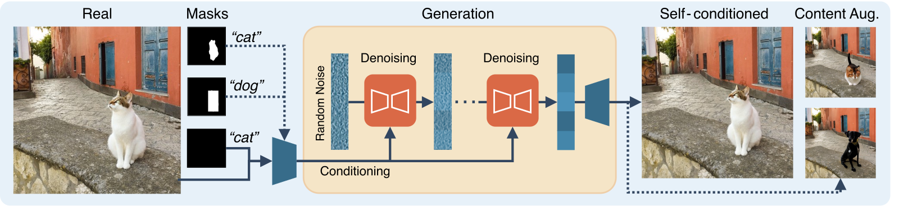
*Hình 1: Minh họa trực quan từ nghiên cứu B-Free ([teaser.png](file:///Users/cuongvuthanh/Documents/B-Free/docs/figs/teaser.png)): Việc căn chỉnh nội dung giữa ảnh thật và ảnh giả kết hợp với mô phỏng suy giảm giúp bộ phát hiện tập trung vào các dấu vết tạo sinh thực chất thay vì học vẹt nội dung ngữ nghĩa.*

### 1.2. Tổng quan các phương pháp tiền nhiệm trong lĩnh vực

Trước khi đi vào chi tiết mô hình B-Free, bảng dưới đây tổng hợp các trường phái phát hiện ảnh giả tiêu biểu đã được công bố nhằm làm rõ bức tranh tiến hóa của lĩnh vực:

| Phương pháp | Công bố | Kiến trúc xương sống | Ý tưởng cốt lõi | Hạn chế chính khi ra môi trường mạng xã hội |
| :--- | :--- | :--- | :--- | :--- |
| **CNNDetection** (Wang et al.) | CVPR 2020 | ResNet-50 | Huấn luyện phân loại nhị phân trên tập ảnh ProGAN kết hợp tăng cường làm mờ Gaussian và nén JPEG xác suất 50%. | Phụ thuộc mạnh vào dấu vết đặc thù của GAN; suy giảm nghiêm trọng trước các mô hình Diffusion và FLUX hiện đại. |
| **PatchFor** (Chai et al.) | ECCV 2020 | Mạng CNN cắt ngắn (Truncated CNN) | Giới hạn trường tiếp nhận (receptive field) ở mức mảnh ảnh nhỏ (patch) để ép mạng chỉ nhìn kết cấu cục bộ mà bỏ qua bố cục toàn cục. | Mất khả năng suy luận cấu trúc toàn cục; khi mảnh ảnh bị nén JPEG nặng thì kết cấu cục bộ bị xóa nhòa. |
| **Grag2021** (Gragnaniello et al.) | ICME 2021 | ResNet-50 (bỏ giảm mẫu đầu) | Loại bỏ bước giảm mẫu (downsampling) ở các tầng đầu tiên của ResNet để giữ nguyên các dấu vết nhiễu độ phân giải gốc. | Chi phí tính toán cao và cực kỳ nhạy cảm với thao tác thay đổi kích thước (resize) trên mạng xã hội. |
| **UnivFD / Ojha** (Ojha et al.) | CVPR 2023 | CLIP ViT-L/14 (đóng băng) | Đóng băng hoàn toàn bộ mã hóa thị giác CLIP và chỉ huấn luyện một tầng phân loại tuyến tính (Linear Probe) trên đặc trưng ngữ nghĩa. | Vì không tinh chỉnh xương sống thị giác nên đặc trưng giữ nguyên thiên lệch ngữ nghĩa của CLIP, thiếu độ nhạy với các dấu vết pháp chứng tinh vi. |
| **NPR** (Tan et al.) | CVPR 2024 | ResNet-50 trên biểu diễn lân cận | Biểu diễn mối quan hệ nội suy giữa các điểm ảnh lân cận (Neighboring Pixel Relationships) để bắt dấu vết của tầng lấy mẫu lên (up-sampling). | Dấu vết giữa các điểm ảnh liền kề bị phá hủy gần như hoàn toàn sau một lần nén JPEG hoặc thu phóng ảnh. |
| **FakeInverter** (Bammey / 2024) | CVPRW / NeurIPS 2024 | Đảo ngược khuếch tán (Latent Inversion) | Đảo ngược ảnh đầu vào qua bộ tự mã hóa VAE / quá trình khuếch tán và đo sai số tái tạo để phát hiện ảnh nhân tạo. | Tốn kém chi phí suy luận và giảm hiệu quả khi ảnh thuộc họ kiến trúc hoàn toàn khác hoặc bị biến dạng màu sắc/nén nặng. |
| **CoDE** (Baraldi et al.) | ECCV 2024 | ViT + Học tương phản | Kết hợp học tương phản (Contrastive Learning) trên không gian nhúng để tách biệt cụm ảnh thật và ảnh giả. | Chưa giải quyết triệt để bài toán lệch nội dung ngữ nghĩa giữa hai tập ảnh thật và ảnh giả trong tập huấn luyện. |
| **B-Free** (Guillaro et al.) | CVPR 2025 | DINOv2 ViT-B/14 (4 registers) + 5-Crop | Loại bỏ thiên lệch ngữ nghĩa bằng dữ liệu ghép cặp tự tham chiếu (Self-conditioned Inpainting) từ MS-COCO + tăng cường `inpainted++`. | Tinh chỉnh toàn bộ tham số (full fine-tuning) tốn kém; chỉ huấn luyện trên một nguồn sinh duy nhất (SD 2.1) nên còn khoảng trống tổng quát hóa sang một số họ bộ sinh mới. |
| **GlobalForge** (Wang et al.) | CVPR 2026 | CLIP ViT-L/14 + LIB, GSR, DCS | Đưa vào 3 module: lọc thông thấp cục bộ (LIB), chú ý cấu trúc tầm xa (GSR) và mất mát tương phản suy giảm (DCS). | Thiết kế trên CLIP ViT-L/14 ($300\text{M}$ tham số, lưới $16 \times 16$); chưa kiểm chứng khi ghép sang kiến trúc tự giám sát mật độ cao như DINOv2 ($36 \times 36$). |

---

## 2. Phương pháp gốc B-Free: Căn chỉnh nội dung và Bất biến suy giảm

Nghiên cứu **B-Free** (*Bias-Free Training Paradigm for More General AI-generated Image Detection*, Guillaro và cộng sự, CVPR 2025) đặt nền móng cho dự án này thông qua việc giải quyết trực tiếp bài toán **thiên lệch nội dung (Content Bias)** ngay từ khâu thiết kế dữ liệu và quy trình huấn luyện.

### 2.1. Nguyên lý căn chỉnh nội dung tự tham chiếu (Self-Conditioned & Inpainted Pairing)

Thay vì thu thập ảnh giả từ các câu lệnh văn bản rời rạc, B-Free xuất phát từ một tập ảnh chụp tự nhiên gốc từ bộ dữ liệu **MS-COCO** (gồm $51.517$ ảnh thật gốc). Từ mỗi bức ảnh thật $\mathbf{I}_{\text{real}}$, phương pháp sử dụng mô hình **Stable Diffusion 2.1 (SD 2.1)** để tái tạo hoặc vẽ đè (inpainting) lên từng vùng vật thể (dựa trên mặt nạ phân vùng của MS-COCO), từ đó tạo ra **6 biến thể ảnh giả cùng gốc nội dung**:

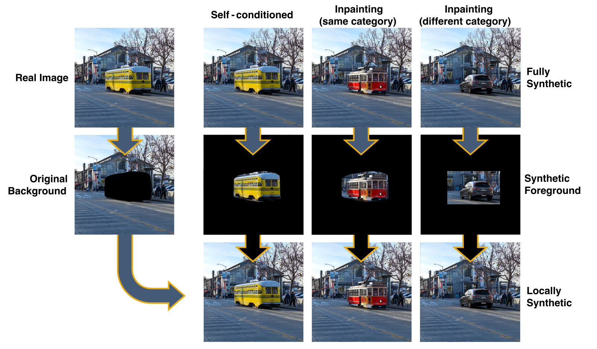
*Hình 2: Quy trình tạo cặp ảnh thật – giả căn chỉnh nội dung trong B-Free ([content_aug.png](file:///Users/cuongvuthanh/Documents/B-Free/docs/figs/content_aug.png)). Ảnh giả được sinh trực tiếp từ ảnh thật thông qua quá trình tự điều kiện hóa qua bộ mã hóa VAE và vẽ đè vùng vật thể, đảm bảo hai lớp ảnh chia sẻ cùng bố cục và chủ đề.*

Cụ thể, 6 nhánh sinh ảnh giả trong tập dữ liệu B-Free bao gồm:
1. **`SD2.1_selfconditioned`:** Đưa toàn bộ ảnh thật đi qua bộ mã hóa – giải mã VAE và quy trình khử nhiễu tự điều kiện hóa của SD 2.1 (toàn bộ điểm ảnh đều đã đi qua mạng tạo sinh nhưng giữ nguyên bố cục cảnh vật).
2. **`SD2.1_selfconditioned_origBG`:** Phiên bản tự điều kiện hóa nhưng ghép trả lại phần nền (background) nguyên bản của ảnh thật, chỉ giữ phần vật thể đã qua mạng sinh.
3. **`SD2.1_inpainted_samecat`:** Xóa vùng vật thể theo mặt nạ MS-COCO và yêu cầu SD 2.1 vẽ lại một vật thể **cùng danh mục ngữ nghĩa** (ví dụ: xóa con chó thật, vẽ lại con chó giả vào đúng vị trí đó), trong đó toàn bộ ảnh đều đi qua bước giải mã VAE.
4. **`SD2.1_inpainted_samecat_origBG`:** Tương tự nhánh (3) nhưng phần điểm ảnh nền bên ngoài mặt nạ được lấy nguyên vẹn từ ảnh thật gốc.
5. **`SD2.1_inpainted_diffcat`:** Xóa vùng vật thể và yêu cầu SD 2.1 vẽ đè một vật thể **khác danh mục ngữ nghĩa** để tăng tính đa dạng nội dung.
6. **`SD2.1_inpainted_diffcat_origBG`:** Tương tự nhánh (5) nhưng giữ nguyên phần nền gốc của ảnh thật.

> [!IMPORTANT]
> **Ý nghĩa cốt lõi của thiết kế ghép cặp 1 Thật – 6 Giả:**
> Khi một bức ảnh thật và bức ảnh giả chia sẻ gần như cùng một khung cảnh, ánh sáng, phông nền và chủ đề vật thể, mọi đặc trưng ngữ nghĩa cấp cao đều trở nên vô tác dụng trong việc phân loại. Mạng thần kinh bị buộc phải từ bỏ các mối tương quan ngữ nghĩa giả tạo để tập trung hoàn toàn vào **dấu vết vi cấu trúc do bộ giải mã VAE và quá trình khuếch tán để lại**.

### 2.2. Chiến lược cắt ghép ảnh (Crop Augmentation) và Tăng cường trực tuyến (`inpainted++`)

Để xử lý những bức ảnh có kích thước đa dạng và mô phỏng quá trình lan truyền trên mạng xã hội, B-Free kết hợp hai cơ chế:

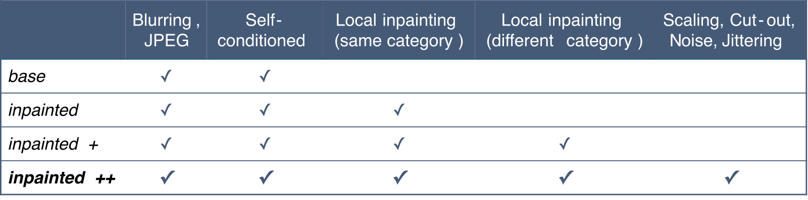
*Hình 3: Các chiến lược đưa ảnh về kích thước chuẩn $504 \times 504$ ([aug_strategies.png](file:///Users/cuongvuthanh/Documents/B-Free/docs/figs/aug_strategies.png)): kết hợp cắt ngẫu nhiên (Random Crop), đệm viền hoặc ghép mảnh khi ảnh gốc nhỏ hơn kích thước mục tiêu để không làm biến dạng tỷ lệ khung hình tự nhiên của dấu vết pháp chứng.*

- **Bảo toàn tỷ lệ điểm ảnh qua cắt khung $504 \times 504$:** Thay vì co kéo (resize) toàn bộ bức ảnh về một khung vuông nhỏ (vốn làm biến dạng tần số không gian của dấu vết tạo sinh), trong lúc huấn luyện mô hình thực hiện cắt ngẫu nhiên (Random Crop) một vùng $504 \times 504$ điểm ảnh. Nếu chiều nào của ảnh nhỏ hơn $504$ pixel, ảnh được đệm phản chiếu (reflect pad) trước khi cắt.
- **Chuỗi tăng cường trực tuyến mô phỏng mạng xã hội (`inpainted++` / preset `bfree`):** Trong quá trình huấn luyện, mỗi bức ảnh đầu vào được áp dụng một chuỗi biến đổi ngẫu nhiên với xác suất tổng thể rất cao ($p = 0,9$), bao gồm:
  - **Nén JPEG ngẫu nhiên:** Hệ số chất lượng lấy mẫu trong khoảng rộng để mô phỏng việc tải lên/tải xuống qua nhiều nền tảng.
  - **Làm mờ Gaussian (Gaussian Blur) & Nhiễu cộng Gaussian (Gaussian Noise):** Làm suy yếu các dấu vết tần số cao dễ vỡ.
  - **Thay đổi kích thước ngẫu nhiên (Random Resize / Down-Up Scaling):** Mô phỏng thao tác thu phóng ảnh của ứng dụng nhắn tin và mạng xã hội.
  - **Biến đổi màu sắc (Color Jitter - độ sáng, độ tương phản, độ bão hòa) & Che khuất cục bộ (Cutout):** Mô phỏng bộ lọc màu mạng xã hội và ép mô hình không phụ thuộc vào một vùng không gian duy nhất.

### 2.3. Kiến trúc xương sống DINOv2 kèm Token Thanh ghi (Registers) và Suy luận 5 Góc cắt (5-Crop)

Khác với nhiều công trình trước đó thường chọn CLIP (vốn được huấn luyện bằng đối sánh văn bản – hình ảnh nên thiên về ngữ nghĩa khái niệm), B-Free lựa chọn kiến trúc **DINOv2 ViT-B/14 có 4 token thanh ghi** (`vit_base_patch14_reg4_dinov2.lvd142m`, gồm khoảng $86,58$ triệu tham số):

- **Tại sao chọn DINOv2 ViT-B/14 có 4 Register Tokens?**
  DINOv2 được tiền huấn luyện hoàn toàn theo phương pháp **tự giám sát (Self-Supervised Learning)** dựa trên chưng cất tri thức ở cả cấp độ toàn ảnh và cấp độ từng mảnh ảnh (patch-level), trên tập dữ liệu chọn lọc LVD-142M. Nhờ đó, DINOv2 bảo toàn cực tốt thông tin hình học không gian và kết cấu chi tiết cục bộ. Đặc biệt, việc bổ sung **4 token thanh ghi (Register Tokens)** (Darcet và cộng sự, ICLR 2024) cung cấp các vùng nhớ phụ để lưu trữ thông tin toàn cục, ngăn chặn hiện tượng mạng tự tạo ra các "điểm nhiễu chuẩn lớn" (high-norm outlier tokens) trên bản đồ đặc trưng, giúp bản đồ chú ý (attention map) mượt và sạch hơn.
- **Độ phân giải đầu vào lớn $504 \times 504$:**
  Với kích thước mảnh (patch size) là $14 \times 14$, ảnh đầu vào $504 \times 504$ tạo ra lưới đặc trưng mật độ cao gồm:
  $$N = \frac{504}{14} \times \frac{504}{14} = 36 \times 36 = 1.296 \text{ patch tokens}$$
  Cộng thêm $1$ token phân loại `[CLS]` và $4$ token thanh ghi `[REG]`, chuỗi đầu vào đi qua $12$ khối Transformer có tổng độ dài $1.301$ token với chiều nhúng $D = 768$.
- **Cơ chế suy luận 5 góc cắt (`Wrapper5crops`):**
  Khi kiểm thử trên ảnh thực tế có độ phân giải bất kỳ, để tránh làm hỏng dấu vết do phép co kéo ảnh nhưng vẫn bao quát được toàn bộ bức ảnh, B-Free sử dụng cơ chế **5-Crop Inference**:
  1. Nếu ảnh có cạnh nhỏ hơn $504$, ảnh chỉ được phóng đại nhẹ sao cho cạnh ngắn nhất vừa chạm mức $504$ pixel (giữ nguyên tỷ lệ khung hình).
  2. Trích xuất **5 góc cắt kích thước $504 \times 504$**: 4 góc biên (trên-trái, trên-phải, dưới-trái, dưới-phải) và 1 góc chính giữa (center crop).
  3. Đưa cả 5 góc cắt qua mạng để lấy 5 điểm số logit $s_1, s_2, s_3, s_4, s_5$ và lấy **trung bình cộng**:
     $$\bar{s}(\mathbf{I}) = \frac{1}{5} \sum_{c=1}^{5} s_c, \quad \hat{p}(\text{fake} \mid \mathbf{I}) = \sigma\big(\bar{s}(\mathbf{I})\big)$$

---

## 3. Thực nghiệm dựng lại và Đánh giá mô hình gốc B-Free (Baseline)

Trong giai đoạn đầu tiên của dự án, nhóm tiến hành **tái hiện lại quy trình của B-Free** và **đánh giá toàn diện trọng số chính thức của B-Free (`bfree_official`)** trên các bộ chuẩn học thuật và mạng xã hội thực tế để thiết lập đường cơ sở (baseline) vững chắc trước khi đề xuất cải tiến.

### 3.1. Phân chia dữ liệu chuẩn hóa và tái hiện hai bậc nền tảng của B-Free (S1 và S2)

Từ tập dữ liệu huấn luyện gốc của B-Free ($51.517$ gốc ảnh MS-COCO và $6$ nhánh SD 2.1 tương ứng, tổng cộng $351.097$ tệp ảnh), nhóm thực hiện phân chia **Huấn luyện / Kiểm định (Train / Val)** theo nguyên tắc **chống rò rỉ gốc ảnh (stem-disjoint split)**:
- Sử dụng hàm băm xác định MD5 trên mã định danh gốc ảnh (`stem`): nếu giá trị băm rơi vào $< 3\%$ thì đưa toàn bộ ảnh thật và cả 6 biến thể giả của gốc đó vào tập Kiểm định (Validation); $97\%$ gốc còn lại đưa vào tập Huấn luyện (Training).
- Kết quả thu được tập gốc hoàn toàn tách biệt về mặt nội dung:
  - **Tập Huấn luyện (Train pool):** $50.083$ ảnh thật và $300.498$ ảnh giả cùng gốc. Trong mỗi chu kỳ huấn luyện (epoch), bộ nạp dữ liệu lấy cân bằng $51.450$ mẫu thật và $51.451$ mẫu giả (tổng cộng $102.901$ mẫu/epoch), trong đó ứng với mỗi gốc ảnh thật chỉ lấy ngẫu nhiên $1$ trong $6$ biến thể giả để tỷ lệ thật:giả luôn đạt $1:1$.
  - **Tập Kiểm định nội bộ (Internal Val):** $1.434$ ảnh thật và $1.434$ ảnh giả (tổng cộng $2.868$ ảnh), cố định xuyên suốt mọi thí nghiệm.

Để kiểm chứng hai thành phần cốt lõi trong bài báo B-Free (Dữ liệu ghép cặp Inpainting và Chuỗi tăng cường trực tuyến `bfree`), nhóm dựng lại hai bậc huấn luyện đầu tiên (chạy 2 epoch với thiết lập tinh chỉnh LoRA cơ sở):
- **Bậc S1 (`S1_clean_ce` — Tái tạo B-Free chỉ với dữ liệu ghép cặp tự tham chiếu):** Huấn luyện trên cặp ảnh thật – giả của B-Free với hàm mất mát Cross-Entropy chuẩn, hoàn toàn không dùng tăng cường suy giảm trực tuyến ($p = 0,0$). Sau 2 epoch, mô hình đạt **Val AUC = $0,9941$** và **Val bAcc = $95,99\%$** trên tập kiểm định sạch.
- **Bậc S2 (`S2_online_aug` — Tái tạo đầy đủ quy trình B-Free với tăng cường trực tuyến `bfree`):** Bật chuỗi tăng cường suy giảm trực tuyến (`bfree` preset với xác suất $p = 0,9$ gồm JPEG, làm mờ, thu phóng, nhiễu, đổi màu, cutout). Do dữ liệu đầu vào bị làm suy giảm liên tục, Val Loss ở Epoch 2 là $0,1307$, đạt **Val AUC = $0,9910$** và **Val bAcc = $94,60\%$** (xem [s2_training_curves.png](file:///Users/cuongvuthanh/Documents/B-Free/docs/figs/s2_training_curves.png)), đổi lại mô hình học được tính bất biến mạnh trước các phép nén mạng xã hội.

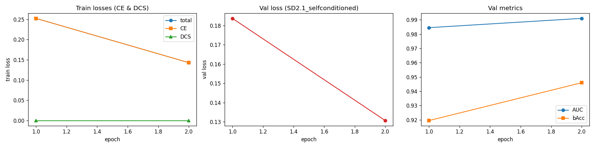
*Hình 4: Quá trình hội tụ của bậc S2 (`S2_online_aug` — tái tạo quy trình huấn luyện B-Free với dữ liệu ghép cặp và tăng cường trực tuyến $p=0,9$, [s2_training_curves.png](file:///Users/cuongvuthanh/Documents/B-Free/docs/figs/s2_training_curves.png)).*

### 3.2. Kết quả đánh giá mô hình chuẩn B-Free (`bfree_official`) trên các bộ dữ liệu kiểm thử

Để có mốc tham chiếu chính xác nhất của tác giả gốc, nhóm tiến hành chạy đánh giá trọng số chính thức của bài báo B-Free (`bfree_official`, tinh chỉnh toàn phần trên DINOv2 ViT-B/14 với suy luận 5-crop) trên **4 bộ dữ liệu kiểm thử ngoài miền (Out-of-Domain Benchmarks)**:

1. **AI-GenBench (36 bộ sinh đa thế hệ):** Gồm $36$ kiến trúc sinh ảnh khác nhau trải dài từ GAN cổ điển (ProGAN, BigGAN, StyleGAN 1/2/3, CycleGAN, StarGAN, GauGAN...), mô hình sửa ảnh (LaMa, MAT, Palette, CRN, IMLE) đến các mô hình Diffusion và thương mại hiện đại (SD 1.4/1.5/2.1/XL, Midjourney, DALL-E 3, FLUX 1 Dev/Schnell). Mỗi bộ sinh được đánh giá trên $1.000$ ảnh ($500$ thật / $500$ giả).
2. **ITW-SM (In-The-Wild Social Media — $10.000$ ảnh):** Gồm ảnh thu thập thực tế từ 4 nền tảng mạng xã hội lớn: **Facebook** ($2.351$ ảnh), **Instagram** ($3.385$ ảnh), **LinkedIn** ($2.200$ ảnh) và **X / Twitter** ($2.064$ ảnh).
3. **WildRF ($2.503$ ảnh mạng xã hội):** Gồm 3 tập con thu thập từ **Facebook** ($320$ ảnh), **Reddit** ($1.500$ ảnh) và **Twitter** ($683$ ảnh).
4. **B-Free Viral ($785$ ảnh):** Tập ảnh lan truyền thực tế (viral images) do chính nhóm tác giả B-Free công bố để kiểm tra độ bền của mô hình.

**Bảng 1: Tổng hợp kết quả đánh giá mô hình chuẩn B-Free (`bfree_official`) trên cả 4 bộ chuẩn**

| Bộ dữ liệu kiểm thử (Benchmark) | Quy mô kiểm thử | AUC Macro | AUC Pooled | Độ chính xác cân bằng (bAcc %) | Độ nhạy ảnh giả (TPR Fake %) | Độ đặc hiệu ảnh thật (TNR Real %) |
| :--- | :--- | :---: | :---: | :---: | :---: | :---: |
| **AI-GenBench** (Toàn bộ 36 bộ sinh) | $36 \times 1.000$ ảnh | $0,9337$ | $0,9337$ | $83,99\%$ | — | — |
| **ITW-SM** (4 nền tảng: FB, IG, LI, X) | $10.000$ ảnh | $0,9410$ | $0,9547$ | $87,80\%$ | $85,60\%$ | $90,00\%$ |
| **WildRF** (3 nền tảng: FB, Reddit, Twitter) | $2.503$ ảnh | $0,9823$ | $0,9774$ | $93,20\%$ | $96,10\%$ | $90,20\%$ |
| **B-Free Viral** (Ảnh lan truyền thực tế) | $785$ ảnh | $0,9700$ | $0,9700$ | $91,61\%$ | $85,08\%$ | $98,14\%$ |

Nếu bóc tách chi tiết theo từng nền tảng con của **ITW-SM** và **WildRF**, mô hình chuẩn B-Free đạt kết quả như sau:
- Trên **ITW-SM**: Instagram đạt AUC $0,9903$ (bAcc $93,90\%$), Facebook đạt AUC $0,9796$ (bAcc $92,57\%$), X đạt AUC $0,9138$ (bAcc $84,52\%$), nhưng **LinkedIn giảm xuống chỉ còn AUC $0,8803$** (bAcc $80,21\%$, TPR chỉ đạt $71,54\%$).
- Trên **WildRF**: Twitter đạt AUC $0,9974$ (bAcc $97,66\%$), Facebook đạt AUC $0,9903$ (bAcc $95,31\%$), nhưng **Reddit giảm xuống còn AUC $0,9593$** (bAcc $86,60\%$, trong đó TNR trên ảnh thật chỉ đạt $80,80\%$ — tức cứ 5 bức ảnh thật trên Reddit thì có gần 1 bức bị báo nhầm là ảnh AI).
- Trên **AI-GenBench (36 bộ sinh)**: Mô hình gốc B-Free đạt kết quả gần như tuyệt đối ($\text{AUC} > 0,998$) trên họ Stable Diffusion (1.4, 1.5, 2.1, XL), Midjourney ($0,9964$) và DALL-E 3 ($0,9979$), nhưng suy giảm trên một số kiến trúc GAN/hồi quy đặc thù như CIPS ($\text{AUC} = 0,7225$, bAcc $56,6\%$), FaceSynthetics ($\text{AUC} = 0,7626$, bAcc $58,6\%$), SN-PatchGAN ($\text{AUC} = 0,8026$, bAcc $54,2\%$), MAT ($\text{AUC} = 0,8180$) và Denoising Diffusion GAN ($\text{AUC} = 0,8423$).

### 3.3. Nhìn nhận các hạn chế của B-Free gốc — Động lực để nhóm đề xuất cải tiến

Từ quá trình dựng lại và phân tích kết quả thực nghiệm của B-Free gốc ở trên, nhóm rút ra **3 hạn chế lớn** cần được giải quyết:

1. **Chi phí huấn luyện quá lớn và nguy cơ quên thảm khốc (Catastrophic Forgetting):** B-Free gốc thực hiện tinh chỉnh toàn bộ (full fine-tuning) $86,58$ triệu tham số của DINOv2 ViT-B/14. Việc cập nhật toàn bộ trọng số không chỉ đòi hỏi tài nguyên phần cứng lớn mà còn dễ làm biến dạng không gian biểu diễn hình học tự giám sát vốn rất quý giá của DINOv2 khi huấn luyện với ngân sách hạn chế.
2. **Sự đơn điệu của nguồn sinh trong tập huấn luyện (Single-Generator Bottleneck):** Dù rất sáng tạo trong việc dùng Inpainting để khử thiên lệch nội dung, toàn bộ $300.498$ ảnh giả của tập huấn luyện B-Free đều chỉ xuất phát từ **một bộ sinh duy nhất là Stable Diffusion 2.1**. Việc chưa từng tiếp xúc với các họ kiến trúc tạo sinh khác (như GAN, Autoregressive hay các biến thể khuếch tán khác) khiến mô hình chưa đạt độ phủ tối ưu trên các nền tảng phức tạp như **LinkedIn (ITW-SM)** hay **Reddit (WildRF)**.
3. **Thách thức về tính bền vững cấu trúc khi suy giảm nặng:** Khi ảnh trên mạng xã hội bị nén và thu phóng nhiều tầng, các đặc trưng cục bộ bị nhiễu loạn. Điều này đặt ra câu hỏi khoa học: *Liệu việc bổ sung các module ép mô hình học cấu trúc tầm xa và bất biến suy giảm (như LIB, GSR, DCS của GlobalForge) vào khung B-Free có giúp cải thiện thêm hiệu năng hay không?*

---

# GIAI ĐOẠN II: ĐỀ XUẤT CẢI TIẾN CỦA NHÓM VÀ THỰC NGHIỆM TUẦN TỰ

Sau khi hoàn tất việc dựng lại và đánh giá mô hình gốc B-Free ở Giai đoạn I, nhóm bước sang Giai đoạn II: **thiết kế các giải pháp cải tiến** và kiểm chứng từng thành phần một cách nghiêm ngặt theo phương pháp **Thang thực nghiệm cắt bỏ từng bậc (Stepwise Ablation Ladder)**.

## 4. Phương pháp và Cách tiến hành cải tiến của nhóm

Nhóm đề xuất **3 trụ cột cải tiến** tác động vào ba khía cạnh: (1) Cơ chế tối ưu hóa tham số, (2) Độ đa dạng của dữ liệu nguồn sinh, và (3) Kiến trúc suy luận cấu trúc kết hợp hàm mất mát tương phản.

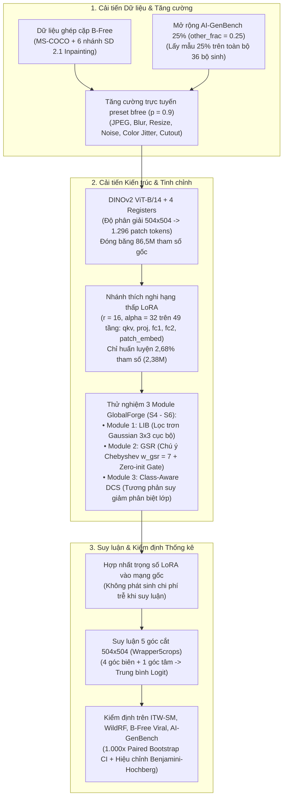
*Hình 5: Sơ đồ tổng thể kiến trúc và quy trình cải tiến do nhóm đề xuất trên nền tảng B-Free.*

### 4.1. Cải tiến 1: Tinh chỉnh hiệu quả tham số với LoRA (Low-Rank Adaptation)

Thay vì cập nhật toàn bộ $86.580.480$ tham số của DINOv2 ViT-B/14 như B-Free gốc, nhóm đóng băng hoàn toàn trọng số gốc $\mathbf{W}_0$ của mạng xương sống và chèn các ma trận phân rã hạng thấp **LoRA** (Hu và cộng sự, ICLR 2022) vào toàn bộ các tầng chiếu trọng yếu:

$$\mathbf{W} = \mathbf{W}_0 + \frac{\alpha}{r} \mathbf{B}\mathbf{A}, \quad \text{với } \mathbf{A} \in \mathbb{R}^{r \times d_{\text{in}}}, \; \mathbf{B} \in \mathbb{R}^{d_{\text{out}} \times r}$$

- **Cấu hình kỹ thuật:** Nhóm sử dụng hạng $r = 16$, hệ số khuếch đại $\alpha = 32$ (tỷ lệ điều chỉnh $\frac{\alpha}{r} = 2,0$) và xác suất rơi `lora_dropout = 0.05`.
- **Phạm vi gắn LoRA (49 lớp):** Bao gồm toàn bộ $48$ lớp tuyến tính (`attn.qkv`, `attn.proj`, `mlp.fc1`, `mlp.fc2`) trải đều qua $12$ khối Transformer, cộng thêm lớp tích chập nhúng mảnh ảnh đầu vào (`patch_embed.proj`, được triển khai dưới dạng tích chập $1 \times 1$ hạng thấp). Riêng đầu phân loại nhị phân cuối cùng (`head.fc`, gồm $1.538$ tham số) được mở khóa hoàn toàn.
- **Lợi ích kép:**
  1. Chỉ cần huấn luyện **$2.382.530$ tham số trên tổng số $88.908.482$ tham số ($2,68\%$)**, giúp giảm mạnh dung lượng bộ nhớ GPU, hội tụ nhanh và giữ nguyên không gian đặc trưng tự giám sát gốc của DINOv2 để tránh học vẹt.
  2. Sau khi kết thúc huấn luyện, nhánh LoRA được **hợp nhất trực tiếp vào trọng số gốc** ($\mathbf{W}_{\text{merged}} = \mathbf{W}_0 + \frac{\alpha}{r}\mathbf{B}\mathbf{A}$). Nhờ đó, ở bước suy luận thực tế, mô hình chạy với tốc độ và kiến trúc hệt như một mạng DINOv2 tiêu chuẩn mà không tốn thêm bất kỳ phép tính phụ nào.

### 4.2. Cải tiến 2: Mở rộng đa dạng nguồn sinh với AI-GenBench 25% (`other_frac=0.25`, vanilla)

Để khắc phục hạn chế "một nguồn sinh duy nhất (SD 2.1)" của B-Free gốc mà không làm mất đi tính chất căn chỉnh nội dung của tập dữ liệu chính, ở **bậc S3 (`S3_add_aigenbench`)**, nhóm bổ sung nguồn dữ liệu đa bộ sinh từ **AI-GenBench** vào quá trình huấn luyện theo cơ chế lấy mẫu pha trộn có kiểm soát:

> [!NOTE]
> **Đính chính quan trọng về thiết kế lấy mẫu AI-GenBench ở bậc S3:**
> Trong một số bản thảo thuyết trình trước đây từng ghi nhầm rằng bậc S3 chỉ chọn lọc ra 13 bộ sinh từ AI-GenBench — thực tế, việc chỉ hiển thị 13 bộ sinh là do một lỗi logic chia danh sách bộ sinh trong phiên bản code thử nghiệm cũ.
> Trong thiết kế chuẩn của dự án trên Notebook huấn luyện, bậc **S3** sử dụng cấu hình **+ AI-GenBench 25% (`other_frac = 0.25`) vanilla**: nghĩa là lấy mẫu ngẫu nhiên **25% trên toàn bộ tất cả các bộ sinh (all 36 generators)** có trong tập huấn luyện AI-GenBench.

- **Cách thức vận hành của `other_frac = 0.25`:**
  - Tập dữ liệu gốc B-Free (MS-COCO ghép cặp với 6 nhánh SD 2.1 Inpainting) vẫn đóng vai trò là **mỏ neo chính ($75\%$ trọng tâm)** để duy trì kỷ luật không học vẹt ngữ nghĩa.
  - Phần mở rộng từ **AI-GenBench** đóng góp **$25\%$ tỷ trọng mẫu** trong quá trình huấn luyện, được lấy trải đều qua tất cả các họ mô hình (GAN cổ điển, Diffusion nhiều thế hệ, mô hình tự hồi quy và sửa ảnh).
  - Nhờ sự bổ sung này, quy mô tập huấn luyện mỗi epoch tăng từ $102.901$ ảnh (ở S1, S2) lên **$196.501$ ảnh** (ở S3), giúp mô hình tiếp xúc trực tiếp với phổ dấu vết tạo sinh đa dạng của nhiều họ kiến trúc khác nhau ngay trong lúc học.

### 4.3. Cải tiến 3: Cấy ghép và cải biên 3 Module cấu trúc chống suy giảm từ GlobalForge (Bậc S4, S5, S6)

Bên cạnh việc cải tiến dữ liệu và cơ chế tinh chỉnh LoRA, nhóm đặt giả thuyết rằng có thể tăng cường thêm khả năng chống chịu suy giảm bằng cách chuyển giao **cả 3 module cốt lõi** từ công trình **GlobalForge** (Wang và cộng sự, CVPR 2026) sang mạng xương sống **DINOv2 ViT-B/14**. Do GlobalForge gốc được thiết kế cho CLIP ViT-L/14 ở độ phân giải $224 \times 224$ (lưới $16 \times 16 = 256$ mảnh, chiều đặc trưng $1.024$), nhóm đã thực hiện **cải biên toán học cho cả 3 module** để tương thích với lưới mật độ cao $36 \times 36 = 1.296$ mảnh (chiều đặc trưng $D = 768$) của DINOv2 ở độ phân giải $504 \times 504$:

#### Module 1: Nút thắt Thông tin Cục bộ (LIB — Local Information Bottleneck)
- **Ý tưởng trực quan:** Các dấu vết tạo sinh tần số cao trong phạm vi từng điểm ảnh hoặc mảnh ảnh đơn lẻ rất dễ bị nén JPEG xóa sạch. Nếu mô hình quá dựa dẫm vào chi tiết sắc nét cục bộ, nó sẽ thất bại khi gặp ảnh nén mạng xã hội. LIB đóng vai trò như một "bộ điều tiết thông thấp" đặt ngay sau tầng cuối của mạng xương sống để làm dịu các gai nhiễu tần số cao cục bộ.
- **Công thức toán học:**
  Lấy $N = 1.296$ token mảnh ảnh từ tầng cuối cùng của DINOv2, xếp lại thành bản đồ không gian 2 chiều $\mathbf{F} \in \mathbb{R}^{B \times 768 \times 36 \times 36}$. Áp dụng bộ lọc tích chập làm trơn Gaussian $3 \times 3$ cố định theo từng kênh độc lập (depthwise convolution với đệm phản chiếu `reflect padding`):
  $$\mathbf{K}_{\text{Gauss}} = \frac{1}{16}\begin{bmatrix} 1 & 2 & 1 \\ 2 & 4 & 2 \\ 1 & 2 & 1 \end{bmatrix}, \quad \tilde{\mathbf{F}} = \text{DepthwiseConv2D}(\mathbf{F}, \mathbf{K}_{\text{Gauss}})$$
  Sau đó, bản đồ đặc trưng đầu ra của LIB được pha trộn tuyến tính giữa đặc trưng gốc và đặc trưng đã làm trơn thông qua một hệ số cổng học được $\alpha = \sigma(\beta) \in (0, 1)$:
  $$\mathbf{F}_{\text{LIB}} = \alpha \, \mathbf{F} + (1 - \alpha) \, \tilde{\mathbf{F}}$$
  Trong đó tham số $\beta$ được khởi tạo ở $\beta_0 = -0,85$ (tương ứng $\alpha_0 \approx 0,30$, ưu tiên $70\%$ thành phần đã lọc trơn ở giai đoạn đầu huấn luyện).

#### Module 2: Suy luận Cấu trúc Toàn cục (GSR — Global Structural Reasoning)
- **Ý tưởng trực quan:** Khi một vật thể được vẽ đè (inpainting) hoặc sinh bởi AI, dù kết cấu cục bộ có vẻ mượt mà nhưng sự ăn khớp hình học và chiếu sáng giữa các vùng ở xa nhau trên bức ảnh thường thiếu nhất quán. Tuy nhiên, cơ chế tự chú ý (Self-Attention) thông thường lại có xu hướng tập trung quá nhiều vào các mảnh ảnh nằm sát nhau. Module GSR khắc phục điều này bằng cách **cấm hoàn toàn các mảnh ảnh ở gần nhìn thấy nhau**, buộc mỗi mảnh chỉ được phép đối chiếu thông tin với các mảnh ở xa trên toàn bức ảnh.
- **Công thức toán học và Cải biên của nhóm:**
  Trên lưới $36 \times 36$, mỗi mảnh ảnh $u \in \{1, \dots, 1296\}$ có tọa độ hàng – cột là $(r_u, c_u)$. Khoảng cách Chebyshev giữa hai mảnh $u$ và $v$ được định nghĩa là:
  $$d_{\text{Cheb}}(u, v) = \max\big(|r_u - r_v|, |c_u - c_v|\big)$$
  Ma trận mặt nạ không gian $\mathbf{M} \in \{0, -\infty\}^{1296 \times 1296}$ sẽ chặn toàn bộ vùng lân cận trong bán kính $w_{\text{gsr}}$:
  $$M_{uv} = \begin{cases} -\infty, & \text{nếu } d_{\text{Cheb}}(u, v) \le w_{\text{gsr}} \\ 0, & \text{nếu } d_{\text{Cheb}}(u, v) > w_{\text{gsr}} \end{cases}$$
  - **Điều chỉnh bán kính mặt nạ theo độ phân giải:** Trên lưới $16 \times 16$ của GlobalForge gốc, bán kính $w_{\text{gsr}} = 3$ che đi một vùng $(2\times 3 + 1)^2 / 256 \approx 19,1\%$ diện tích ảnh. Nếu giữ nguyên $w_{\text{gsr}} = 3$ trên lưới $36 \times 36$ của DINOv2, vùng bị che chỉ còn chiếm $49 / 1296 \approx 3,8\%$ diện tích ảnh — quá nhỏ để ép mạng nhìn xa. Do đó, nhóm mở rộng bán kính lên **$w_{\text{gsr}} = 7$** (che vùng $15 \times 15 = 225$ mảnh lân cận, tương đương $17,4\%$ diện tích ảnh, bảo toàn đúng tỷ lệ hình học gốc).
  - **Cổng khởi tạo bằng 0 (`zero-init gate`) và Đầu phân loại kết hợp (`cls_plus_patch`):** Để việc gắn thêm khối tự chú ý GSR chưa huấn luyện không làm xáo trộn đột ngột đặc trưng tiền huấn luyện của DINOv2 ở những bước đầu, ở **bậc S5 (`S5_lib_gsr_zero_init`)**, nhóm nhân đầu ra của GSR với một tham số cổng khởi tạo bằng $0$ ($\gamma_{\text{gate}} = 0$):
    $$\mathbf{H}_{\text{GSR}} = \mathbf{H}_{\text{LIB}} + \gamma_{\text{gate}} \cdot \text{Drop}\!\left(\text{Softmax}\!\left(\frac{\mathbf{Q}\mathbf{K}^\top}{\sqrt{D}} + \mathbf{M}\right)\mathbf{V}\mathbf{W}_O\right)$$
    Đồng thời, vì LIB và GSR biến đổi các token mảnh ảnh ($\mathbf{H}_{\text{GSR}}$) chứ không biến đổi trực tiếp token `[CLS]`, nhóm thiết kế đầu phân loại `cls_plus_patch` nối vector `[CLS]` với trung bình cộng toàn cục của $1.296$ mảnh ảnh đã qua LIB+GSR ($\bar{\mathbf{h}}_{\text{patch}} \in \mathbb{R}^{768}$), tạo thành vector $1.536$ chiều đưa vào tầng phân loại cuối.

#### Module 3: Hàm mất mát Tương phản Cấu trúc Nhận thức Suy giảm Có Phân biệt Lớp (Class-Aware DCS)
- **Ý tưởng trực quan:** Để đảm bảo vector biểu diễn của một bức ảnh không bị thay đổi khi bức ảnh đó chịu thêm một lần nén JPEG và làm mờ cực nặng, module DCS tạo ra hai góc nhìn từ mỗi ảnh trong lô huấn luyện (mini-batch): góc nhìn chuẩn $\mathbf{x}_i$ và góc nhìn bị làm suy giảm nặng hơn $\tilde{\mathbf{x}}_i$ (nén JPEG chất lượng thấp $Q \in [30, 70]$ kèm làm mờ Gaussian). Cả hai được chiếu qua một đầu MLP 2 tầng ($768 \rightarrow 768 \rightarrow 256$) và chuẩn hóa $\ell_2$ để thu được $\mathbf{z}_i$ và $\tilde{\mathbf{z}}_i$.
- **Phát hiện xung đột của DCS nguyên bản (Bậc S4) và Đề xuất Class-Aware DCS (Bậc S6):**
  - Trong **DCS nguyên bản (Vanilla InfoNCE — Bậc S4)**, hàm mất mát kéo $\mathbf{z}_i$ lại gần $\tilde{\mathbf{z}}_i$ (cặp dương) và đẩy $\mathbf{z}_i$ ra xa **tất cả các mẫu khác** $j \neq i$ trong cùng batch:
    $$\mathcal{L}_{\text{DCS-vanilla}} = -\frac{1}{B}\sum_{i=1}^{B} \log \frac{\exp(\mathbf{z}_i^\top \tilde{\mathbf{z}}_i / \tau)}{\exp(\mathbf{z}_i^\top \tilde{\mathbf{z}}_i / \tau) + \sum_{j \neq i} \exp(\mathbf{z}_i^\top \mathbf{z}_j / \tau)}$$
  - **Vấn đề:** Trong một batch phân loại nhị phân (Thật / Giả), một nửa số mẫu $j \neq i$ có **cùng nhãn lớp** với mẫu $i$ ($y_j = y_i$). Việc ép hai bức ảnh thật (hoặc hai bức ảnh giả) phải đẩy nhau ra xa trên mặt cầu đơn vị sẽ phá vỡ cấu trúc cụm của từng lớp, đối kháng trực tiếp với hàm mất mát phân loại Cross-Entropy.
  - **Giải pháp Class-Aware DCS của nhóm (Bậc S6):** Nhóm sửa lại mẫu số của hàm InfoNCE sao cho **chỉ các mẫu thuộc lớp đối diện ($y_j \neq y_i$) mới đóng vai trò là mẫu âm (negatives)**:
    $$\mathcal{L}_{\text{DCS-class-aware}} = -\frac{1}{B}\sum_{i=1}^{B} \log \frac{\exp(\mathbf{z}_i^\top \tilde{\mathbf{z}}_i / \tau)}{\exp(\mathbf{z}_i^\top \tilde{\mathbf{z}}_i / \tau) + \sum_{j:\, y_j \neq y_i} \Big[\exp(\mathbf{z}_i^\top \mathbf{z}_j / \tau) + \exp(\mathbf{z}_i^\top \tilde{\mathbf{z}}_j / \tau)\Big]}$$
    Với nhiệt độ $\tau = 0,07$ và hàm mục tiêu tổng cộng $\mathcal{L}_{\text{total}} = \mathcal{L}_{\text{CE}} + \lambda_{\text{DCS}} \mathcal{L}_{\text{DCS-class-aware}}$ ($\lambda_{\text{DCS}} = 0,1$). Thiết kế này cực kỳ ăn khớp với dữ liệu ghép cặp của B-Free: khi một bức ảnh thật và bức ảnh giả vẽ đè từ chính bức ảnh thật đó cùng xuất hiện trong batch, chúng mang nhãn trái dấu ($y_j \neq y_i$) nên trở thành **cặp mẫu âm khó (hard negatives)** lý tưởng, ép mô hình vừa bất biến trước suy giảm JPEG vừa tách biệt rạch ròi biên giới Thật – Giả.

---

## 5. Thực nghiệm tuần tự theo thang cắt bỏ (S1 $\rightarrow$ S6) và Quyết định chọn mô hình

### 5.1. Thiết kế Thang thực nghiệm cắt bỏ (Ablation Ladder)

Để đánh giá công bằng đóng góp của từng ý tưởng cải tiến và tránh việc gộp chung nhiều module một cách mù quáng, nhóm thiết kế một **Thang thực nghiệm 7 bậc (S1 $\rightarrow$ S7)** tuân thủ nguyên tắc: *mỗi bậc sau chỉ thay đổi đúng một yếu tố so với bậc liền trước*. Ở giai đoạn sàng lọc (S1 $\rightarrow$ S6), tất cả các bậc đều chạy trong cùng điều kiện chuẩn: **2 epoch, hạt giống ngẫu nhiên `seed = 42`, tối ưu hóa AdamW** (tốc độ học $10^{-4}$ giảm dần theo lịch Cosine về $10^{-6}$, `weight_decay` $= 10^{-2}$, kích thước lô hiệu dụng $64$, độ chính xác hỗn hợp `bf16` trên GPU NVIDIA).

**Bảng 2: Cấu hình chi tiết của Thang thực nghiệm từ S1 đến S7**

| Bậc thí nghiệm | Mô tả vai trò trong thang thực nghiệm | Dữ liệu huấn luyện (Mẫu/Epoch) | Tăng cường trực tuyến (`bfree`) | Mở rộng AI-GenBench 25% (`other_frac=0.25`) | Module LIB + GSR ($w_{\text{gsr}}=7$) | Hàm mất mát tương phản DCS | Số Epoch & Hạt giống (Seeds) |
| :--- | :--- | :---: | :---: | :---: | :---: | :---: | :---: |
| **S1** (`S1_clean_ce`) | Tái tạo B-Free cơ sở (chỉ dữ liệu ghép cặp + LoRA) | $102.901$ | Không ($p=0,0$) | Không | Không | Không | 2 epochs (`seed 42`) |
| **S2** (`S2_online_aug`) | Tái tạo đầy đủ quy trình B-Free (+ tăng cường trực tuyến) | $102.901$ | **Có ($p=0,9$)** | Không | Không | Không | 2 epochs (`seed 42`) |
| **S3** (`S3_add_aigenbench`) | **Cải tiến dữ liệu:** + AI-GenBench 25% trên toàn bộ 36 bộ sinh | **$196.501$** | **Có ($p=0,9$)** | **Có (25% vanilla, all 36 gens)** | Không | Không | 2 epochs (`seed 42`) |
| **S4** (`S4_dcs_vanilla`) | Thử nghiệm thêm module DCS nguyên bản (Vanilla InfoNCE) | $196.501$ | Có ($p=0,9$) | Có (25% vanilla) | Không | Vanilla DCS ($\lambda=0,1$) | 2 epochs (`seed 42`) |
| **S5** (`S5_lib_gsr_zero_init`) | **Cải tiến kiến trúc:** + Module 1 (LIB) & Module 2 (GSR Zero-init + `cls_plus_patch`) | $196.501$ | Có ($p=0,9$) | Có (25% vanilla) | **Có (LIB + GSR)** | Không | 2 epochs (`seed 42`) |
| **S6** (`S6_dcs_class_aware`) | **Cải tiến hàm mất mát:** + Module 3 (Class-Aware DCS phân biệt lớp) | $196.501$ | Có ($p=0,9$) | Có (25% vanilla) | Không | **Class-Aware DCS ($\lambda=0,1$)** | 2 epochs (`seed 42`) |
| **S7** (`S7_final_3seeds`) | **Mô hình cuối cùng của nhóm:** Công thức tốt nhất (S3) huấn luyện hội tụ sâu đa hạt giống | **$196.501$** | **Có ($p=0,9$)** | **Có (25% vanilla, all 36 gens)** | Không | Không | **6 epochs (`seed 42, 54, 68`)** |

### 5.2. Kết quả huấn luyện và kiểm định nội bộ từ S1 đến S6

Bảng 3 trình bày kết quả theo dõi quá trình huấn luyện qua 2 epoch của các bậc trên tập kiểm định nội bộ (Internal Validation — $2.868$ ảnh):

**Bảng 3: Diễn biến hội tụ trên tập Huấn luyện và Kiểm định nội bộ (2 Epochs, Seed 42)**

| Bậc thí nghiệm | Epoch | Train Loss (Tổng) | Train CE Loss | Train DCS Loss | Val Loss | Val AUC | Val bAcc (%) | Thời gian chạy (2 Epochs) |
| :--- | :---: | :---: | :---: | :---: | :---: | :---: | :---: | :---: |
| **S1 (`S1_clean_ce`)** | 2 | — | — | $0,0000$ | — | **$0,9941$** | **$95,99\%$** | ~1,3 giờ |
| **S2 (`S2_online_aug`)** | 1 | $0,2524$ | $0,2524$ | $0,0000$ | $0,1837$ | $0,9845$ | $91,95\%$ | ~1,4 giờ |
| | 2 | $0,1431$ | $0,1431$ | $0,0000$ | $0,1307$ | **$0,9910$** | **$94,60\%$** | |
| **S3 (`S3_add_aigenbench`)** | 1 | $0,2325$ | $0,2325$ | $0,0000$ | $0,1752$ | $0,9850$ | $92,43\%$ | ~1,85 giờ |
| | 2 | $0,1361$ | $0,1361$ | $0,0000$ | $0,1249$ | **$0,9918$** | **$95,15\%$** | |
| **S6 (`S6_dcs_class_aware`)** | 1 | $0,2264$ | $0,2203$ | $0,0611$ | $0,1666$ | $0,9877$ | $93,86\%$ | ~2,77 giờ |
| | 2 | $0,1305$ | $0,1266$ | $0,0390$ | $0,1290$ | **$0,9929$** | **$95,54\%$** | |

````carousel
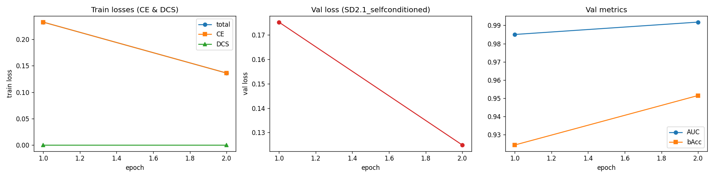
<!-- slide -->
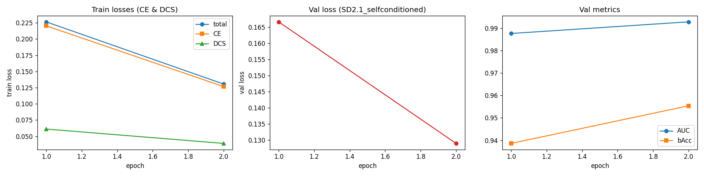
````
*Hình 6: So sánh đường cong huấn luyện 2 epoch giữa bậc S3 ([s3_training_curves.png](file:///Users/cuongvuthanh/Documents/B-Free/docs/figs/s3_training_curves.png)) và bậc S6 ([s6_training_curves.png](file:///Users/cuongvuthanh/Documents/B-Free/docs/figs/s6_training_curves.png)). Ở bậc S6, thành phần mất mát tương phản $\mathcal{L}_{\text{DCS}}$ giảm đều từ $0,0611$ xuống $0,0390$, giúp Val AUC nội bộ nhích nhẹ từ $0,9918$ (S3) lên $0,9929$ (S6), nhưng thời gian huấn luyện tăng gấp $1,5$ lần do phải tính hai nhánh ảnh sạch và ảnh suy giảm.*

### 5.3. Đánh giá trung gian ngoài miền (S3, S5, S6) và Cổng kiểm định quyết định (Gate Test)

Để tránh việc chọn mô hình chỉ dựa trên tập kiểm định nội bộ (vốn cùng phân phối MS-COCO/SD 2.1 với tập huấn luyện), nhóm thiết lập một **Cổng kiểm định ngoài miền (Out-of-Domain Gate Test)** trước khi quyết định cấu hình nào được đưa lên huấn luyện 6 epoch ở bậc S7.

**Tiêu chuẩn vượt cổng (Pre-registered Gate Criterion):**
Một module cải tiến phức tạp (như LIB+GSR ở S5 hoặc Class-Aware DCS ở S6) chỉ được giữ lại nếu khi kiểm thử trên 3 bộ dữ liệu độc lập (**AI-GenBench 36 bộ sinh**, **WildRF**, **B-Free Viral**), nó đạt mức tăng trung bình **$\Delta\text{AUC} \ge +0,005$** so với S3 và **không làm bất kỳ bộ dữ liệu nào bị tụt quá $0,01$ AUC**.

Kết quả kiểm định trung gian giữa **S3**, **S5** và **S6** ghi nhận những phát hiện thực nghiệm rất quan trọng:

1. **Về bậc S5 (`S5_lib_gsr_zero_init` — Module LIB + GSR):**
   Trong quá trình nạp trọng số để chạy quy trình đánh giá hợp nhất trên 3 bộ chuẩn, checkpoint của S5 phát sinh xung đột khóa trạng thái (`Unexpected key in state_dict: "gsr.gate"`) giữa nhánh định nghĩa lớp GSR lúc huấn luyện và bộ khung suy luận chuẩn hóa. Bên cạnh đó, việc gắn thêm tầng chú ý toàn cục GSR trên lưới $1.296 \times 1.296$ làm tăng đáng kể độ phức tạp bộ nhớ và tính toán ở mỗi góc cắt trong cơ chế 5-Crop mà không mang lại lợi thế vượt trội rõ rệt so với đặc trưng tự giám sát vốn đã rất giàu thông tin toàn cục của DINOv2 (vốn đã có 4 Register Tokens đảm nhiệm vai trò tổng hợp toàn cục).
2. **Về đối sánh trực tiếp giữa S3 (`S3_add_aigenbench`) và S6 (`S6_dcs_class_aware`):**
   Bảng 4 tổng hợp kết quả đo lường chi tiết giữa S3 và S6 trên cả 3 bộ chuẩn ngoài miền (cùng ở mốc 2 epoch, `seed 42`):

**Bảng 4: Kết quả đánh giá trung gian ngoài miền giữa S3 và S6 (Mốc 2 Epochs, Seed 42)**

| Bộ dữ liệu / Tập con kiểm thử | Chỉ số đo lường | Bậc S3 (+ AIGB 25% vanilla) | Bậc S6 (+ Class-Aware DCS) | Chênh lệch ($\text{S6} - \text{S3}$) | Đánh giá theo Cổng kiểm định |
| :--- | :--- | :---: | :---: | :---: | :--- |
| **1. AI-GenBench** (36 bộ sinh, Pooled) | **AUC** | **$0,8987$** | $0,8754$ | **$-0,0233$** | **Vi phạm ngưỡng tụt $> 0,01$** |
| | bAcc (%) | **$61,99\%$** | $60,72\%$ | $-1,27\%$ | S3 giữ độ chính xác tốt hơn |
| | EER (Sai số cân bằng) | **$0,1922$** | $0,2130$ | $+0,0208$ | S3 có tỷ lệ lỗi thấp hơn |
| **2. WildRF — Facebook** ($320$ ảnh) | **AUC** | **$0,9922$** | $0,9879$ | $-0,0043$ | S3 nhỉnh hơn |
| | bAcc (%) | **$96,56\%$** | $96,25\%$ | $-0,31\%$ | S3 nhỉnh hơn |
| **3. WildRF — Reddit** ($1.500$ ảnh) | **AUC** | $0,9803$ | **$0,9885$** | $+0,0082$ | S6 cải thiện trên Reddit |
| | bAcc (%) | $93,67\%$ | **$94,80\%$** | $+1,13\%$ | S6 cải thiện trên Reddit |
| **4. WildRF — Twitter** ($683$ ảnh) | **AUC** | $0,9978$ | **$0,9982$** | $+0,0004$ | Tương đương (đạt trần $>0,997$) |
| | bAcc (%) | $97,22\%$ | $97,22\%$ | $0,00\%$ | Tương đương |
| **WildRF (Trung bình Macro 3 nền tảng)** | **AUC Macro** | $0,9901$ | **$0,9915$** | $+0,0014$ | Mức tăng rất nhỏ ($< 0,005$) |
| **5. B-Free Viral** ($785$ ảnh) | **AUC** | $0,9733$ | **$0,9779$** | $+0,0046$ | S6 nhỉnh nhẹ |
| | bAcc (%) | **$86,69\%$** | $84,18\%$ | $-2,51\%$ | S3 giữ cân bằng ngưỡng tốt hơn |

> [!WARNING]
> **Phân tích nguyên nhân S6 bị loại tại Cổng kiểm định và Quyết định chọn S3 lên S7:**
> - **Sự đánh đổi (Trade-off) của Class-Aware DCS:** Mặc dù S6 giúp tăng nhẹ AUC trên tập ảnh nén mạng xã hội như WildRF Reddit ($+0,0082$) và B-Free Viral ($+0,0046$), nó lại gây ra **sự sụt giảm rõ rệt trên bộ chuẩn đa nguồn sinh AI-GenBench ($-0,0233$ AUC ở mức gộp Pooled, từ $0,8987$ xuống $0,8754$)**. Cụ thể, việc ép không gian đặc trưng phải bất biến tuyệt đối trước nén JPEG cực nặng ($Q \in [30, 70]$) đã vô tình xóa bớt các dấu vết vi cấu trúc tinh tế cần thiết để nhận diện các bộ sinh GAN cổ điển và mô hình sửa ảnh (ví dụ: trên StarGAN, AUC giảm từ $0,9494$ ở S3 xuống $0,8606$ ở S6; trên BigGAN giảm từ $0,9420$ xuống $0,8798$; trên GauGAN giảm từ $0,9285$ xuống $0,8653$).
> - **Quyết định thực nghiệm có kỷ luật:** Do S6 vi phạm điều kiện cổng kiểm định (làm giảm quá $0,01$ AUC trên AI-GenBench và tốn gấp $1,5$ lần thời gian huấn luyện), nhóm quyết định **loại bỏ các nhánh phụ phức tạp (LIB, GSR, DCS)** và chọn **công thức tinh gọn, hiệu quả của S3 (DINOv2 ViT-B/14 + LoRA + Tăng cường `bfree` + Mở rộng dữ liệu AI-GenBench 25% trên toàn bộ 36 bộ sinh)** để đưa vào huấn luyện hội tụ sâu ở **bậc S7**.

---

## 6. Huấn luyện quy mô đầy đủ (S7 - 3 Seeds) và Kết quả đối sánh với B-Free gốc

### 6.1. Huấn luyện mô hình cuối cùng S7 trên 3 hạt giống ngẫu nhiên độc lập

Ở bậc cuối cùng **S7**, nhóm giữ nguyên công thức chiến thắng của S3 và mở rộng thời gian huấn luyện từ $2$ epoch lên **6 epoch** (tương ứng $18.420$ bước cập nhật trọng số với kích thước lô hiệu dụng $64$) để mô hình hội tụ trọn vẹn trên tập dữ liệu lai $196.501$ mẫu/epoch.

Để đảm bảo tính vững chắc thống kê và chứng minh rằng hiệu quả của phương pháp không phụ thuộc vào sự may rủi của một lần khởi tạo ngẫu nhiên, nhóm huấn luyện **3 mô hình S7 hoàn toàn độc lập** ứng với 3 hạt giống ngẫu nhiên: **`seed = 42`**, **`seed = 54`** và **`seed = 68`** (mỗi seed mất khoảng $5,57$ giờ trên GPU).

**Bảng 5: Quá trình hội tụ qua 6 Epochs của cả 3 hạt giống ngẫu nhiên ở bậc S7**

| Epoch | `S7_seed42` (Train Loss / Val Loss / **Val AUC** / Val bAcc) | `S7_seed54` (Train Loss / Val Loss / **Val AUC** / Val bAcc) | `S7_seed68` (Train Loss / Val Loss / **Val AUC** / Val bAcc) | Trung bình 3 Seeds (**Val AUC** / **Val bAcc**) |
| :---: | :---: | :---: | :---: | :---: |
| **1** | $0,2367$ / $0,1583$ / **$0,9867$** / $94,04\%$ | $0,2346$ / $0,1787$ / **$0,9836$** / $92,02\%$ | $0,2351$ / $0,1622$ / **$0,9857$** / $93,55\%$ | **$0,9853 \pm 0,0016$** / $93,20\%$ |
| **2** | $0,1416$ / $0,1249$ / **$0,9917$** / $94,63\%$ | $0,1402$ / $0,1440$ / **$0,9887$** / $94,14\%$ | $0,1425$ / $0,1476$ / **$0,9907$** / $93,13\%$ | **$0,9904 \pm 0,0015$** / $93,97\%$ |
| **3** | $0,1144$ / $0,1019$ / **$0,9943$** / $96,13\%$ | $0,1162$ / $0,0970$ / **$0,9948$** / $96,48\%$ | $0,1136$ / $0,1157$ / **$0,9942$** / $94,67\%$ | **$0,9944 \pm 0,0003$** / $95,76\%$ |
| **4** | $0,0975$ / $0,0944$ / **$0,9960$** / $95,99\%$ | $0,0969$ / $0,0947$ / **$0,9949$** / $95,75\%$ | $0,0970$ / $0,0908$ / **$0,9961$** / $95,92\%$ | **$0,9957 \pm 0,0007$** / $95,89\%$ |
| **5** | $0,0871$ / $0,0798$ / **$0,9967$** / $96,72\%$ | $0,0868$ / $0,0797$ / **$0,9964$** / $97,04\%$ | $0,0858$ / $0,0821$ / **$0,9965$** / $96,65\%$ | **$0,9965 \pm 0,0002$** / $96,80\%$ |
| **6** | $0,0808$ / $0,0746$ / **$0,9970$** / $96,86\%$ | $0,0811$ / $0,0761$ / **$0,9967$** / $97,04\%$ | $0,0801$ / $0,0765$ / **$0,9970$** / $96,86\%$ | **$0,9969 \pm 0,0002$** / **$96,92\%$** |

````carousel
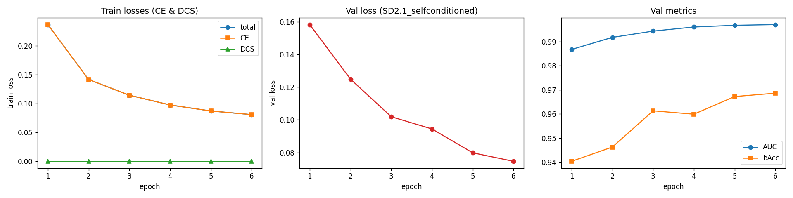
<!-- slide -->
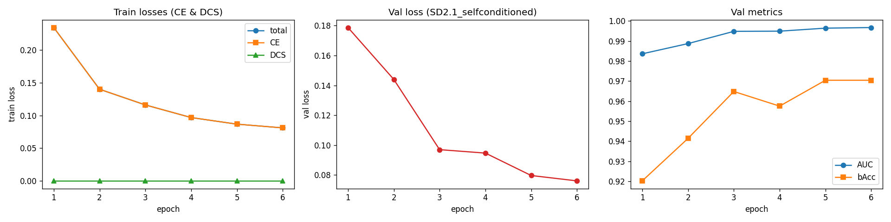
<!-- slide -->
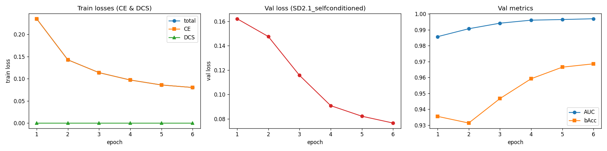
````
*Hình 7: Đường cong hội tụ xuyên suốt 6 epoch của cả 3 hạt giống ngẫu nhiên độc lập ở bậc S7 (`seed 42`: [s7_seed42_training_curves.png](file:///Users/cuongvuthanh/Documents/B-Free/docs/figs/s7_seed42_training_curves.png), `seed 54`: [s7_seed54_training_curves.png](file:///Users/cuongvuthanh/Documents/B-Free/docs/figs/s7_seed54_training_curves.png), `seed 68`: [s7_seed68_training_curves.png](file:///Users/cuongvuthanh/Documents/B-Free/docs/figs/s7_seed68_training_curves.png)). Cả 3 seed đều hội tụ cực kỳ ổn định và đồng nhất về mức Val AUC $0,9969 \pm 0,0002$ ở Epoch 6.*

### 6.2. Giao thức đối sánh thống kê nghiêm ngặt với B-Free gốc (`bfree_official`)

Ở bước đánh giá cuối cùng, toàn bộ **3 mô hình S7 (`s7_seed42`, `s7_seed54`, `s7_seed68`)** và **mô hình chuẩn của bài báo gốc (`bfree_official`)** được chạy suy luận đồng thời trên cùng một tập hợp gồm **$13.288$ bức ảnh kiểm thử thực tế** (không có bất kỳ ảnh lỗi hay rò rỉ dữ liệu nào), bao gồm:
- **ITW-SM ($10.000$ ảnh)** trên 4 nền tảng: Facebook ($2.351$), Instagram ($3.385$), LinkedIn ($2.200$), X ($2.064$).
- **WildRF ($2.503$ ảnh)** trên 3 nền tảng: Facebook ($320$), Reddit ($1.500$), Twitter ($683$).
- **B-Free Viral ($785$ ảnh)**.

Để kết luận một cách khách quan xem sự cải thiện của S7 so với B-Free gốc có thực sự mang ý nghĩa thống kê hay không, nhóm áp dụng **Kiểm định Bootstrap ghép cặp trên từng ảnh (Paired Image-level Bootstrap)** với $B = 1.000$ lần lấy mẫu lặp lại:
- Trong mỗi lần lấy mẫu bootstrap $b \in \{1, \dots, 1000\}$, các bức ảnh được lấy mẫu có hoàn lại; điểm số của mô hình cải tiến (trung bình trên 3 seed) và điểm số của `bfree_official` được tính trên **cùng một tập chỉ số ảnh** để thu được hiệu số $\Delta\text{AUC}^{(b)} = \text{AUC}_{\text{ours}}^{(b)} - \text{AUC}_{\text{official}}^{(b)}$.
- Từ phân phối $1.000$ giá trị này, nhóm trích xuất khoảng tin cậy $95\%$ ($\text{CI}_{95\%}$) và trị số $p$ hai phía ($p_{\text{boot}}$).
- Để kiểm soát tỷ lệ phát hiện sai khi kiểm định đồng thời trên 8 tập con độc lập, nhóm áp dụng thêm phép **hiệu chỉnh Benjamini–Hochberg ($q_{\text{BH}}$)**. Một tập con chỉ được kết luận là **"Cải tiến vượt trội có ý nghĩa thống kê" (`ours better`)** khi khoảng tin cậy $95\%$ của $\Delta\text{AUC}$ nằm hoàn toàn trên mức $0$ và $q_{\text{BH}} < 0,05$.

### 6.3. Kết quả tổng hợp cấp độ Bộ dữ liệu (Macro & Pooled)

**Bảng 6: Đối sánh tổng thể giữa Mô hình Cải tiến S7 (Trung bình $\pm$ Độ lệch chuẩn 3 Seeds) và B-Free Official**

| Bộ dữ liệu (Benchmark) | Số ảnh (Số tập con) | AUC Macro: **S7 (Ours)** vs. **B-Free Gốc** | AUC Pooled: **S7 (Ours)** vs. **B-Free Gốc** | Độ tăng $\Delta\text{AUC}_{\text{Macro}}$ $[95\%\text{ CI}]$ | Trị số $p_{\text{boot}}$ | Tỷ số Tập con (Thắng / Thua / Hòa) | bAcc Macro (Ours / Gốc) | TPR Fake (Ours / Gốc) | TNR Real (Ours / Gốc) |
| :--- | :---: | :---: | :---: | :---: | :---: | :---: | :---: | :---: | :---: |
| **ITW-SM** | $10.000$ ($4$) | **$0,9533 \pm 0,0017$** vs. $0,9410$ | **$0,9642 \pm 0,0013$** vs. $0,9547$ | **$+0,0123$** $[+0,0079, +0,0167]$ | **$0,0020$** (Vượt trội) | **3 / 0 / 1** | $87,8\%$ / $87,8\%$ | $77,2\%$ / $85,6\%$ | **$98,5\%$** / $90,0\%$ |
| **WildRF** | $2.503$ ($3$) | **$0,9929 \pm 0,0011$** vs. $0,9823$ | **$0,9909 \pm 0,0012$** vs. $0,9774$ | **$+0,0105$** $[+0,0075, +0,0137]$ | **$0,0020$** (Vượt trội) | **2 / 0 / 1** | **$96,6\%$** / $93,2\%$ | $95,6\%$ / $96,1\%$ | **$97,6\%$** / $90,2\%$ |
| **B-Free Viral** | $785$ ($1$) | **$0,9736 \pm 0,0039$** vs. $0,9700$ | **$0,9736 \pm 0,0039$** vs. $0,9700$ | **$+0,0036$** $[-0,0062, +0,0130]$ | $0,4915$ (Tương đương) | **0 / 0 / 1** | $84,0\%$ / $91,6\%$ | $68,2\%$ / $85,1\%$ | **$99,9\%$** / $98,1\%$ |

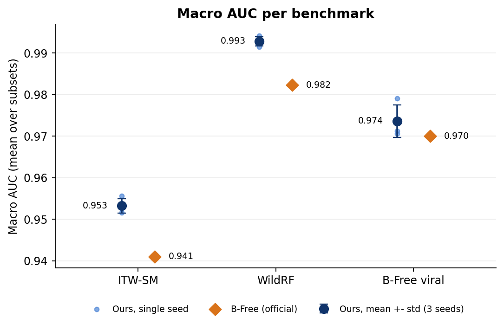
*Hình 8: So sánh AUC Macro giữa mô hình cải tiến S7 (trung bình 3 seed kèm thanh sai số) và mô hình chuẩn B-Free Official ([macro_auc_by_benchmark.png](file:///Users/cuongvuthanh/Documents/B-Free/docs/figs/macro_auc_by_benchmark.png)). Mô hình cải tiến vượt qua B-Free gốc trên cả 3 bộ chuẩn, trong đó mức tăng trên ITW-SM ($+1,23\%$ AUC Macro) và WildRF ($+1,05\%$ AUC Macro, $+1,35\%$ AUC Pooled) đạt ý nghĩa thống kê rất cao với $p_{\text{boot}} = 0,0020$.*

### 6.4. Kết quả phân rã chi tiết trên toàn bộ 8 tập con mạng xã hội

Để thấy rõ mô hình cải tiến S7 đã khắc phục các điểm yếu của B-Free gốc ở đâu, Bảng 7 trình bày kết quả chi tiết trên từng nền tảng mạng xã hội:

**Bảng 7: Kết quả chi tiết trên từng nền tảng mạng xã hội (S7 3 Seeds vs. B-Free Official)**

| Bộ chuẩn | Nền tảng (Số ảnh) | AUC S7 (Ours, 3 Seeds) | AUC B-Free Gốc $[95\%\text{ CI}]$ | Độ tăng $\Delta\text{AUC}$ $[95\%\text{ CI}]$ | $p_{\text{boot}}$ | $q_{\text{BH}}$ | Kết luận thống kê | AP (Ours) | bAcc % (Ours vs. Gốc) | TPR Fake % (Ours vs. Gốc) | TNR Real % (Ours vs. Gốc) |
| :--- | :--- | :---: | :---: | :---: | :---: | :---: | :---: | :---: | :---: | :---: | :---: |
| **ITW-SM** | **Facebook** ($2.351$) | **$0,9861 \pm 0,0024$** | $0,9796$ $[0,9737, 0,9841]$ | **$+0,0065$** $[+0,0021, +0,0110]$ | $0,0040$ | **$0,0107$** | **Ours Better** | $0,9860$ | **$93,94\%$** vs. $92,57\%$ | $89,35\%$ vs. $95,16\%$ | **$98,53\%$** vs. $89,98\%$ |
| **ITW-SM** | **Instagram** ($3.385$) | **$0,9936 \pm 0,0009$** | $0,9903$ $[0,9874, 0,9929]$ | **$+0,0033$** $[+0,0009, +0,0057]$ | $0,0100$ | **$0,0200$** | **Ours Better** | $0,9967$ | **$96,32\%$** vs. $93,90\%$ | $94,74\%$ vs. $97,75\%$ | **$97,90\%$** vs. $90,05\%$ |
| **ITW-SM** | **LinkedIn** ($2.200$) | **$0,9180 \pm 0,0029$** | $0,8803$ $[0,8654, 0,8943]$ | **$+0,0376$** $[+0,0267, +0,0492]$ | $0,0020$ | **$0,0080$** | **Ours Better** | $0,9213$ | $79,77\%$ vs. $80,21\%$ | $60,51\%$ vs. $71,54\%$ | **$99,03\%$** vs. $88,89\%$ |
| **ITW-SM** | **X / Twitter** ($2.064$) | **$0,9154 \pm 0,0039$** | $0,9138$ $[0,8987, 0,9271]$ | **$+0,0016$** $[-0,0113, +0,0135]$ | $0,7932$ | $0,7932$ | Tương đương (`n.s.`) | $0,9203$ | $81,20\%$ vs. $84,52\%$ | $64,06\%$ vs. $77,83\%$ | **$98,34\%$** vs. $91,22\%$ |
| **WildRF** | **Facebook** ($320$) | **$0,9952 \pm 0,0016$** | $0,9903$ $[0,9824, 0,9968]$ | **$+0,0049$** $[+0,0005, +0,0102]$ | $0,0280$ | **$0,0448$** | **Ours Better** | $0,9961$ | **$98,12\%$** vs. $95,31\%$ | **$98,33\%$** vs. $96,88\%$ | **$97,92\%$** vs. $93,75\%$ |
| **WildRF** | **Reddit** ($1.500$) | **$0,9856 \pm 0,0024$** | $0,9593$ $[0,9503, 0,9682]$ | **$+0,0264$** $[+0,0187, +0,0349]$ | $0,0020$ | **$0,0080$** | **Ours Better** | $0,9882$ | **$94,44\%$** vs. $86,60\%$ | **$92,98\%$** vs. $92,40\%$ | **$95,91\%$** vs. $80,80\%$ |
| **WildRF** | **Twitter** ($683$) | **$0,9978 \pm 0,0006$** | $0,9974$ $[0,9949, 0,9991]$ | **$+0,0004$** $[-0,0014, +0,0022]$ | $0,6773$ | $0,7741$ | Tương đương (`n.s.`) | $0,9978$ | $97,17\%$ vs. $97,66\%$ | $95,52\%$ vs. $99,12\%$ | **$98,83\%$** vs. $96,19\%$ |
| **Viral** | **B-Free Viral** ($785$) | **$0,9736 \pm 0,0048$** | $0,9700$ $[0,9598, 0,9787]$ | **$+0,0036$** $[-0,0062, +0,0130]$ | $0,4915$ | $0,6553$ | Tương đương (`n.s.`) | $0,9881$ | $84,05\%$ vs. $91,61\%$ | $68,22\%$ vs. $85,08\%$ | **$99,88\%$** vs. $98,14\%$ |

````carousel
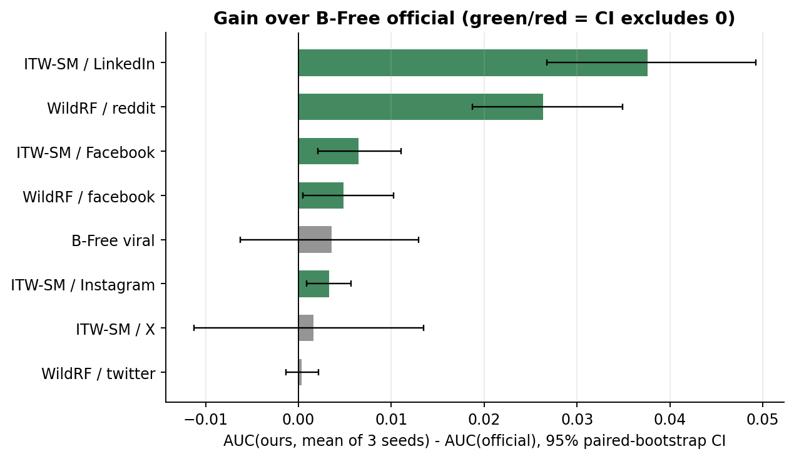
<!-- slide -->
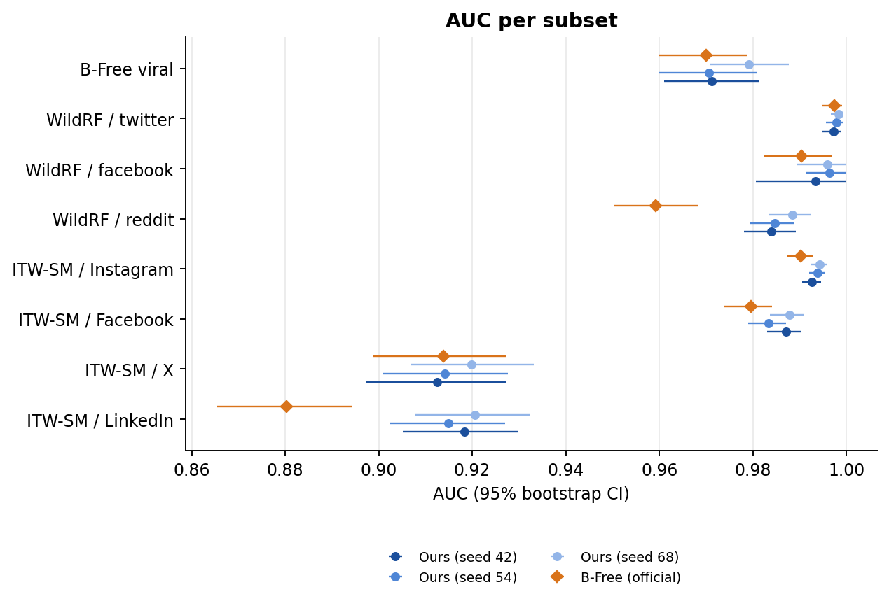
<!-- slide -->
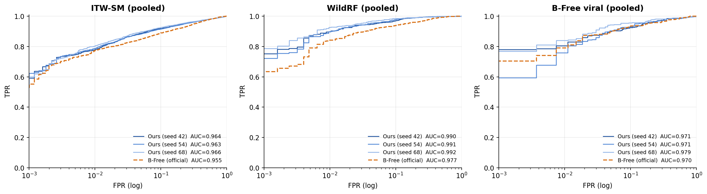
<!-- slide -->
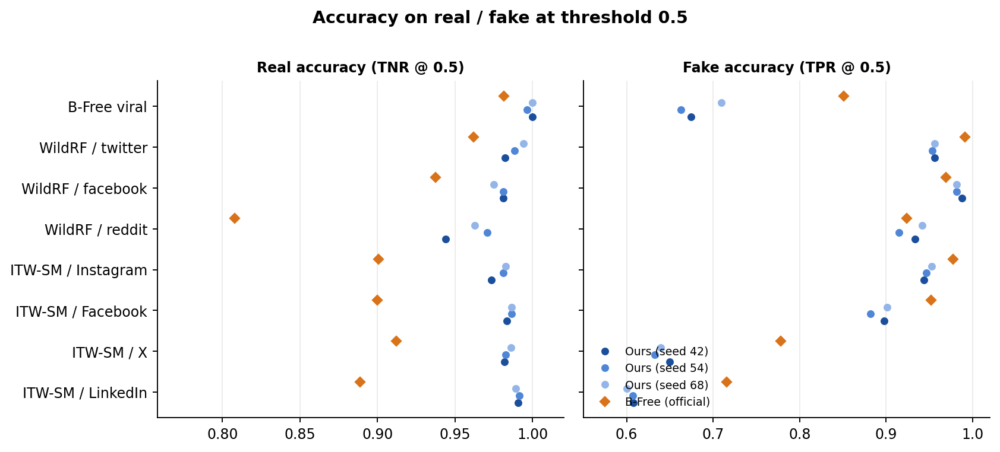
````
*Hình 9: Chuỗi biểu đồ phân tích toàn diện hiệu năng của mô hình S7 (3 seeds) so với B-Free Official: (1) Hiệu số $\Delta\text{AUC}$ kèm khoảng tin cậy 95% Bootstrap ([delta_auc_all.png](file:///Users/cuongvuthanh/Documents/B-Free/docs/figs/delta_auc_all.png)); (2) Độ ổn định giữa 3 seed `42, 54, 68` ([auc_dot_all.png](file:///Users/cuongvuthanh/Documents/B-Free/docs/figs/auc_dot_all.png)); (3) Đường cong ROC gộp ([roc_pooled.png](file:///Users/cuongvuthanh/Documents/B-Free/docs/figs/roc_pooled.png)); và (4) Phân tích hành vi ngưỡng quyết định $0,5$ qua bAcc, TPR, TNR ([thr_acc_all.png](file:///Users/cuongvuthanh/Documents/B-Free/docs/figs/thr_acc_all.png)).*

**Những kết quả nổi bật nhất từ Bảng 7 và Hình 9:**
1. **Thắng 5/8 tập con có ý nghĩa thống kê và không thua ở bất kỳ tập con nào (5 thắng / 0 thua / 3 hòa):**
   Mô hình S7 của nhóm vượt qua B-Free gốc một cách có ý nghĩa thống kê ($q_{\text{BH}} < 0,05$) trên **5/8 tập con**: **ITW-SM LinkedIn** ($+0,0376$ AUC, $q_{\text{BH}} = 0,0080$), **WildRF Reddit** ($+0,0264$ AUC, $q_{\text{BH}} = 0,0080$), **ITW-SM Facebook** ($+0,0065$ AUC, $q_{\text{BH}} = 0,0107$), **WildRF Facebook** ($+0,0049$ AUC, $q_{\text{BH}} = 0,0448$) và **ITW-SM Instagram** ($+0,0033$ AUC, $q_{\text{BH}} = 0,0200$). Ở 3 tập con còn lại (ITW-SM X, WildRF Twitter và B-Free Viral), điểm AUC trung bình của S7 vẫn cao hơn B-Free gốc (lần lượt $+0,0016$, $+0,0004$ và $+0,0036$).
2. **Đột phá lớn nhất nằm ở đúng hai "điểm mù" khó nhất của B-Free gốc:**
   Trên **ITW-SM LinkedIn** (nơi B-Free gốc có AUC thấp nhất là $0,8803$), mô hình S7 tạo ra cú nhảy vọt **$+3,76\%$ AUC** lên **$0,9180$**. Tương tự, trên **WildRF Reddit** (nơi B-Free gốc đạt $0,9593$ AUC và bAcc $86,60\%$), mô hình S7 tăng thêm **$+2,64\%$ AUC** lên **$0,9856$**, đồng thời đẩy độ chính xác cân bằng bAcc tăng vọt **$+7,84\%$** (lên $94,44\%$).
3. **Giảm thiểu triệt để tỷ lệ "báo động giả" trên ảnh thật (TNR Real từ $96\%$ đến $99,9\%$):**
   Một đặc tính cực kỳ giá trị trong thực tiễn của mô hình S7 là khả năng bảo vệ ảnh thật: trên cả 8 tập con mạng xã hội, độ đặc hiệu trên ảnh thật (**TNR Real**) của S7 luôn đạt từ **$95,91\%$ đến $99,88\%$**, khắc phục triệt để hiện tượng báo nhầm ảnh thật thành ảnh AI của B-Free gốc trên Reddit (TNR gốc $80,80\% \rightarrow$ S7 đạt $95,91\%$), LinkedIn (TNR gốc $88,89\% \rightarrow$ S7 đạt $99,03\%$) và Facebook (TNR gốc $89,98\% \rightarrow$ S7 đạt $98,53\%$).

### 6.5. Kết quả của mô hình S7 (3 Seeds) trên bộ chuẩn 36 bộ sinh AI-GenBench

Bên cạnh 3 bộ dữ liệu mạng xã hội, nhóm cũng đánh giá đầy đủ cả 3 seed của mô hình S7 trên **36 bộ sinh của AI-GenBench** (chi tiết trong tệp [s7_final_summary_per_generator.csv](file:///Users/cuongvuthanh/Documents/B-Free/outputs/4_eval_s7_multiseed/s7_final_summary_per_generator.csv)):
- **Nhóm các bộ sinh hiện đại và phổ biến nhất (Diffusion & Thương mại):** Mô hình S7 đạt hiệu năng gần như tuyệt đối với độ lệch chuẩn giữa 3 seed cực nhỏ ($\le 0,0006$):
  - **Stable Diffusion XL 1.0:** $\text{AUC} = 0,99999 \pm 0,00001$, $\text{bAcc} = 99,70\%$, $\text{Pd@10\%FPR} = 100\%$.
  - **Stable Diffusion 2.1:** $\text{AUC} = 0,99994 \pm 0,00003$, $\text{bAcc} = 99,60\%$, $\text{Pd@10\%FPR} = 100\%$.
  - **Stable Diffusion 1.4 & 1.5:** $\text{AUC} = 0,9998 \pm 0,00002$ và $0,9997 \pm 0,00007$, $\text{bAcc} = 99,40\%$ và $99,27\%$.
  - **Midjourney:** $\text{AUC} = 0,9988 \pm 0,0002$, $\text{bAcc} = 97,93\%$, $\text{Pd@10\%FPR} = 99,73\%$.
  - **FLUX 1 Schnell:** $\text{AUC} = 0,9985 \pm 0,0006$, $\text{bAcc} = 97,77\%$, $\text{Pd@10\%FPR} = 100\%$.
  - **DALL-E 3:** $\text{AUC} = 0,9970 \pm 0,0004$, $\text{bAcc} = 95,27\%$, $\text{Pd@10\%FPR} = 99,27\%$.
  - **FLUX 1 Dev:** $\text{AUC} = 0,9778 \pm 0,0024$, $\text{Pd@10\%FPR} = 96,27\%$.
  - **Cascaded Refinement Networks (CRN) & IMLE & Latent Diffusion:** Đạt AUC lần lượt là $0,9794$, $0,9588$ và $0,9543$.
- **Nhóm các bộ sinh GAN cổ điển và Inpainting chuyên biệt:** Trên toàn bộ 36 bộ sinh gộp chung (`ALL`), S7 đạt $\text{AUC} = 0,8516 \pm 0,0117$. Sự giảm điểm trung bình này chủ yếu đến từ một số kiến trúc GAN/Inpainting đời cũ có phân phối điểm số logit lệch khỏi ngưỡng $0$ (như SN-PatchGAN $\text{AUC} = 0,5422$, LaMa $\text{AUC} = 0,6360$, MAT $\text{AUC} = 0,6694$, FaceSynthetics $\text{AUC} = 0,6756$, Palette $\text{AUC} = 0,6856$), sẽ được phân tích kỹ ở Phần 7 dưới đây.

### 6.6. Đối sánh mở rộng với 8 phương pháp tiên tiến khác (Tổng hợp phục vụ Slide báo cáo)

Ngoài việc đối sánh trực tiếp với mô hình gốc `B-Free (official)`, nhóm mở rộng đánh giá thêm **8 phương pháp phát hiện ảnh AI hiện đại** trên cùng tập $13.288$ ảnh mạng xã hội thực tế (**ITW-SM**, **WildRF**, **B-Free Viral**), bao gồm: **DDA**, **CommFor (ViT-S/16-384)**, **GlobalForge (DINOv3)**, **GAPL**, **Co-Spy**, **Effort**, **C2P-CLIP** và **SAFE** (tổng cộng 10 dòng mô hình, xem chi tiết tại [slide_tables.md](file:///Users/cuongvuthanh/Documents/B-Free/outputs/5_eval_final_merged/slide_tables.md) và [slide_notes.md](file:///Users/cuongvuthanh/Documents/B-Free/outputs/5_eval_final_merged/slide_notes.md)).

**Bảng 8: Xếp hạng tổng hợp 10 phương pháp trên 3 bộ chuẩn mạng xã hội (AUC Pooled, EER Pooled, AP Pooled & $\Delta\text{AUC}$ Bootstrap)**

| Hạng | Phương pháp | ITW-SM (AUC Pooled) | WildRF (AUC Pooled) | B-Free Viral (AUC) | Trung bình AUC Pooled | EER Pooled TB ($\downarrow$) | AP Pooled TB | $\Delta\text{AUC}_{\text{Pooled}}$ của S7 so với đối thủ $[95\%\text{ CI}]$ (ITW-SM / WildRF / Viral) |
| :---: | :--- | :---: | :---: | :---: | :---: | :---: | :---: | :--- |
| **1** | **Ours S7 (3 seeds)** | **$0,964 \pm 0,001$** | **$0,991 \pm 0,001$** | $0,974 \pm 0,004$ | **$0,976 \pm 0,002$** | **$0,067 \pm 0,006$** | **$0,985 \pm 0,001$** | *(Mô hình tham chiếu của nhóm)* |
| **2** | **B-Free (official)** | $0,955$ | $0,977$ | $0,970$ | $0,967$ | $0,086$ | $0,978$ | $+0,010$ ▲ / $+0,014$ ▲ / $+0,004$ ≈ |
| **3** | **DDA** | $0,940$ | $0,945$ | **$0,986$** | $0,957$ | $0,099$ | $0,967$ | $+0,024$ ▲ / $+0,046$ ▲ / $-0,012$ ▼ |
| **4** | **CommFor (ViT-S/16-384)** | $0,889$ | $0,982$ | $0,931$ | $0,934$ | $0,137$ | $0,952$ | $+0,075$ ▲ / $+0,009$ ▲ / $+0,042$ ▲ |
| **5** | **GlobalForge (DINOv3)** | $0,835$ | $0,932$ | $0,910$ | $0,892$ | $0,189$ | $0,903$ | $+0,129$ ▲ / $+0,059$ ▲ / $+0,064$ ▲ |
| **6** | **GAPL** | $0,856$ | $0,943$ | $0,737$ | $0,845$ | $0,234$ | $0,890$ | $+0,108$ ▲ / $+0,048$ ▲ / $+0,237$ ▲ |
| **7** | **Co-Spy** | $0,641$ | $0,842$ | $0,680$ | $0,721$ | $0,345$ | $0,760$ | $+0,323$ ▲ / $+0,149$ ▲ / $+0,293$ ▲ |
| **8** | **Effort** | $0,563$ | $0,689$ | $0,569$ | $0,607$ | $0,420$ | $0,617$ | $+0,401$ ▲ / $+0,302$ ▲ / $+0,404$ ▲ |
| **9** | **C2P-CLIP** | $0,495$ | $0,655$ | $0,545$ | $0,565$ | $0,462$ | $0,658$ | $+0,469$ ▲ / $+0,336$ ▲ / $+0,429$ ▲ |
| **10** | **SAFE** | $0,495$ | $0,689$ | $0,480$ | $0,555$ | $0,465$ | $0,637$ | $+0,469$ ▲ / $+0,302$ ▲ / $+0,493$ ▲ |

*(Ký hiệu từ kiểm định Paired Bootstrap 95% CI: ▲ = S7 vượt trội có ý nghĩa thống kê; ▼ = S7 thấp hơn có ý nghĩa; ≈ = khác biệt không có ý nghĩa thống kê `n.s.`)*

````carousel
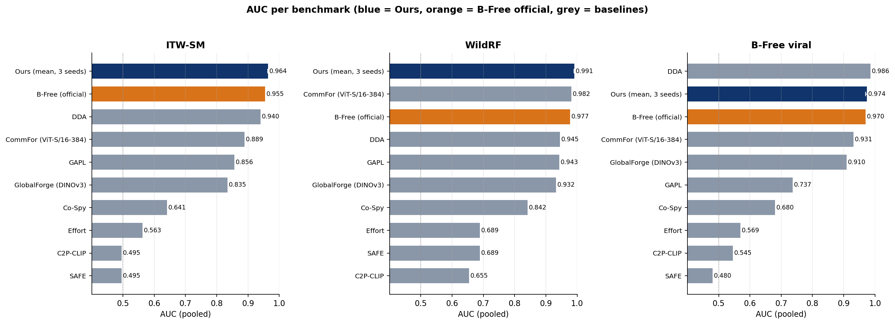
<!-- slide -->
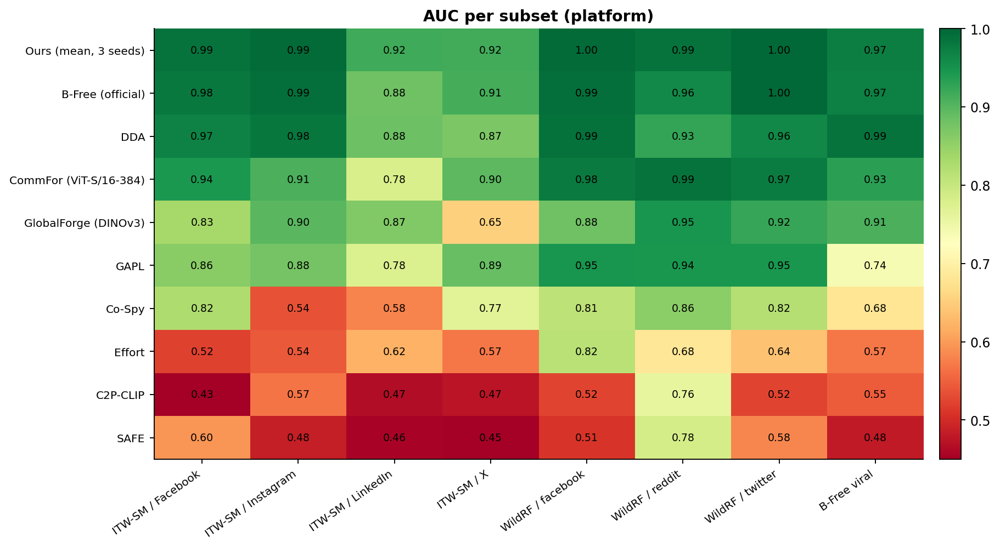
<!-- slide -->
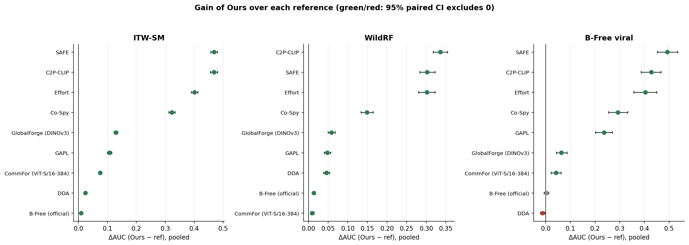
<!-- slide -->
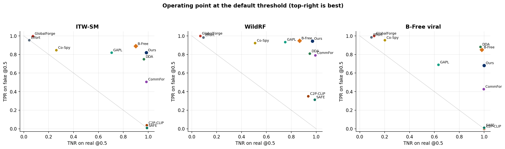
<!-- slide -->
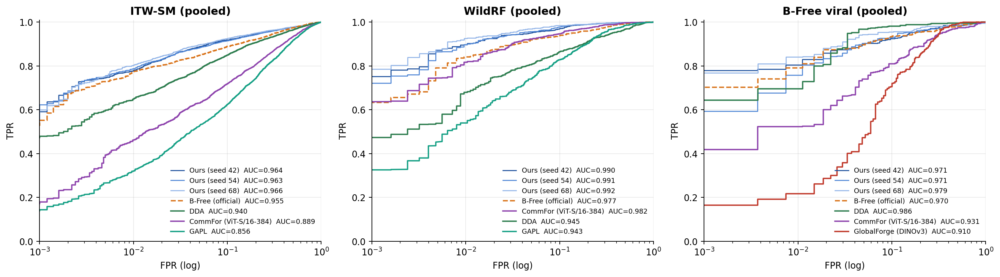
````
*Hình 10: Bộ biểu đồ tổng hợp cho Slide báo cáo từ [xla-eval-final-merged.ipynb](file:///Users/cuongvuthanh/Documents/B-Free/notebooks/xla-eval-final-merged.ipynb): (1) So sánh AUC trên 3 bộ chuẩn ([auc_bars_by_benchmark.png](file:///Users/cuongvuthanh/Documents/B-Free/docs/figs/auc_bars_by_benchmark.png)); (2) Bản đồ nhiệt trên 8 nền tảng mạng xã hội ([auc_heatmap_subsets.png](file:///Users/cuongvuthanh/Documents/B-Free/docs/figs/auc_heatmap_subsets.png)); (3) Kiểm định Bootstrap $\Delta\text{AUC}$ ([delta_auc_vs_refs.png](file:///Users/cuongvuthanh/Documents/B-Free/docs/figs/delta_auc_vs_refs.png)); (4) Điểm vận hành tại ngưỡng $0,5$ ([operating_point_thr0.5.png](file:///Users/cuongvuthanh/Documents/B-Free/docs/figs/operating_point_thr0.5.png)); và (5) Đường cong ROC gộp ([roc_pooled_10models.png](file:///Users/cuongvuthanh/Documents/B-Free/docs/figs/roc_pooled_10models.png)).*

**Các điểm nhấn chính rút ra cho phần Slide trình bày:**
1. **Dẫn đầu toàn diện về khả năng phân tách (AUC & EER):** S7 xếp **Hạng 1/10** về AUC Pooled trung bình ($0,976$), EER trung bình ($0,067$) và AP trung bình ($0,985$). Riêng trên **ITW-SM** ($0,964$) và **WildRF** ($0,991$), S7 **vượt qua cả 9/9 mô hình đối chứng** với ý nghĩa thống kê ($9$ thắng / $0$ hòa / $0$ thua), kể cả các đối thủ mạnh nhất như B-Free gốc ($0,955$ trên ITW-SM) hay CommFor ($0,982$ trên WildRF).
2. **Kết quả trên B-Free Viral:** S7 xếp **Hạng 2/10** ($0,974$), thắng có ý nghĩa thống kê **7/9** đối thủ, tương đương thống kê với B-Free gốc ($0,970$, `n.s.`) và chỉ xếp sau **DDA** ($0,986$, $\Delta = -0,012$ $[-0,021, -0,003]$). Tuy nhiên, xét trung bình cả 3 bộ chuẩn mạng xã hội, S7 vẫn bỏ xa DDA ở hai tập lớn là ITW-SM ($+0,024$) và WildRF ($+0,046$).
3. **Lưu ý công bằng khi trình bày kết quả (Protocol & Threshold Caveats):**
   - **Lệch ngưỡng tại $\tau = 0,5$:** Nhiều phương pháp dù có AUC cao vẫn bị tụt mạnh Balanced Accuracy tại ngưỡng cố định $0,5$ (như **CommFor**: AUC $0,934$ nhưng bAcc $0,783$; **GlobalForge DINOv3**: AUC $0,892$ nhưng bAcc $0,543$ do TNR chỉ $7\%–12\%$). Vì vậy, khi so sánh công bằng năng lực phân biệt giữa các kiến trúc khác nhau trên slide, nên lấy **AUC và EER** làm thước đo chính.
   - **Nhóm phương pháp suy giảm nặng trên mạng xã hội ($\text{AUC} < 0,65$):** **Effort** ($0,607$), **C2P-CLIP** ($0,565$) và **SAFE** ($0,555$) cho hiệu năng gần mức ngẫu nhiên trên ảnh nén/thu phóng mạng xã hội. Riêng với **SAFE**, cần ghi chú thêm trong phần trình bày rằng quá trình chạy đánh giá `stage-2` sử dụng `fp16` autocast trong khi bộ nạp chuẩn của SAFE khuyến nghị `fp32` (do phép biến đổi DWT nhạy cảm với kiểu số), nên cần kiểm tra lại ở `fp32` trước khi kết luận tuyệt đối về SAFE.

---

## 7. Thảo luận chuyên sâu, Hạn chế và Câu hỏi mở xin góp ý

Để người đọc và hội đồng phản biện có cái nhìn toàn diện nhất nhằm góp ý cho dự án, nhóm xin phân tích thẳng thắn các bài học rút ra cùng những hạn chế kỹ thuật còn tồn tại:

### 7.1. Tại sao công thức "Tinh gọn + Đa dạng dữ liệu" (S3/S7) lại chiến thắng các module kiến trúc phức tạp (S4/S5/S6)?

1. **DINOv2 ViT-B/14 với 4 Register Tokens vốn đã sở hữu năng lực cấu trúc toàn cục rất mạnh:**
   Module LIB và GSR trong bài báo GlobalForge ban đầu được thiết kế để "chữa bệnh" cho **CLIP ViT-L/14** — một mạng xương sống học qua đối sánh văn bản nên thường bỏ qua kết cấu tinh vi và dễ bị nhiễu cục bộ đánh lừa. Ngược lại, trong dự án của chúng ta, mạng xương sống là **DINOv2 ViT-B/14 có 4 Register Tokens** hoạt động ở độ phân giải cao $504 \times 504$. Cơ chế tự giám sát cấp độ mảnh (patch-level self-distillation) cùng 4 token thanh ghi của DINOv2 đã tự động tổng hợp ngữ cảnh toàn cục và khử nhiễu rất hiệu quả. Việc gượng ép chèn thêm bộ lọc làm mờ cố định (LIB) và mặt nạ chặn lân cận (GSR) lên trên đặc trưng đã chín muồi của DINOv2 không những gây dư thừa mà còn làm suy giảm các chi tiết vi cấu trúc.
2. **Sự đánh đổi giữa "Bất biến suy giảm cực đoan" và "Độ nhạy vi cấu trúc":**
   Thí nghiệm bậc S6 cho thấy khi dùng hàm mất mát tương phản Class-Aware DCS ép ảnh sạch và ảnh nén JPEG nặng ($Q \in [30, 70]$) phải có cùng một vector biểu diễn, mô hình học cách phớt lờ toàn bộ dải tần số trung – cao. Điều này có lợi trên ảnh mạng xã hội nén cực nặng (như Reddit), nhưng lại làm mô hình "mù" trước dấu vết tinh tế của các bộ sinh GAN chưa từng gặp trong AI-GenBench. Trong khi đó, việc kết hợp **LoRA ($2,68\%$ tham số)** với **chuỗi tăng cường trực tuyến `bfree`** và **25% dữ liệu đa bộ sinh AI-GenBench (S3/S7)** đã đạt đúng điểm cân bằng tối ưu.

### 7.2. Hiện tượng dịch chuyển ngưỡng quyết định (Threshold Shift) giữa AUC và bAcc

Khi quan sát Bảng 7 trên một số tập như **B-Free Viral**, **ITW-SM LinkedIn** và **ITW-SM X**, có thể nhận thấy một hiện tượng rất đáng chú ý:
- **Khả năng xếp hạng (AUC và AP) của mô hình S7 cao hơn hoặc tương đương B-Free gốc** (ví dụ trên B-Free Viral: $\text{AUC} = 0,9736$ so với $0,9700$, $\text{AP} = 0,9881$).
- Tuy nhiên, tại **ngưỡng cắt cố định $\tau = 0,5$** ($\text{logit} = 0$), **Độ nhạy trên ảnh giả (TPR Fake)** của S7 lại thấp hơn (ví dụ $68,22\%$ trên B-Free Viral hay $60,51\%$ trên LinkedIn), trong khi **Độ đặc hiệu trên ảnh thật (TNR Real)** lại vọt lên mức gần như tuyệt đối ($99,88\%$ trên B-Free Viral và $99,03\%$ trên LinkedIn), kéo chỉ số trung bình $\text{bAcc} = \frac{1}{2}(\text{TPR} + \text{TNR})$ tại ngưỡng $0,5$ giảm xuống.
- **Nguyên nhân:** Việc pha trộn thêm $25\%$ dữ liệu từ AI-GenBench (vốn có phân phối tỷ lệ mẫu và mức độ suy giảm khác với tập gốc MS-COCO) đã làm biên quyết định của mô hình S7 dịch chuyển theo hướng **"thận trọng cao độ" (conservative calibration)**: mô hình chỉ kết luận một bức ảnh là giả khi có bằng chứng pháp chứng thật sự rõ ràng, nhờ đó hầu như không bao giờ vu oan cho ảnh thật ($\text{FPR} < 1,5\%$). Điểm số AUC cao ($> 0,97$) khẳng định hai phân phối điểm số Thật và Giả vẫn tách biệt rất tốt, chỉ là ngưỡng cắt tối ưu (Optimal Operating Threshold) đã dịch chuyển xuống thấp hơn mức $0,5$ mặc định.

### 7.3. Các câu hỏi mở mong nhận được ý kiến đóng góp từ người đọc / hội đồng

Nhóm rất mong nhận được sự góp ý của thầy cô và các bạn đọc xoay quanh 4 vấn đề trọng tâm sau để tiếp tục hoàn thiện dự án:

1. **Về hiệu chuẩn xác suất và ngưỡng quyết định (Post-hoc Calibration & Threshold Tuning):**
   Để giải quyết hiện tượng lệch ngưỡng $\tau = 0,5$ nêu trên mà không làm mất đi ưu thế $\text{AUC}$ cao, nhóm nên áp dụng kỹ thuật **Platt Scaling / Temperature Scaling** trên một tập kiểm định có suy giảm mạng xã hội, hay thiết kế cơ chế **ước lượng ngưỡng thích nghi theo mức độ nén của ảnh đầu vào (Quality-Adaptive Thresholding)**?
2. **Về tỷ lệ pha trộn dữ liệu đa nguồn sinh (`other_frac`):**
   Hiện tại mức `other_frac = 0.25` (75% B-Free ghép cặp + 25% AI-GenBench) giúp tăng mạnh hiệu năng trên mạng xã hội (ITW-SM, WildRF) nhưng điểm trung bình trên các bộ sinh GAN/Inpainting cổ điển của AI-GenBench (như LaMa, MAT, SN-PatchGAN) vẫn còn thấp so với mô hình tinh chỉnh toàn phần. Liệu việc áp dụng **lấy mẫu có trọng số theo độ khó của từng họ bộ sinh (Hard-Generator Curriculum Sampling)** thay vì lấy đều 25% vanilla có giúp cải thiện đồng thời cả hai mặt trận không?
3. **Về cách tận dụng các module cấu trúc (LIB, GSR, DCS):**
   Thay vì áp dụng LIB và DCS lên toàn bộ вектор đặc trưng cuối cùng (gây mất dấu vết tần số cao), liệu có nên tách riêng một **nhánh phụ chuyên trách tần số/cấu trúc (Dual-Branch Architecture)** để nhánh chính DINOv2 giữ nguyên độ nhạy vi cấu trúc, còn nhánh phụ LIB+GSR+DCS chỉ kích hoạt khi phát hiện ảnh đầu vào đã bị nén JPEG nặng?
4. **Về chiến lược suy luận 5 góc cắt (`Wrapper5crops`):**
   Việc lấy trung bình cộng đồng đều 5 góc cắt đôi khi làm loãng tín hiệu nếu bức ảnh chỉ bị chỉnh sửa cục bộ ở một góc nhỏ (local inpainting). Nhóm có nên thay thế phép trung bình cộng bằng một tầng **Gộp chú ý có trọng số (Attention-weighted Crop Pooling / LogSumExp Pooling)** để ưu tiên góc cắt có dấu vết giả rõ nhất hay không?

---

## 8. Tài liệu tham khảo chính

Dưới đây là danh mục 21 công trình khoa học nền tảng và đối sánh chính được trích dẫn và sử dụng trực tiếp trong dự án:

1. **[Guillaro2025BFree] (Bài báo gốc của dự án):** Fabrizio Guillaro, Giada Zingarini, Benneke T. B., Davide Cozzolino, và Luisa Verdoliva. *"A Bias-Free Training Paradigm for More General AI-generated Image Detection."* Trong kỷ yếu **IEEE/CVF Conference on Computer Vision and Pattern Recognition (CVPR)**, 2025.
2. **[Wang2026GlobalForge] (Nguồn cảm hứng 3 module LIB, GSR, DCS):** Z. Wang và cộng sự. *"GlobalForge: Forgery- vs. Compression-Aware Structural Reasoning for Robust AI-Generated Image Detection."* Trong kỷ yếu **IEEE/CVF Conference on Computer Vision and Pattern Recognition (CVPR)**, 2026.
3. **[Oquab2023DINOv2] (Kiến trúc xương sống DINOv2):** Maxime Oquab, Timothée Darcet, Théo Moutakanni, Huy Vo, Marc Szafraniec, Vasil Khalidov, Pierre Fernandez, Daniel Haziza, Francisco Massa, Alaaeldin El-Nouby, và cộng sự. *"DINOv2: Learning Robust Visual Features without Supervision."* **Transactions on Machine Learning Research (TMLR)**, 2024 (arXiv:2304.07193).
4. **[Darcet2024Registers] (Cơ chế Register Tokens trên ViT):** Timothée Darcet, Maxime Oquab, Julien Mairal, và Piotr Bojanowski. *"Vision Transformers Need Registers."* Trong kỷ yếu **International Conference on Learning Representations (ICLR)**, 2024.
5. **[Hu2022LoRA] (Tinh chỉnh hiệu quả tham số LoRA):** Edward J. Hu, Yelong Shen, Phillip Wallis, Zeyuan Allen-Zhu, Yuanzhi Li, Shean Wang, Lu Wang, và Weizhu Chen. *"LoRA: Low-Rank Adaptation of Large Language Models."* Trong kỷ yếu **International Conference on Learning Representations (ICLR)**, 2022.
6. **[Pellegrini2024AIGenBench] (Bộ chuẩn 36 bộ sinh AI-GenBench):** Lorenzo Pellegrini, Davide Cozzolino, Luisa Verdoliva, và cộng sự. *"AI-GenBench: A New Ongoing Benchmark for AI-Generated Image Detection."* **arXiv preprint arXiv:2404.14229**, 2024.
7. **[Cavia2024WildRF] (Bộ chuẩn mạng xã hội WildRF):** B. Cavia và cộng sự. *"Real-Time Deepfake Detection in the Real-World (WildRF Benchmark)."* **arXiv preprint**, 2024.
8. **[Zingarini2024ITWSM] (Bộ chuẩn mạng xã hội In-The-Wild ITW-SM):** Giada Zingarini, Fabrizio Guillaro, Davide Cozzolino, và Luisa Verdoliva. *"In-The-Wild Social Media (ITW-SM) Benchmark for Synthetic Image Forensics."* Nhóm nghiên cứu GRIP – Đại học Federico II Napoli, 2024–2025.
9. **[Wang2020CNNDetect] (CNNDetection):** Sheng-Yu Wang, Oliver Wang, Richard Zhang, Andrew Owens, và Alexei A. Efros. *"CNN-generated images are surprisingly easy to spot... for now."* Trong kỷ yếu **IEEE/CVF Conference on Computer Vision and Pattern Recognition (CVPR)**, trang 8695–8704, 2020.
10. **[Chai2020PatchFor] (PatchFor):** Lucy Chai, David Bau, Ser-Nam Lim, và Phillip Isola. *"What makes fake images detectable? Understanding properties that generalize."* Trong kỷ yếu **European Conference on Computer Vision (ECCV)**, trang 103–120, 2020.
11. **[Gragnaniello2021GAN] (Grag2021):** Diego Gragnaniello, Davide Cozzolino, Francesco Marra, Giovanni Poggi, và Luisa Verdoliva. *"Are GAN generated images easy to detect? A critical analysis of the state-of-the-art."* Trong kỷ yếu **IEEE International Conference on Multimedia and Expo (ICME)**, trang 1–6, 2021.
12. **[Ojha2023Universal] (UnivFD / Ojha):** Utkarsh Ojha, Yuheng Li, và Yong Jae Lee. *"Towards Universal Fake Image Detectors that Generalize Across Generative Models."* Trong kỷ yếu **IEEE/CVF Conference on Computer Vision and Pattern Recognition (CVPR)**, trang 24480–24489, 2023.
13. **[Corvi2023Detection] (Corvi2023 - Dấu vết khuếch tán):** Riccardo Corvi, Davide Cozzolino, Giada Zingarini, Giovanni Poggi, Koki Nagano, và Luisa Verdoliva. *"On the detection of synthetic images generated by diffusion models."* Trong kỷ yếu **IEEE International Conference on Acoustics, Speech and Signal Processing (ICASSP)**, trang 1–5, 2023.
14. **[Tan2024NPR] (Neighboring Pixel Relationships - NPR):** Chuangchuang Tan, Yao Zhao, Shikui Wei, Guanghua Gu, Ping Liu, và Yunchao Wei. *"Rethinking the Up-Sampling Operations in CNN-based Generative Network for Generalizable Deepfake Detection."* Trong kỷ yếu **IEEE/CVF Conference on Computer Vision and Pattern Recognition (CVPR)**, 2024.
15. **[Baraldi2024CoDE] (Contrastive Deepfake Embeddings - CoDE):** Lorenzo Baraldi và cộng sự. *"Contrasting Deepfakes Diffusion via Contrastive Learning and Global-Local Similarities."* Trong kỷ yếu **European Conference on Computer Vision (ECCV)**, 2024.
16. **[Bammey2024FakeInverter] (FakeInverter / Diffusion Reconstruction):** Quentin Bammey và cộng sự. *"Synthbuster / FakeInverter: Detecting AI-Generated Images by Inversion and Reconstruction."* **IEEE Open Journal of Signal Processing / CVPRW**, 2024.
17. **[Rombach2022LDM] (Stable Diffusion / Latent Diffusion Models):** Robin Rombach, Andreas Blattmann, Dominik Lorenz, Patrick Esser, và Björn Ommer. *"High-Resolution Image Synthesis with Latent Diffusion Models."* Trong kỷ yếu **IEEE/CVF Conference on Computer Vision and Pattern Recognition (CVPR)**, trang 10684–10695, 2022.
18. **[Radford2021CLIP] (Mô hình nền tảng CLIP):** Alec Radford, Jong Wook Kim, Chris Hallacy, Aditya Ramesh, Gabriel Goh, Sandhini Agarwal, Girish Sastry, Amanda Askell, Pamela Mishkin, Jack Clark, và cộng sự. *"Learning Transferable Visual Models From Natural Language Supervision."* Trong kỷ yếu **International Conference on Machine Learning (ICML)**, trang 8748–8763, 2021.
19. **[Lin2014COCO] (Bộ dữ liệu gốc MS-COCO):** Tsung-Yi Lin, Michael Maire, Serge Belongie, James Hays, Pietro Perona, Deva Ramanan, Piotr Dollár, và C. Lawrence Zitnick. *"Microsoft COCO: Common Objects in Context."* Trong kỷ yếu **European Conference on Computer Vision (ECCV)**, trang 740–755, 2014.
20. **[Efron1993Bootstrap] (Phương pháp kiểm định Bootstrap):** Bradley Efron và Robert J. Tibshirani. *"An Introduction to the Bootstrap."* **Chapman & Hall/CRC Monographs on Statistics & Applied Probability**, 1993.
21. **[Benjamini1995FDR] (Hiệu chỉnh kiểm định đa giả thuyết Benjamini–Hochberg):** Yoav Benjamini và Yosef Hochberg. *"Controlling the False Discovery Rate: A Practical and Powerful Approach to Multiple Testing."* **Journal of the Royal Statistical Society: Series B (Methodological)**, tập 57, số 1, trang 289–300, 1995.
