# So sánh Ours S7 với 9 mô hình đối thủ — tài liệu dựng slide

> **Nguồn số liệu duy nhất:** notebook cuối [`xla-eval-final-merged.ipynb`](../../notebooks/xla-eval-final-merged.ipynb) → thư mục output [`outputs/5_eval_final_merged/`](../../outputs/5_eval_final_merged/) (gộp `xla-eval-final-stage-1` + `xla-eval-final-stage-2`).
> Các hình "đối thủ kém hơn bao nhiêu" (mục 2–4) được sinh lại từ cùng CSV đó bằng [`make_gap_figs.py`](make_gap_figs.py). Mọi hình dùng cho slide nằm trong [`docs/slides/figs/`](figs/).

**Quy ước trình bày trong toàn bộ tài liệu**

| Ký hiệu | Ý nghĩa |
|---|---|
| **ΔAUC = Đối thủ − Ours** | Số **âm** = đối thủ **kém** Ours bấy nhiêu điểm AUC |
| 🔴 `▼` | Đối thủ kém hơn Ours, có ý nghĩa thống kê (95% paired-bootstrap CI không chứa 0) |
| ⚪ `≈` | Không khác biệt có ý nghĩa |
| 🟢 `▲` | Đối thủ hơn Ours (chỉ có **1 ô** duy nhất: DDA trên B-Free viral) |
| Màu xanh | **Chỉ dành cho Ours** (hàng tham chiếu) — tránh làm người xem tưởng đối thủ "xanh = tốt" |

---

## 0. Thiết lập đánh giá (1 slide ngắn hoặc chú thích chân trang)

| Mục | Nội dung |
|---|---|
| Mô hình của nhóm | **Ours S7** = DINOv2 ViT-B/14 reg4 + LoRA r=16, train B-Free + 25% AI-GenBench; báo cáo **trung bình ± std của 3 seed** (42 / 54 / 68) |
| Đối thủ (9) | B-Free (official), DDA, CommFor (ViT-S/16-384), GlobalForge (DINOv3), GAPL, Co-Spy, Effort, C2P-CLIP, SAFE — dùng checkpoint công bố |
| Benchmark (ảnh mạng xã hội thật, ngoài phân phối train) | **ITW-SM** 10.000 ảnh (5.000 thật / 5.000 giả; Facebook, Instagram, LinkedIn, X) · **WildRF** 2.503 ảnh (Facebook, Reddit, Twitter) · **B-Free viral** 785 ảnh (269 thật / 516 giả) |
| Giao thức | Cùng một harness cho mọi model, 13.288 ảnh/model; chỉ số chính **AUC pooled**, kèm EER, AP; kiểm định **paired bootstrap 95% CI** cho ΔAUC |

---

## 1. Slide mở đầu — thông điệp chính (số "đinh")

> **Ours S7 đứng hạng 1/10 về AUC trung bình (0,976), EER thấp nhất (0,067), AP cao nhất (0,985).**

Các con số nên làm to trên slide:

- **Thắng có ý nghĩa thống kê 25/27 cặp so sánh** (9 đối thủ × 3 benchmark): ITW-SM **9/9**, WildRF **9/9**, B-Free viral **7/9** (1 hoà với B-Free official, 1 thua DDA −0,012).
- **Đối thủ mạnh nhất (B-Free official) vẫn kém 0,009 AUC** trung bình và **lỗi EER nhiều hơn ×1,3**.
- **Nhóm baseline yếu kém tới 0,26 – 0,42 AUC** và **lỗi nhiều hơn ×5 – ×7** (Co-Spy, Effort, C2P-CLIP, SAFE).
- Ổn định giữa các seed: std AUC chỉ **±0,001 – ±0,004**.

---

## 2. Slide bảng tổng — bản đã sửa (thay cho bảng cũ có cột Delta xanh)

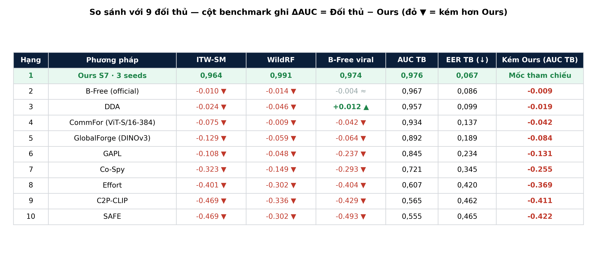

Bản markdown để copy vào công cụ dựng slide:

| Hạng | Phương pháp | ITW-SM | WildRF | B-Free viral | AUC TB | EER TB (↓) | **Kém Ours (AUC TB)** |
|---|---|---|---|---|---|---|---|
| **1** | **Ours S7 · 3 seeds** | **0,964 ± 0,001** | **0,991 ± 0,001** | 0,974 ± 0,004 | **0,976 ± 0,002** | **0,067 ± 0,006** | **Mốc tham chiếu** |
| 2 | B-Free (official) | −0,010 ▼ | −0,014 ▼ | −0,004 ≈ | 0,967 | 0,086 | **−0,009** |
| 3 | DDA | −0,024 ▼ | −0,046 ▼ | **+0,012 ▲** | 0,957 | 0,099 | **−0,019** |
| 4 | CommFor (ViT-S/16-384) | −0,075 ▼ | −0,009 ▼ | −0,042 ▼ | 0,934 | 0,137 | **−0,042** |
| 5 | GlobalForge (DINOv3) | −0,129 ▼ | −0,059 ▼ | −0,064 ▼ | 0,892 | 0,189 | **−0,084** |
| 6 | GAPL | −0,108 ▼ | −0,048 ▼ | −0,237 ▼ | 0,845 | 0,234 | **−0,131** |
| 7 | Co-Spy | −0,323 ▼ | −0,149 ▼ | −0,293 ▼ | 0,721 | 0,345 | **−0,255** |
| 8 | Effort | −0,401 ▼ | −0,302 ▼ | −0,404 ▼ | 0,607 | 0,420 | **−0,369** |
| 9 | C2P-CLIP | −0,469 ▼ | −0,336 ▼ | −0,429 ▼ | 0,565 | 0,462 | **−0,411** |
| 10 | SAFE | −0,469 ▼ | −0,302 ▼ | −0,493 ▼ | 0,555 | 0,465 | **−0,422** |

*Hàng 1 ghi AUC tuyệt đối; hàng 2–10 ở 3 cột benchmark ghi **ΔAUC = Đối thủ − Ours** (pooled, paired bootstrap). Cột "Kém Ours" = trung bình 3 ΔAUC.*

**Gợi ý thiết kế:** chỉ hàng 1 nền xanh nhạt; mọi ô `▼` chữ đỏ; ô `≈` chữ xám; ô `+0,012 ▲` của DDA để xanh nhưng nhỏ — giữ trung thực mà không làm loãng thông điệp.

**Nếu muốn giữ bảng AUC tuyệt đối** (bảng gốc), dùng phiên bản sau và thêm cột cuối "Kém Ours":

| Hạng | Phương pháp | ITW-SM | WildRF | B-Free viral | AUC TB | EER TB (↓) | AP TB | Kém Ours |
|---|---|---|---|---|---|---|---|---|
| 1 | **Ours S7 · 3 seeds** | **0,964** | **0,991** | 0,974 | **0,976** | **0,067** | **0,985** | — |
| 2 | B-Free (official) | 0,955 | 0,977 | 0,970 | 0,967 | 0,086 | 0,978 | −0,009 |
| 3 | DDA | 0,940 | 0,945 | **0,986** | 0,957 | 0,099 | 0,967 | −0,019 |
| 4 | CommFor (ViT-S/16-384) | 0,889 | 0,982 | 0,931 | 0,934 | 0,137 | 0,952 | −0,042 |
| 5 | GlobalForge (DINOv3) | 0,835 | 0,932 | 0,910 | 0,892 | 0,189 | 0,903 | −0,084 |
| 6 | GAPL | 0,856 | 0,943 | 0,737 | 0,845 | 0,234 | 0,890 | −0,131 |
| 7 | Co-Spy | 0,641 | 0,842 | 0,680 | 0,721 | 0,345 | 0,760 | −0,255 |
| 8 | Effort | 0,563 | 0,689 | 0,569 | 0,607 | 0,420 | 0,617 | −0,369 |
| 9 | C2P-CLIP | 0,495 | 0,655 | 0,545 | 0,565 | 0,462 | 0,658 | −0,411 |
| 10 | SAFE | 0,495 | 0,689 | 0,480 | 0,555 | 0,465 | 0,637 | −0,422 |

---

## 3. Slide "Đối thủ kém bao nhiêu?" — bản đồ nhiệt

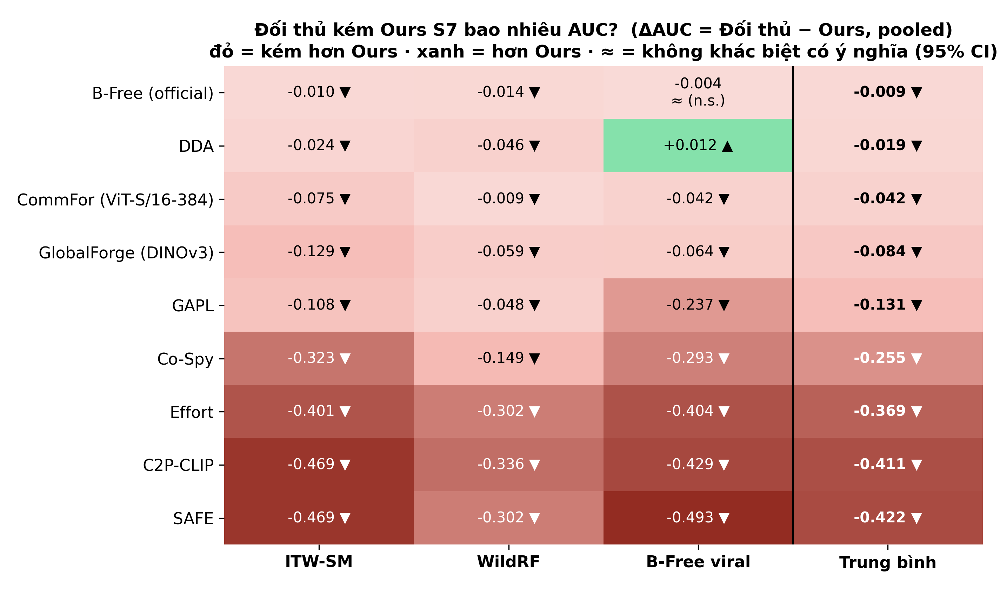

**Lời thoại gợi ý:**
- Gần như cả bảng **đỏ**: 25/27 ô đối thủ kém Ours có ý nghĩa thống kê.
- Càng xuống dưới càng đỏ đậm — các phương pháp dựa CLIP/tần số (C2P-CLIP, SAFE, Effort) gần như **sụp về mức đoán ngẫu nhiên** trên ảnh mạng xã hội bị nén/resize.
- Ô xanh duy nhất: DDA trên B-Free viral (+0,012) — nhưng DDA lại kém Ours **−0,024** ở ITW-SM và **−0,046** ở WildRF, nên trung bình vẫn kém **−0,019**.

---

## 4. Slide "Tất cả đối thủ nằm bên trái mốc Ours"

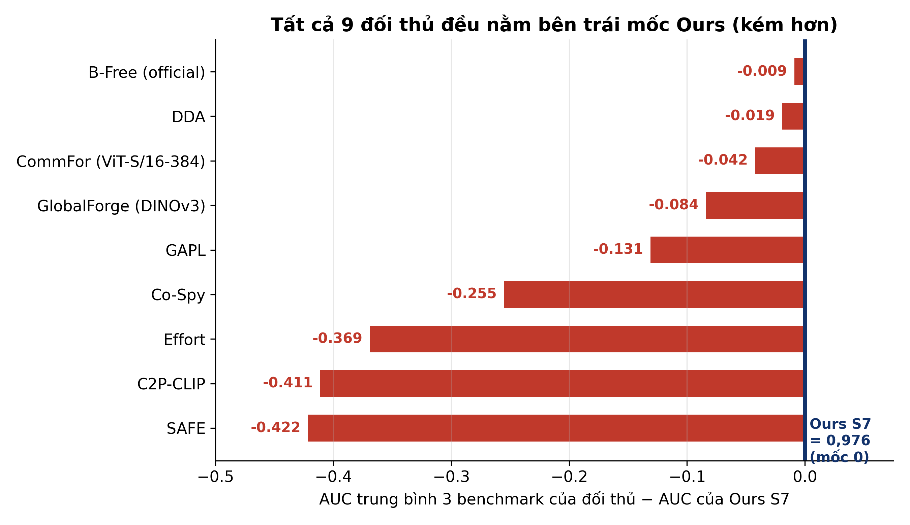

**Lời thoại:** Lấy Ours làm vạch 0. Không có đối thủ nào vượt qua vạch; khoảng cách đi từ −0,009 (B-Free official) đến −0,422 (SAFE).

---

## 5. Slide "Đối thủ mắc lỗi nhiều gấp bao nhiêu lần?" (EER)

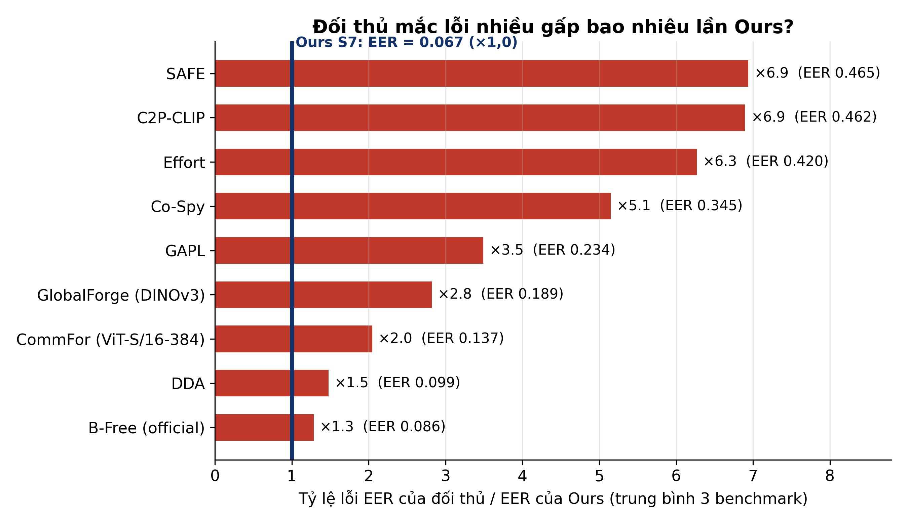

| Đối thủ | EER TB | Lỗi nhiều hơn Ours |
|---|---|---|
| B-Free (official) | 0,086 | **×1,3** |
| DDA | 0,099 | **×1,5** |
| CommFor | 0,137 | **×2,0** |
| GlobalForge (DINOv3) | 0,189 | **×2,8** |
| GAPL | 0,234 | **×3,5** |
| Co-Spy | 0,345 | **×5,1** |
| Effort | 0,420 | **×6,3** |
| C2P-CLIP | 0,462 | **×6,9** |
| SAFE | 0,465 | **×6,9** |

**Lời thoại:** EER là tỷ lệ lỗi tại điểm mà báo nhầm ảnh thật = bỏ sót ảnh giả. Ours chỉ sai **6,7%**; B-Free official sai 8,6%; các baseline yếu sai gần **50%** (≈ tung đồng xu).

> [!TIP]
> Cách diễn đạt "×N lần lỗi" dễ gây ấn tượng hơn ΔAUC cho khán giả không chuyên. Nên dùng slide này làm slide "đinh".

---

## 6. Slide xếp hạng AUC theo từng benchmark

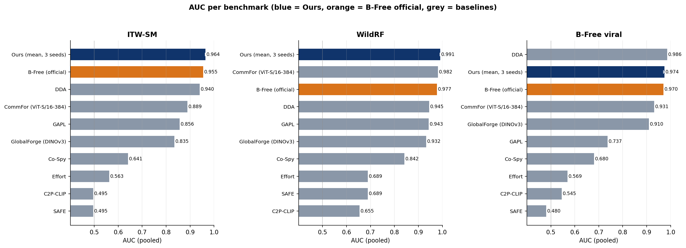

- **ITW-SM:** Ours **0,964** — hạng 1/10 (B-Free 0,955; DDA 0,940).
- **WildRF:** Ours **0,991** — hạng 1/10 (CommFor 0,982; B-Free 0,977).
- **B-Free viral:** Ours **0,974** — hạng 2/10, sau DDA 0,986; vượt B-Free official 0,970 (chênh không có ý nghĩa).

---

## 7. Slide đường cong ROC (vùng báo động giả thấp)

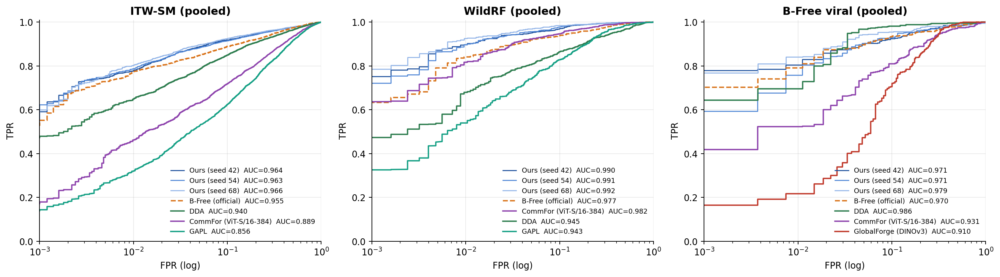

**Lời thoại:** Trục FPR log-scale tập trung vào vùng **báo nhầm ảnh thật cực thấp (0,1% – 10%)** — vùng quan trọng khi triển khai thật. Trên ITW-SM và WildRF, 3 đường xanh của Ours (3 seed) nằm **trên** mọi đối thủ suốt dải này; 3 seed gần như trùng nhau → kết quả ổn định, không phải may mắn của 1 lần chạy.

---

## 8. Slide theo từng nền tảng mạng xã hội

````carousel
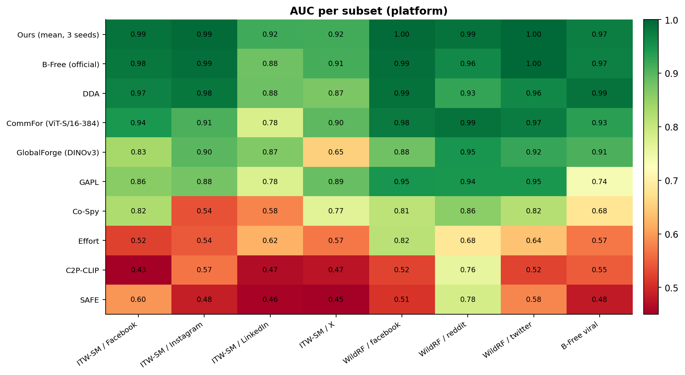
<!-- slide -->
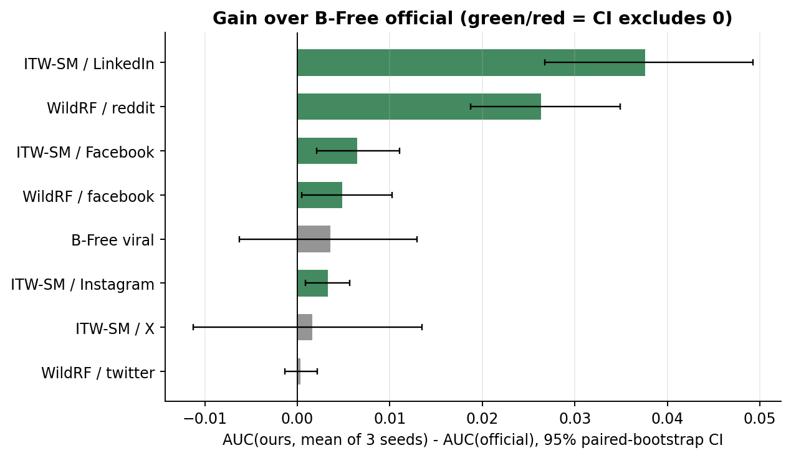
````

**Ours vs B-Free official theo nền tảng** (ΔAUC = Ours − B-Free, paired bootstrap):

| Nền tảng | Ours | B-Free official | Ours hơn | Kết luận |
|---|---|---|---|---|
| ITW-SM / **LinkedIn** | 0,918 | 0,880 | **+0,038** | ▲ có ý nghĩa |
| WildRF / **Reddit** | 0,986 | 0,959 | **+0,026** | ▲ có ý nghĩa |
| ITW-SM / Facebook | 0,986 | 0,980 | +0,006 | ▲ có ý nghĩa |
| WildRF / Facebook | 0,995 | 0,990 | +0,005 | ▲ có ý nghĩa |
| ITW-SM / Instagram | 0,994 | 0,990 | +0,003 | ▲ có ý nghĩa |
| B-Free viral | 0,974 | 0,970 | +0,004 | ≈ |
| ITW-SM / X | 0,915 | 0,914 | +0,002 | ≈ |
| WildRF / Twitter | 0,998 | 0,997 | +0,000 | ≈ |

**Lời thoại:** Ours thắng **5/8** nền tảng có ý nghĩa và **không thua nền tảng nào**; mức thắng lớn nhất ở LinkedIn và Reddit — hai nền tảng nén/xử lý ảnh mạnh, đúng chỗ mà việc bổ sung 25% AI-GenBench + augmentation phát huy.
Ours cũng có AUC trung bình theo nền tảng cao nhất: **0,971** (B-Free 0,960; DDA 0,946; CommFor 0,924).

---

## 9. Slide "Biên chiến thắng có ý nghĩa thống kê" (backup / slide phương pháp luận)

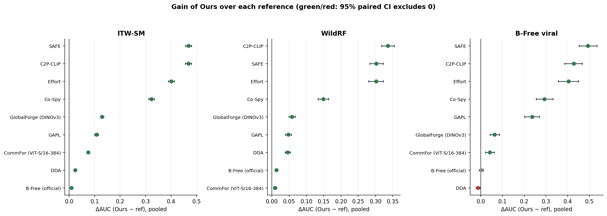

*Hình gốc từ notebook vẽ theo chiều **Ours − ref** (phải = Ours tốt hơn). Nếu dùng hình này, chú thích rõ "điểm nằm bên phải vạch 0 = Ours tốt hơn" để không bị hiểu nhầm.*

Đầy đủ khoảng tin cậy (ΔAUC = Đối thủ − Ours, 95% CI):

| Đối thủ | ITW-SM | WildRF | B-Free viral |
|---|---|---|---|
| B-Free (official) | −0,010 [−0,013; −0,006] ▼ | −0,014 [−0,018; −0,009] ▼ | −0,004 [−0,013; +0,006] ≈ |
| DDA | −0,024 [−0,028; −0,020] ▼ | −0,046 [−0,054; −0,038] ▼ | +0,012 [+0,003; +0,021] ▲ |
| CommFor (ViT-S/16-384) | −0,075 [−0,081; −0,069] ▼ | −0,009 [−0,015; −0,004] ▼ | −0,042 [−0,063; −0,023] ▼ |
| GlobalForge (DINOv3) | −0,129 [−0,136; −0,123] ▼ | −0,059 [−0,068; −0,050] ▼ | −0,064 [−0,086; −0,044] ▼ |
| GAPL | −0,108 [−0,116; −0,101] ▼ | −0,048 [−0,057; −0,040] ▼ | −0,237 [−0,270; −0,202] ▼ |
| Co-Spy | −0,323 [−0,334; −0,312] ▼ | −0,149 [−0,165; −0,134] ▼ | −0,293 [−0,333; −0,255] ▼ |
| Effort | −0,401 [−0,413; −0,391] ▼ | −0,302 [−0,323; −0,281] ▼ | −0,404 [−0,451; −0,357] ▼ |
| C2P-CLIP | −0,469 [−0,481; −0,457] ▼ | −0,336 [−0,354; −0,318] ▼ | −0,429 [−0,467; −0,387] ▼ |
| SAFE | −0,469 [−0,481; −0,457] ▼ | −0,302 [−0,323; −0,284] ▼ | −0,493 [−0,535; −0,453] ▼ |

---

## 10. Slide "Điểm vận hành tại ngưỡng mặc định 0,5" (backup)

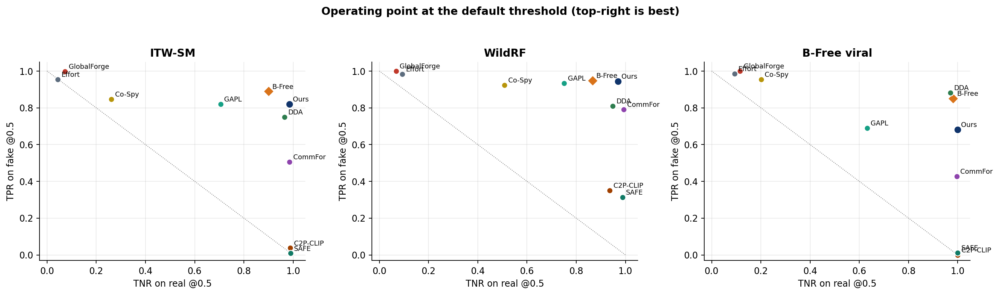

| Model | TPR giả / TNR thật — ITW-SM | WildRF | B-Free viral |
|---|---|---|---|
| **Ours** | 0,82 / **0,98** | 0,94 / **0,97** | 0,68 / **1,00** |
| B-Free (official) | 0,89 / 0,90 | 0,95 / 0,87 | 0,85 / 0,98 |
| DDA | 0,75 / 0,96 | 0,81 / 0,95 | 0,88 / 0,97 |
| CommFor | 0,51 / 0,99 | 0,79 / 0,99 | 0,43 / 1,00 |
| GlobalForge (DINOv3) | 1,00 / 0,07 | 1,00 / 0,07 | 1,00 / 0,12 |
| Co-Spy / Effort | gần như gán **mọi ảnh là giả** (TNR 0,04 – 0,51) | | |
| C2P-CLIP / SAFE | gần như gán **mọi ảnh là thật** (TPR 0,00 – 0,35) | | |

**Lời thoại:** Ở ngưỡng cố định 0,5, Ours là mô hình **ít báo nhầm ảnh thật nhất** trong nhóm mạnh (TNR 0,97 – 1,00). Nhiều đối thủ lệch ngưỡng nặng: GlobalForge báo giả gần như mọi ảnh (TNR 0,07), C2P-CLIP/SAFE bỏ sót gần hết ảnh giả.

> [!NOTE]
> Trung thực: balanced accuracy @0,5 trung bình của Ours là **0,900**, xấp xỉ B-Free official **0,906** (Ours thắng ITW-SM 0,902 vs 0,895 và WildRF 0,957 vs 0,907, nhưng thấp hơn ở B-Free viral 0,840 vs 0,916 do ngưỡng 0,5 bảo thủ). Đây là vấn đề **hiệu chỉnh ngưỡng**, không phải năng lực phân tách — AUC/EER (không phụ thuộc ngưỡng) mới là chỉ số chính.

---

## 11. Slide chi phí suy luận (backup, tuỳ chọn)

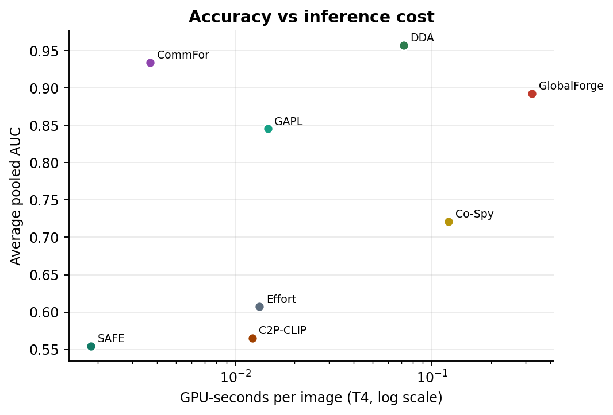

| Model | GPU-giây / ảnh (T4) | AUC TB |
|---|---|---|
| CommFor | 0,004 | 0,934 |
| GAPL | 0,015 | 0,845 |
| DDA | 0,072 | 0,957 |
| Co-Spy | 0,122 | 0,721 |
| GlobalForge (DINOv3) | 0,322 | 0,892 |
| SAFE / C2P-CLIP / Effort | 0,002 – 0,013 | 0,555 – 0,607 |

> [!WARNING]
> Notebook **không đo** thời gian của Ours và B-Free official (cột "-" trong `slide_cost.csv`), nên hình này không có điểm của Ours. Không nên khẳng định "Ours nhanh hơn X" bằng số. Có thể nói định tính: LoRA được merge vào trọng số nên chi phí suy luận của Ours **bằng đúng một ViT-B/14** chuẩn, không phát sinh thêm.

---

## 12. Những điểm cần nói trung thực (chuẩn bị cho phần hỏi đáp)

1. **DDA nhỉnh hơn Ours trên B-Free viral** (+0,012, có ý nghĩa). B-Free viral chỉ có 785 ảnh; trên hai benchmark lớn hơn nhiều (ITW-SM 10.000 ảnh, WildRF 2.503 ảnh) Ours vượt DDA rõ (−0,024 và −0,046 cho DDA).
2. **Ours vs B-Free official trên B-Free viral là hoà** (−0,004, CI chứa 0).
3. **Effort, C2P-CLIP, SAFE gần ngẫu nhiên** (AUC TB < 0,65). Notebook ghi chú: SAFE ở stage-2 chạy fp16 autocast trong khi loader khuyến nghị fp32 → nên nói "theo đúng checkpoint công bố và cùng một harness", tránh kết luận tuyệt đối về bản thân phương pháp.
4. **CI của ΔAUC chỉ phản ánh biến động do chọn ảnh** (Ours lấy trung bình 3 seed); độ dao động giữa seed nằm ở ± std trong bảng (±0,001 – ±0,004).

---

## Phụ lục — bảng đầy đủ (lấy từ `slide_tables.md` của notebook)

### A. AUC macro (trung bình theo nền tảng)

| Model | ITW-SM | WildRF | B-Free viral | TB | Hạng |
|---|---|---|---|---|---|
| **Ours (3 seeds)** | **0,953 ± 0,002** | **0,993 ± 0,001** | 0,974 ± 0,004 | **0,973 ± 0,002** | 1 |
| B-Free (official) | 0,941 | 0,982 | 0,970 | 0,964 | 2 |
| DDA | 0,926 | 0,959 | **0,986** | 0,957 | 3 |
| CommFor | 0,882 | 0,979 | 0,931 | 0,931 | 4 |
| GlobalForge (DINOv3) | 0,812 | 0,918 | 0,910 | 0,880 | 5 |
| GAPL | 0,849 | 0,946 | 0,737 | 0,844 | 6 |
| Co-Spy | 0,677 | 0,829 | 0,680 | 0,729 | 7 |
| Effort | 0,564 | 0,712 | 0,569 | 0,615 | 8 |
| C2P-CLIP | 0,485 | 0,603 | 0,545 | 0,544 | 9 |
| SAFE | 0,496 | 0,625 | 0,480 | 0,534 | 10 |

### B. Average Precision (pooled)

| Model | ITW-SM | WildRF | B-Free viral | TB | Hạng |
|---|---|---|---|---|---|
| **Ours (3 seeds)** | **0,973 ± 0,001** | **0,992 ± 0,001** | 0,988 ± 0,002 | **0,985 ± 0,001** | 1 |
| B-Free (official) | 0,965 | 0,981 | 0,986 | 0,978 | 2 |
| DDA | 0,952 | 0,956 | **0,993** | 0,967 | 3 |
| CommFor | 0,906 | 0,984 | 0,965 | 0,952 | 4 |
| GlobalForge (DINOv3) | 0,843 | 0,924 | 0,941 | 0,903 | 5 |
| GAPL | 0,871 | 0,948 | 0,851 | 0,890 | 6 |
| Co-Spy | 0,650 | 0,838 | 0,791 | 0,760 | 7 |
| C2P-CLIP | 0,524 | 0,718 | 0,732 | 0,658 | 8 |
| SAFE | 0,497 | 0,751 | 0,662 | 0,637 | 9 |
| Effort | 0,544 | 0,653 | 0,655 | 0,617 | 10 |

### C. EER pooled (thấp hơn = tốt hơn)

| Model | ITW-SM | WildRF | B-Free viral | TB | Hạng |
|---|---|---|---|---|---|
| **Ours (3 seeds)** | **0,086 ± 0,002** | **0,044 ± 0,005** | 0,071 ± 0,012 | **0,067 ± 0,006** | 1 |
| B-Free (official) | 0,108 | 0,071 | 0,078 | 0,086 | 2 |
| DDA | 0,128 | 0,123 | **0,047** | 0,099 | 3 |
| CommFor | 0,196 | 0,067 | 0,149 | 0,137 | 4 |
| GlobalForge (DINOv3) | 0,251 | 0,145 | 0,171 | 0,189 | 5 |
| GAPL | 0,227 | 0,137 | 0,339 | 0,234 | 6 |
| Co-Spy | 0,398 | 0,241 | 0,397 | 0,345 | 7 |
| Effort | 0,451 | 0,364 | 0,446 | 0,420 | 8 |
| C2P-CLIP | 0,500 | 0,414 | 0,472 | 0,462 | 9 |
| SAFE | 0,499 | 0,378 | 0,519 | 0,465 | 10 |

### D. Danh mục hình trong `docs/slides/figs/`

| File | Nội dung | Nguồn |
|---|---|---|
| `slide_table_gap.png` | Bảng tổng đã sửa (ΔAUC = Đối thủ − Ours) | sinh mới bằng `make_gap_figs.py` |
| `gap_heatmap_auc.png` | Heatmap đối thủ kém Ours bao nhiêu | sinh mới |
| `gap_bars_avg_auc.png` | Bar ΔAUC trung bình, mốc Ours = 0 | sinh mới |
| `eer_multiplier.png` | Đối thủ lỗi gấp ×N lần Ours | sinh mới |
| `auc_bars_by_benchmark.png` | Xếp hạng AUC theo benchmark | `outputs/5_eval_final_merged/figs` |
| `roc_pooled.png` | Đường ROC (FPR log) | `outputs/5_eval_final_merged/figs` |
| `auc_heatmap_subsets.png` | AUC theo 8 nền tảng | `outputs/5_eval_final_merged/figs` |
| `delta_auc_vs_refs.png` | ΔAUC Ours − ref kèm CI | `outputs/5_eval_final_merged/figs` |
| `delta_auc_vs_bfree_subsets.png` | Ours − B-Free theo nền tảng | `docs/figs/delta_auc_all.png` (khớp `paired_bootstrap_auc.csv`) |
| `operating_point_thr0.5.png` | TPR/TNR tại ngưỡng 0,5 | `outputs/5_eval_final_merged/figs` |
| `auc_vs_cost.png` | AUC vs chi phí suy luận | `outputs/5_eval_final_merged/figs` |

**Thứ tự slide đề xuất:** 1 (thông điệp) → 2 (bảng sửa) → 3 hoặc 4 (đối thủ kém bao nhiêu) → 5 (×N lần lỗi) → 7 (ROC) → 8 (theo nền tảng) → backup: 9, 10, 11, 12.
